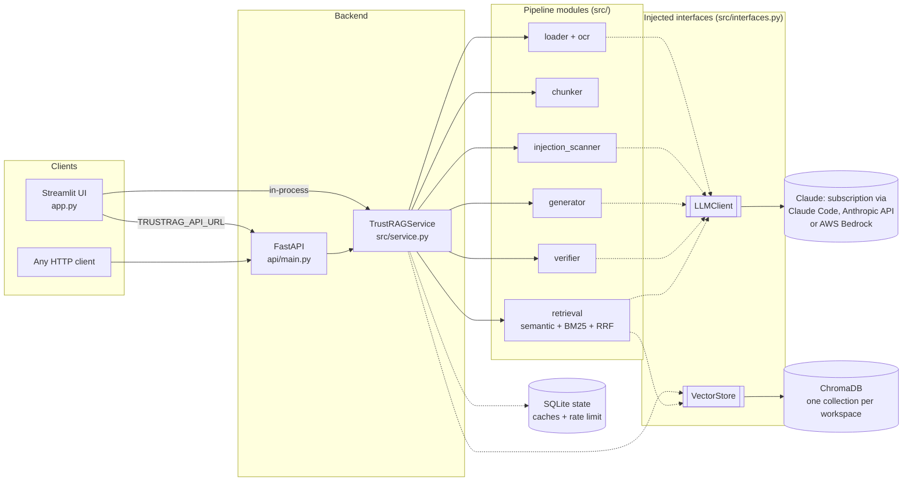
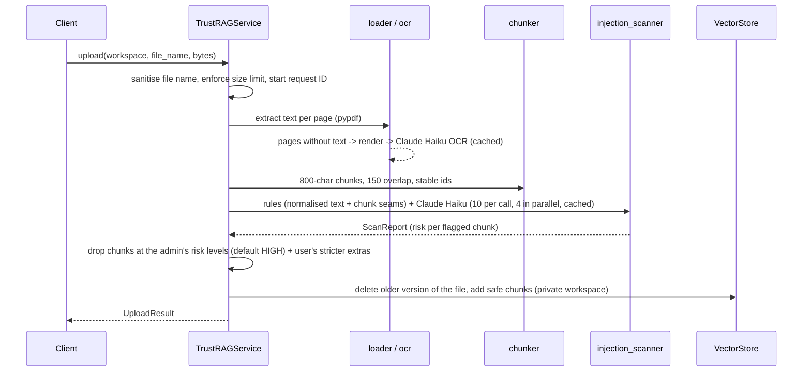
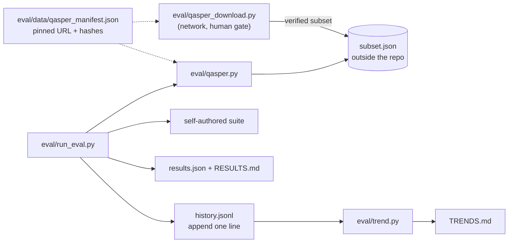

# TrustRAG architecture

TrustRAG answers questions about a user's PDFs using only those documents, fact-checks every answer, and
scans every document for prompt-injection attacks before it is indexed. This document explains how the
pieces fit together and why they are shaped this way. Individual decisions are recorded in [`docs/adr/`](docs/adr/).

## Components



| Layer | Responsibility | Key files |
|---|---|---|
| **Clients** | Render results; no pipeline logic. The UI talks to the service in-process, or to the API when `TRUSTRAG_API_URL` is set. | `app.py`, `src/api_client.py` |
| **API** | HTTP, authentication (`X-API-Key`), request IDs, error-to-status mapping, `/metrics`. | `api/main.py` |
| **Service** | The pipeline as two use cases, `upload` and `ask`, with dependencies injected. | `src/service.py` |
| **Pipeline** | One responsibility per module (load, OCR, chunk, scan, retrieve, generate, verify). | `src/*.py` |
| **Interfaces** | `LLMClient` and `VectorStore` protocols, so providers and stores are swappable and tests need no monkeypatching. | `src/interfaces.py`, `src/llm.py` |
| **Cross-cutting** | Validated settings, shared state, structured logs and metrics, input/output safety helpers. | `src/settings.py`, `src/config.py`, `src/state.py`, `src/observability.py`, `src/safety.py` |

## Data flow

### Upload (once per document)



### Ask (every question)

```mermaid
sequenceDiagram
    participant C as Client
    participant S as TrustRAGService
    participant R as retrieval
    participant G as generator
    participant F as verifier
    C->>S: ask(workspace, question)
    S->>R: semantic top-12 + BM25 top-12 -> reciprocal rank fusion -> top-4 (optional Haiku rerank)
    S->>G: Claude Sonnet, escaped context, strict grounding rules, cite [file, p.N]
    S->>F: one Claude Haiku call: split into claims, label, quote; quotes verified word for word
    F-->>S: Verification (claims + trust score)
    S-->>C: AskResult (answer, sources, verification, request ID, timing)
```

## Trust boundaries

Everything that comes from a document or from a model is treated as **untrusted**:

| Boundary | Untrusted input | Controls |
|---|---|---|
| Upload | file bytes, file name | size and page limits, pdfium render cap, file-name sanitisation |
| Indexing | document text | two-layer injection scanner, fail-closed fallback, seam checks |
| Prompts | chunk text, file names, the question | HTML-escaping inside fixed tags (random tag names in the scanner), "data, not instructions" system rules |
| Verification | model output | quotes must exist verbatim; refusal only if the answer *is* the refusal sentence |
| Rendering | model output | images and link targets stripped before Markdown rendering |
| Access | network clients | localhost binding by default, optional `APP_PASSWORD` / `API_KEY`, per-session workspaces, rate limits |

The full analysis, including what is *not* defended against, is in [`THREAT_MODEL.md`](THREAT_MODEL.md).

## State

| Data | Where | Lifetime |
|---|---|---|
| Chunks and embeddings | ChromaDB, one collection per workspace (`ws_<random id>`) | deleted after 24 h of age, or on "Clear" |
| OCR and scan results | SQLite `cache` table, keyed by prompt version + file hash | until the prompt version changes |
| Rate-limit window | SQLite `calls` table | rolling hour, shared by all processes |
| Metrics | process memory | process lifetime (scraped via `/metrics`) |

## Observability

Every log line is JSON with a request ID that follows one upload or question through every stage, including
worker threads. Each Claude call logs its purpose, prompt version, model, tokens, cost and latency - never
document text or answers. `/metrics` exposes counters and stage timings in Prometheus format. Prompt
versions (`config.PROMPT_VERSIONS`) are also stored with every evaluation run, so a behaviour change can be
traced to the prompt change that caused it.

## Evaluation

The evaluation suite (`eval/`) is a client of the pipeline modules. It is not part of the product and is not in the
Docker image. It runs two benchmarks. The first is the self-authored suite, whose output format is unchanged since
v1.0. The second is a public benchmark on 50 papers from Qasper (dev split, CC BY 4.0). Every run is also appended to
a history file, which feeds a trend report.



| Part | What it does | Key files |
|---|---|---|
| **Download** (once per machine) | Uses only the standard library. Accepts HTTPS only, with a verified TLS context, and also refuses a non-HTTPS redirect. Applies a 200 MiB byte cap while reading. The archive is held in memory and its SHA-256 must match the manifest. A gzip archive is decompressed with a 512 MiB byte cap (`MAX_DECOMPRESSED`) before any tar parsing. Exactly one allow-listed tar member is read with `extractfile`. That member must be a regular file within the size cap, in an archive of at most 50 members with no unsafe names. Nothing is written to disk from a member name. The script selects the first 50 sorted paper ids with an answerable question and writes only that subset, as canonical JSON, atomically, with mode 0600. The downloader creates the data directory with mode 0700. It refuses a data directory that is a symlink, and an existing directory that is not owned by the current user or that holds anything other than `subset.json`. Immediately before writing the subset it re-checks the data directory (outside the repository, not a symlink, owner, contents), in case it was swapped during the download. Any of these refusals prints a friendly error and exits 1. The first run needs `--record-hash`, which pins the archive hash, subset hash and paper ids in the manifest (trust on first use). A human reviews the manifest and commits it. The script refuses `--record-hash` when a hash is already pinned. | `eval/qasper_download.py`, `make eval-download-qasper` |
| **Data directory** | `~/.cache/trustrag/qasper/` by default, overridden by `TRUSTRAG_EVAL_DATA_DIR`. The read path (`resolve_data_dir`) only resolves and validates the path; it never creates the directory or changes its mode (only the downloader does). A path inside the repository is refused by an identity check: `os.path.samefile` compares the path and each existing ancestor with the repository root, which also covers case-insensitive filesystems, symlinks and hardlinks. A path that cannot be resolved (for example a symlink loop) is refused with a friendly `QasperDataError`, not a traceback. This keeps the data out of git, the Docker context and the invisible-character scan. | `eval/qasper.py` |
| **Loader** | On every load it re-hashes `subset.json` against the manifest and stops on a mismatch. It parses the file as plain JSON, rejecting NaN and Infinity. Fields are validated one by one: a malformed paper is skipped and counted in `rejected_records`, and its text is never echoed. One malformed question rejects the whole paper record; this is documented behaviour. The manifest is validated too: `dataset`, `version`, `split` and `licence` must match `[A-Za-z0-9 ._()-]{1,64}`, and `source_url` must be HTTPS, printable ASCII, with no spaces and none of `|<>[]()`. `citation` is never rendered and is unconstrained. Paper and question ids must match `[A-Za-z0-9][A-Za-z0-9._-]{0,63}`. The module does no network I/O. | `eval/qasper.py` |
| **Mapping to TrustRAG** | Each paper becomes `Page`s with no PDF rendering: page 1 is the title and abstract, then one page per section. The file name is `sanitize_filename("qasper-<id>.pdf")`, so citations still read `[file, p.N]`. Each paper gets its own workspace, built with `chunk_pages` and indexed through `VectorStore`, then cleared after its questions. Retrieval uses the default settings with rerank off. | `eval/qasper.py` |
| **Question rules** | A question is *unanswerable* if every annotator marked it so. It is *answerable* if every annotator answered it and at least one text evidence paragraph remains after dropping `FLOAT SELECTED` (figure or table) evidence. Every other question is excluded and counted by reason: `mixed_answerability`, `figure_or_table_only` or `no_evidence`. Gold evidence is the union of all annotators' text paragraphs. | `eval/qasper.py` |
| **Scoring** | `evidence_hit(chunk, paragraph, min_chars=200)` is a pure function. After normalisation, a chunk hits if it contains the whole paragraph, or if their longest common substring is at least `min(len(paragraph), 200)` characters. 200 is above the 150-character chunk overlap. From these hits the suite computes recall@k and MRR over answerable questions. With `--suite all`, answers are generated without fact-checking to compute correct-refusal and false-refusal rates. | `eval/metrics.py`, `eval/qasper.py` |
| **Run integration** | `run_eval.py` sets `ANONYMIZED_TELEMETRY=False` before ChromaDB is imported. This applies to the eval process only; the product setting is unchanged. Results gain a `public_benchmark` block (dataset, version, split, licence, source URL, subset hash, metrics, exclusion counts). RESULTS.md gains a matching section after all existing sections, so earlier output stays byte-identical. `preflight_qasper()` loads the manifest, resolves the data directory and verifies an existing subset before any paid suite runs. A `QasperDataError` or `OSError` there ends the run with a non-zero exit before any paid suite runs and before any results are written. If the Qasper step itself fails later, after the paid suites (any exception), the paid results are kept: the block becomes `{status: "error", reason: "The Qasper benchmark step failed."}` (a fixed string, with no exception text or paths), and the run still writes `results.json`, RESULTS.md, a history line (without Qasper metrics or the `qasper` dataset hash) and TRENDS.md, then exits non-zero. If the subset is missing or not yet pinned, the block has `status: "skipped"` with a reason and the run continues with exit 0. | `eval/run_eval.py` |
| **History** | After every run, one strict-ASCII JSON line is appended to the history file. The line holds the run time, commit, a dirty-tree flag, suite, models, prompt versions, settings, dataset hashes and a fixed list of metrics. Earlier lines are never rewritten. Each entry is validated before it is written and again on load (patterned fields use full matches, so a trailing newline is rejected), and any bad line fails the load with its line number. The first entry was backfilled from the committed `results.json`. | `eval/history.py`, `eval/results/history.jsonl` |
| **Trend report** | A static, deterministic Markdown report with the last 10 runs per metric, newest first, and the change from the previous run. The change is marked "(dataset changed)" only when the relevant dataset hash changed: the `qasper` hash for `qasper.*` metrics, the `self_authored` hash otherwise. It contains only validated numbers, hashes, enum values and timestamps. It is regenerated after each run and by `make eval-trend` (no network). | `eval/trend.py`, `eval/results/TRENDS.md` |

Decisions: [ADR 0009](docs/adr/0009-public-benchmark-data-handling.md) (public benchmark data handling) and
[ADR 0010](docs/adr/0010-eval-history-jsonl-and-static-trend-report.md) (history file and static trend report). The
related threats are in [`THREAT_MODEL.md`](THREAT_MODEL.md).

## Deployment shapes

| Shape | Command | When |
|---|---|---|
| Single process | `streamlit run app.py` | local use, demos |
| One container | `docker run ... trustrag` | local use without a Python setup |
| API + UI | `docker compose up` | separate backend; other clients can use the API |

ChromaDB runs embedded, so one API process owns a data directory. Scaling out beyond one API instance would
mean moving vectors to a server-based store behind the same `VectorStore` interface (see ADR 0003).
