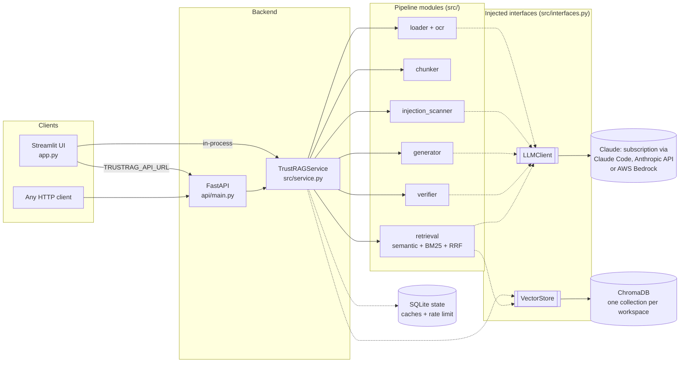
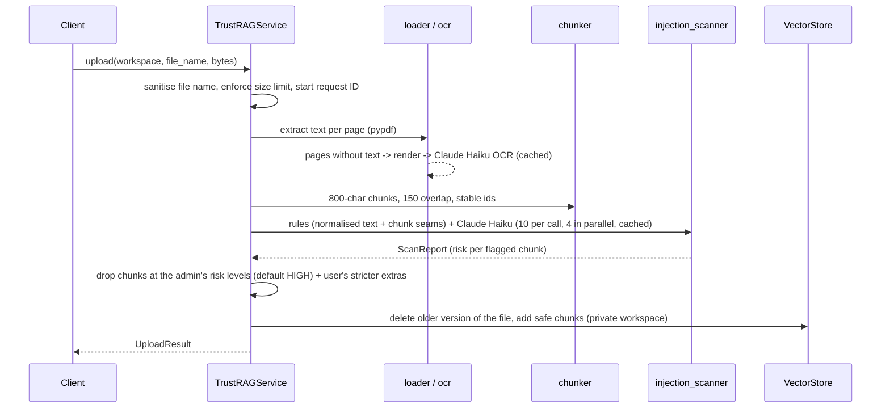

# TrustRAG architecture

TrustRAG answers questions about a user's PDFs using only those documents, fact-checks every answer, and
scans every document for prompt-injection attacks before it is indexed. This document explains how the
pieces fit together and why they are shaped this way. Individual decisions are recorded in [`docs/adr/`](docs/adr/).

## Components



| Layer | Responsibility | Key files |
|---|---|---|
| **Clients** | Render results; no pipeline logic. The UI talks to the service in-process, or to the API when `TRUSTRAG_API_URL` is set. | `app.py`, `src/api_client.py` |
| **API** | HTTP, authentication (`X-API-Key`), request IDs, error-to-status mapping, `/metrics`. | `api/main.py` |
| **Service** | The pipeline as two use cases, `upload` and `ask`, with dependencies injected. | `src/service.py` |
| **Pipeline** | One responsibility per module (load, OCR, chunk, scan, retrieve, generate, verify). | `src/*.py` |
| **Interfaces** | `LLMClient` and `VectorStore` protocols, so providers and stores are swappable and tests need no monkeypatching. | `src/interfaces.py`, `src/llm.py` |
| **Cross-cutting** | Validated settings, shared state, structured logs and metrics, input/output safety helpers. | `src/settings.py`, `src/config.py`, `src/state.py`, `src/observability.py`, `src/safety.py` |

## Data flow

### Upload (once per document)



### Ask (every question)

```mermaid
sequenceDiagram
    participant C as Client
    participant S as TrustRAGService
    participant R as retrieval
    participant G as generator
    participant F as verifier
    C->>S: ask(workspace, question)
    S->>R: semantic top-12 + BM25 top-12 -> reciprocal rank fusion -> top-4 (optional Haiku rerank)
    S->>G: Claude Sonnet, escaped context, strict grounding rules, cite [file, p.N]
    S->>F: one Claude Haiku call: split into claims, label, quote; quotes verified word for word
    F-->>S: Verification (claims + trust score)
    S-->>C: AskResult (answer, sources, verification, request ID, timing)
```

## Trust boundaries

Everything that comes from a document or from a model is treated as **untrusted**:

| Boundary | Untrusted input | Controls |
|---|---|---|
| Upload | file bytes, file name | size and page limits, pdfium render cap, file-name sanitisation |
| Indexing | document text | two-layer injection scanner, fail-closed fallback, seam checks |
| Prompts | chunk text, file names, the question | HTML-escaping inside fixed tags (random tag names in the scanner), "data, not instructions" system rules |
| Verification | model output | quotes must exist verbatim; refusal only if the answer *is* the refusal sentence |
| Rendering | model output | images and link targets stripped before Markdown rendering |
| Access | network clients | localhost binding by default, optional `APP_PASSWORD` / `API_KEY`, per-session workspaces, rate limits |

The full analysis, including what is *not* defended against, is in [`THREAT_MODEL.md`](THREAT_MODEL.md).

## State

| Data | Where | Lifetime |
|---|---|---|
| Chunks and embeddings | ChromaDB, one collection per workspace (`ws_<random id>`) | deleted after 24 h of age, or on "Clear" |
| OCR and scan results | SQLite `cache` table, keyed by prompt version + file hash | until the prompt version changes |
| Rate-limit window | SQLite `calls` table | rolling hour, shared by all processes |
| Metrics | process memory | process lifetime (scraped via `/metrics`) |

## Observability

Every log line is JSON with a request ID that follows one upload or question through every stage, including
worker threads. Each Claude call logs its purpose, prompt version, model, tokens, cost and latency - never
document text or answers. `/metrics` exposes counters and stage timings in Prometheus format. Prompt
versions (`config.PROMPT_VERSIONS`) are also stored with every evaluation run, so a behaviour change can be
traced to the prompt change that caused it.

## Deployment shapes

| Shape | Command | When |
|---|---|---|
| Single process | `streamlit run app.py` | local use, demos |
| One container | `docker run ... trustrag` | local use without a Python setup |
| API + UI | `docker compose up` | separate backend; other clients can use the API |

ChromaDB runs embedded, so one API process owns a data directory. Scaling out beyond one API instance would
mean moving vectors to a server-based store behind the same `VectorStore` interface (see ADR 0003).
