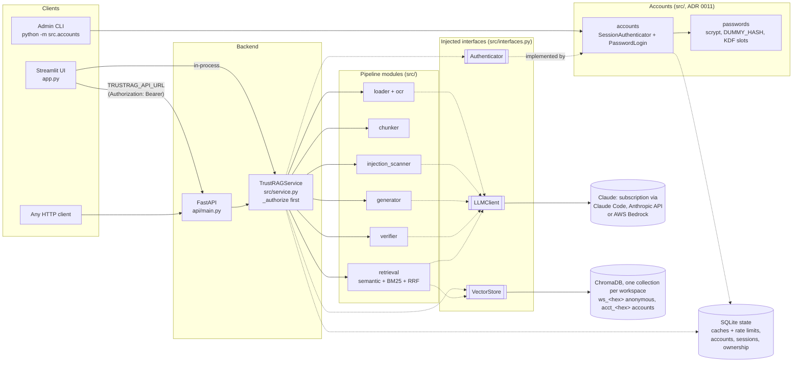
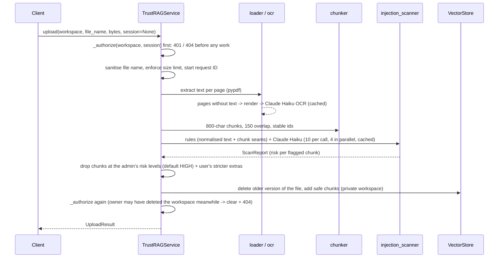
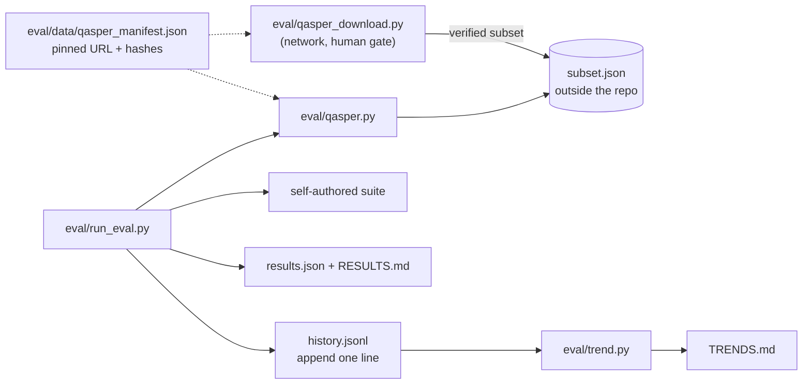

# TrustRAG architecture

TrustRAG answers questions about a user's PDFs using only those documents, fact-checks every answer, and
scans every document for prompt-injection attacks before it is indexed. This document explains how the
pieces fit together and why they are shaped this way. Individual decisions are recorded in [`docs/adr/`](docs/adr/).

## Components



| Layer | Responsibility | Key files |
|---|---|---|
| **Clients** | Render results; no pipeline logic. The UI talks to the service in-process, or to the API when `TRUSTRAG_API_URL` is set. With `ACCOUNTS_ENABLED=true` the UI offers "Sign in" or "Continue without an account"; the session token lives only in `st.session_state` and the API client sends it as `Authorization: Bearer`. The admin CLI is the only way to create and manage accounts. | `app.py`, `src/api_client.py`, `src/accounts.py` (CLI) |
| **API** | HTTP, outer gate (`X-API-Key`), bearer-token extraction, sign-in routes, request IDs, error-to-status mapping, `/metrics`. `ACCOUNTS_ENABLED` gates only the sign-in routes, session use and `GET /v1/workspaces`. | `api/main.py` |
| **Service** | The pipeline as two use cases, `upload` and `ask`, plus workspace management (`new_workspace`, `list_workspaces`, `list_files`, `count`, `clear_documents`, `clear`) and `login` / `logout`, with dependencies injected. Every workspace method takes an optional keyword-only `session` and calls `_authorize` first. | `src/service.py` |
| **Accounts** | Local password accounts (ADR 0011): scrypt hashing, username canonicalisation, password policy, rate-limited login, server-side sessions, admin CLI. | `src/accounts.py`, `src/passwords.py` |
| **Pipeline** | One responsibility per module (load, OCR, chunk, scan, retrieve, generate, verify). | `src/*.py` |
| **Interfaces** | `LLMClient`, `VectorStore` and `Authenticator` protocols, so providers, stores and (in P8) sign-in methods are swappable and tests need no monkeypatching. | `src/interfaces.py`, `src/llm.py` |
| **Cross-cutting** | Validated settings, shared state, structured logs and metrics, input/output safety helpers. | `src/settings.py`, `src/config.py`, `src/state.py`, `src/observability.py`, `src/safety.py` |

## Data flow

### Upload (once per document)



### Ask (every question)

```mermaid
sequenceDiagram
    participant C as Client
    participant S as TrustRAGService
    participant R as retrieval
    participant G as generator
    participant F as verifier
    C->>S: ask(workspace, question, session=None)
    S->>S: _authorize(workspace, session) first: 401 / 404 before retrieval
    S->>R: semantic top-12 + BM25 top-12 -> reciprocal rank fusion -> top-4 (optional Haiku rerank)
    S->>G: Claude Sonnet, escaped context, strict grounding rules, cite [file, p.N]
    S->>F: one Claude Haiku call: split into claims, label, quote; quotes verified word for word
    F-->>S: Verification (claims + trust score)
    S-->>C: AskResult (answer, sources, verification, request ID, timing)
```

Anonymous callers (`session=None`) follow exactly the v1.0 path; the extra authorisation step only refuses ids that
have an ownership row or the `acct-` prefix (see [Accounts and workspaces](#accounts-and-workspaces)).

### Sign in (`ACCOUNTS_ENABLED=true` only)

```mermaid
sequenceDiagram
    participant C as Client
    participant L as PasswordLogin
    participant S as state.py
    participant P as passwords.py
    C->>L: login(raw body, client_key or None)
    L->>L: 1. shape check (body <= 4096 bytes, JSON object, string fields, password <= 1024 chars), canonical username
    L->>S: 2. reserve_login_attempt: one BEGIN IMMEDIATE - prune, count user / client / global keys, refuse or insert
    S-->>L: refused -> 429 + Retry-After (no hashing)
    L->>S: 3. get_account_by_username (skipped for a bad shape)
    L->>P: 4. kdf_slot (5 s wait; busy -> refund + 429)
    L->>P: 5. exactly one scrypt vs stored hash or DUMMY_HASH, compare_digest
    alt right password, account enabled
        L->>S: 6. separate atomic transactions: rehash if parameters changed (compare-and-set); create_session (re-checks disabled AND unchanged hash, caps sessions); refund user/client rows
        L-->>C: SessionInfo (token, username, expires_at)
    else unknown user / wrong password / disabled / bad shape
        L-->>C: LoginFailed "Wrong username or password." (reservation kept as a failure)
    end
```

Step 6 is not one transaction as ADR 0011 describes; the split is recorded in SPEC-GAP-060. The whole login runs in
the threadpool (`run_in_threadpool`), so scrypt does not block the event loop.

Bad-shape bodies still cost a reservation (client and global keys only) and one hash against `DUMMY_HASH`, so every
failure does the same hashing work.

## Accounts and workspaces

Accounts are opt-in (`ACCOUNTS_ENABLED`, default `false`). Decisions: [ADR 0011](docs/adr/0011-local-password-accounts-and-server-side-sessions.md)
(accounts, hashing, login order, sessions) and [ADR 0012](docs/adr/0012-workspace-ownership-and-retention.md)
(ownership, retention).

| Part | What it does | Key files |
|---|---|---|
| **Accounts** | Created by the administrator only (`python -m src.accounts create\|set-password\|disable\|enable\|list`); no sign-up route. Passwords are typed twice with `getpass`, or piped with `--password-stdin`; a non-terminal stdin without that flag is refused; never argv or environment. Usernames: `isascii()` first, then `lower()`, then `fullmatch([a-z0-9][a-z0-9._-]{2,31})`; that one canonical value is used for lookup, rate-limit key and CLI. Passwords: 12 to 1024 characters, not equal to the username. `account_id` is a random 32-hex id, never the username. | `src/accounts.py`, `src/passwords.py` |
| **Hashing** | Standard-library `hashlib.scrypt` (N = 2^17, r = 8, p = 1, 16-byte salt, 32-byte key, `maxmem` 256 MiB), stored as `scrypt$n=…,r=…,p=…$<salt hex>$<key hex>`. Rehashed on a successful login when the parameters differ: a compare-and-set inside the KDF slot that never overwrites a concurrent password reset and does not revoke sessions. `DUMMY_HASH` is built at import with the configured parameters. A bounded semaphore (`KDF_MAX_CONCURRENT = 2`, `KDF_WAIT_SECONDS = 5`) caps simultaneous hashes. | `src/passwords.py`, `src/config.py` |
| **Login rate limit** | Keys `sha256("user:" + canonical)`, `sha256("client:" + address)` and `"global"`, counted in the `login_attempts` table inside one `BEGIN IMMEDIATE` transaction. Defaults: 5 per user and 20 per client per rolling 15 minutes, 5 per second across all clients. A success refunds the user and client rows; a failure keeps them. No client key when the address is unknown (`client_key=None`). | `src/accounts.py`, `src/state.py` |
| **Sessions** | `secrets.token_urlsafe(32)`, new at every login; only `sha256(token)` is stored. Idle 2 h, absolute 24 h, at most 10 per account (oldest revoked). `resolve` joins `accounts` and rejects a session of a disabled account or one created before the last password change. Logout, `set-password` and `disable` delete sessions. `last_seen` is written at most once per 60 s. | `src/accounts.py` (`SessionAuthenticator`), `src/state.py` |
| **Auth interface** | `Authenticator` protocol (`resolve`, `start_session`, `logout`) and `Principal` (`account_id`, `username`). The service depends only on the protocol; P8 SSO can add another login class that calls the same `start_session`. | `src/interfaces.py`, `src/models.py` |
| **Workspace ids** | Anonymous: `<32 hex>` → collection `ws_<32 hex>` (v1.0). Account: `acct-<32 hex>` → collection `acct_<32 hex>`. `_collection_name` accepts these two forms and nothing else. Clients must treat ids as opaque. | `src/vectorstore.py` |
| **Ownership** | One `workspaces` row per account workspace (`account_id`, `created`, `deleted`). `new_workspace(session=…)` creates an `acct-` id and inserts the row only while the account has fewer than `MAX_WORKSPACES_PER_ACCOUNT` (default 10) live rows; otherwise `WorkspaceLimitReached`. `list_workspaces` returns the caller's live rows as `WorkspaceList`. Owner delete (`clear`) tombstones the row first (`deleted = 1`, the id is never reused), then clears the vectors. | `src/service.py`, `src/state.py` |
| **Retention** | Every `new_workspace` calls `store.cleanup(keep=live owned ids, purge=tombstoned ids)`, whatever the flag. `ws_*` older than 24 h are deleted as in v1.0; `acct_*` are never deleted by age, only when their id is in `purge`. | `src/service.py`, `src/vectorstore.py` |

### Authorisation rule

One function, `TrustRAGService._authorize(workspace, session)`, is the first statement of `list_files`, `count`,
`clear`, `upload` (before the size check, loader, OCR and scanner) and `ask` (before retrieval). It is always on,
whatever `ACCOUNTS_ENABLED` says. The token is checked first, so the answer to an invalid token does not depend on the
workspace id.

| Workspace id | Ownership row | Caller | Result |
|---|---|---|---|
| any | any | token that does not resolve (unknown, malformed, expired, revoked) | `NotAuthenticated` (401), never a fallback to anonymous |
| `acct-<hex>` | live, owner A | session of A | allowed |
| `acct-<hex>` | live, owner A | session of B, or anonymous | `WorkspaceNotFound` (404) |
| `acct-<hex>` | tombstoned or missing | anyone | 404 (fail closed) |
| `<hex>` | none | anonymous | allowed (v1.0 path) |
| `<hex>` | none | any session | 404 |
| `<hex>` | a row exists (not expected) | | handled like an `acct-` id |

`WorkspaceNotFound` is the same error as an unknown id, so a caller cannot tell "exists but not yours" from "does not
exist".

### HTTP API additions

Every route keeps the `X-API-Key` gate when `API_KEY` is set. The session token is accepted only in the
`Authorization: Bearer` header (never a query parameter or cookie); it is read from the request headers without a
declared parameter, so existing OpenAPI operations do not change. A malformed header or a token longer than 512
characters gives 401.

| Method, path | Request | Success | Errors |
|---|---|---|---|
| `POST /v1/auth/login` | raw body of at most 4096 bytes, JSON `{username, password}`, parsed by hand (no pydantic model, so no 422 echo) | `200 SessionInfo` | `401 {"detail":"Wrong username or password."}` for unknown user, wrong password, disabled account and every bad shape; `429 {"detail":"Too many sign-in attempts. Please try again later."}` + `Retry-After` |
| `POST /v1/auth/logout` | bearer | `204` (also for unknown or expired tokens) | |
| `GET /v1/auth/me` | bearer | `200 {"username": …}` | `401` + `WWW-Authenticate: Bearer` |
| `GET /v1/workspaces` | bearer required | `200 WorkspaceList` (own live workspaces) | `401` |
| `POST /v1/workspaces` | no bearer → anonymous workspace (v1.0); bearer → `acct-` workspace | `201 {"workspace": …}` | `401` invalid token; `409` at the per-account cap |
| `DELETE /v1/workspaces/{id}/documents` | optional bearer | `204`; removes the documents, keeps the workspace and its owner (no tombstone) | same `401` / `404` as below |
| existing workspace routes (documents, questions, `DELETE`) | optional bearer | unchanged | `401` for an invalid token, checked before the id; `404 "Workspace not found."` when not authorised, before the empty-workspace 409 and before any upload processing |

With `ACCOUNTS_ENABLED=false`, `/v1/auth/*` answer `404`, `GET /v1/workspaces` answers `405` with `Allow: POST`, and
the `Authorization` header is ignored, as in v1.0. `/metrics` records `/v1/auth/*` requests with `status="-"`, so
sign-in outcomes are not counted. uvicorn runs with `--no-proxy-headers`, and the login client key is the TCP peer
address (`X-Forwarded-For` is never read).

### Flag off and rollback

With `ACCOUNTS_ENABLED=false` no session can be presented, so account workspaces are unreachable but kept: cleanup
still passes `keep` / `purge`. Rolling back to v1.0 neither deletes them (v1.0 cleanup only touches `ws_*`) nor
exposes them (v1.0 rejects `acct-` ids). An `acct_` collection whose state row is lost is refused and not deleted
automatically; recovery is a human action.

## Trust boundaries

Everything that comes from a document or from a model is treated as **untrusted**:

| Boundary | Untrusted input | Controls |
|---|---|---|
| Upload | file bytes, file name | size and page limits, pdfium render cap, file-name sanitisation |
| Indexing | document text | two-layer injection scanner, fail-closed fallback, seam checks |
| Prompts | chunk text, file names, the question | HTML-escaping inside fixed tags (random tag names in the scanner), "data, not instructions" system rules |
| Verification | model output | quotes must exist verbatim; refusal only if the answer *is* the refusal sentence |
| Rendering | model output | images and link targets stripped before Markdown rendering |
| Access | network clients | localhost binding by default, optional `APP_PASSWORD` / `API_KEY` (unchanged outer gates), per-session workspaces, rate limits |
| Sign-in | username, password, raw login body, client address | body read by hand (size cap, fixed 401, no echo); canonical ASCII usernames; atomic per-user / per-client / global rate limit before any hashing; one scrypt per attempt (`DUMMY_HASH` for unknown users); bounded hashing slots; uvicorn `--no-proxy-headers` |
| Sessions | bearer token | random 256-bit tokens, new at each login; SHA-256 only at rest; header only; idle and absolute expiry; revoked by logout, password change and disable; per-account cap |
| Workspace ownership | workspace id, session | `_authorize` first in every workspace method, always on; 404 identical to an unknown id; `acct-` ids fail closed without a live owner row; tombstones; re-authorise after upload writes |
| State file | anyone with file-system access | state directory 0700, DB and `-wal` / `-shm` 0600 (tightened on open); salted scrypt hashes; token hashes only |

The full analysis, including what is *not* defended against, is in [`THREAT_MODEL.md`](THREAT_MODEL.md).

## State

| Data | Where | Lifetime |
|---|---|---|
| Chunks and embeddings, anonymous | ChromaDB, one collection per workspace (`ws_<random id>`) | deleted after 24 h of age, or on "Clear" |
| Chunks and embeddings, accounts | ChromaDB, one collection per workspace (`acct_<random id>`) | never deleted by age; deleted when the owner deletes the workspace (immediately, and again by the next cleanup via `purge`) |
| OCR and scan results | SQLite `cache` table, keyed by prompt version + file hash | until the prompt version changes |
| Rate-limit window | SQLite `calls` table | rolling hour, shared by all processes |
| Accounts | SQLite `accounts` table (canonical username, scrypt hash, `disabled`, `password_changed`) | until an administrator changes it; accounts are disabled, not deleted, in P6 |
| Sessions | SQLite `sessions` table (SHA-256 of the token, `created`, `last_seen`, `expires`) | `last_seen` is written only when at least 60 s stale (`touch_session`); until logout, expiry (pruned at login), password change, disable or the per-account cap |
| Workspace ownership | SQLite `workspaces` table (owner, `created`, `deleted` tombstone) | forever; tombstone rows are kept so ids are never reused |
| Login attempts | SQLite `login_attempts` table (hashed keys, timestamp, attempt id) | pruned once older than the longest window; each key is pruned against its own window |
| Metrics | process memory | process lifetime (scraped via `/metrics`) |

The state DB (`<CHROMA_DIR>/trustrag_state.sqlite`) was a cache in v1.0. Since P6 it also holds durable data
(accounts and ownership, ADR 0012), so it must be backed up with `chroma_db/` and must not be wiped as a cache: losing
it makes account workspaces unreachable (not deleted). On open, `CHROMA_DIR` is created or tightened to 0700 and the
DB, `-wal` and `-shm` files to 0600. All new tables are additive; the v1.0 tables are unchanged.

## Observability

Every log line is JSON with a request ID that follows one upload or question through every stage, including
worker threads. Each Claude call logs its purpose, prompt version, model, tokens, cost and latency - never
document text or answers. Sign-in events (`auth.login_failed`, `auth.rate_limited`, `auth.busy`, `auth.logout`) carry
no submitted username; `auth.login_succeeded`, `auth.logout`, `workspace.created` and `workspace.deleted` carry the
`account_id`, never a token or username. Passwords, tokens and token hashes are never
logged. `/metrics` exposes counters and stage timings in Prometheus format. Prompt
versions (`config.PROMPT_VERSIONS`) are also stored with every evaluation run, so a behaviour change can be
traced to the prompt change that caused it.

## Evaluation

The evaluation suite (`eval/`) is a client of the pipeline modules. It is not part of the product and is not in the
Docker image. It runs two benchmarks. The first is the self-authored suite, whose output format is unchanged since
v1.0. The second is a public benchmark on 50 papers from Qasper (dev split, CC BY 4.0). Every run is also appended to
a history file, which feeds a trend report.



| Part | What it does | Key files |
|---|---|---|
| **Download** (once per machine) | Uses only the standard library. Accepts HTTPS only, with a verified TLS context, and also refuses a non-HTTPS redirect. Applies a 200 MiB byte cap while reading. The archive is held in memory and its SHA-256 must match the manifest. A gzip archive is decompressed with a 512 MiB byte cap (`MAX_DECOMPRESSED`) before any tar parsing. Exactly one allow-listed tar member is read with `extractfile`. That member must be a regular file within the size cap, in an archive of at most 50 members with no unsafe names. Nothing is written to disk from a member name. The script selects the first 50 sorted paper ids with an answerable question and writes only that subset, as canonical JSON, atomically, with mode 0600. The downloader creates the data directory with mode 0700. It refuses a data directory that is a symlink, and an existing directory that is not owned by the current user or that holds anything other than `subset.json`. Immediately before writing the subset it re-checks the data directory (outside the repository, not a symlink, owner, contents), in case it was swapped during the download. Any of these refusals prints a friendly error and exits 1. The first run needs `--record-hash`, which pins the archive hash, subset hash and paper ids in the manifest (trust on first use). A human reviews the manifest and commits it. The script refuses `--record-hash` when a hash is already pinned. | `eval/qasper_download.py`, `make eval-download-qasper` |
| **Data directory** | `~/.cache/trustrag/qasper/` by default, overridden by `TRUSTRAG_EVAL_DATA_DIR`. The read path (`resolve_data_dir`) only resolves and validates the path; it never creates the directory or changes its mode (only the downloader does). A path inside the repository is refused by an identity check: `os.path.samefile` compares the path and each existing ancestor with the repository root, which also covers case-insensitive filesystems, symlinks and hardlinks. A path that cannot be resolved (for example a symlink loop) is refused with a friendly `QasperDataError`, not a traceback. This keeps the data out of git, the Docker context and the invisible-character scan. | `eval/qasper.py` |
| **Loader** | On every load it re-hashes `subset.json` against the manifest and stops on a mismatch. It parses the file as plain JSON, rejecting NaN and Infinity. Fields are validated one by one: a malformed paper is skipped and counted in `rejected_records`, and its text is never echoed. One malformed question rejects the whole paper record; this is documented behaviour. The manifest is validated too: `dataset`, `version`, `split` and `licence` must match `[A-Za-z0-9 ._()-]{1,64}`, and `source_url` must be HTTPS, printable ASCII, with no spaces and none of `|<>[]()`. `citation` is never rendered and is unconstrained. Paper and question ids must match `[A-Za-z0-9][A-Za-z0-9._-]{0,63}`. The module does no network I/O. | `eval/qasper.py` |
| **Mapping to TrustRAG** | Each paper becomes `Page`s with no PDF rendering: page 1 is the title and abstract, then one page per section. The file name is `sanitize_filename("qasper-<id>.pdf")`, so citations still read `[file, p.N]`. Each paper gets its own workspace, built with `chunk_pages` and indexed through `VectorStore`, then cleared after its questions. Retrieval uses the default settings with rerank off. | `eval/qasper.py` |
| **Question rules** | A question is *unanswerable* if every annotator marked it so. It is *answerable* if every annotator answered it and at least one text evidence paragraph remains after dropping `FLOAT SELECTED` (figure or table) evidence. Every other question is excluded and counted by reason: `mixed_answerability`, `figure_or_table_only` or `no_evidence`. Gold evidence is the union of all annotators' text paragraphs. | `eval/qasper.py` |
| **Scoring** | `evidence_hit(chunk, paragraph, min_chars=200)` is a pure function. After normalisation, a chunk hits if it contains the whole paragraph, or if their longest common substring is at least `min(len(paragraph), 200)` characters. 200 is above the 150-character chunk overlap. From these hits the suite computes recall@k and MRR over answerable questions. With `--suite all`, answers are generated without fact-checking to compute correct-refusal and false-refusal rates. | `eval/metrics.py`, `eval/qasper.py` |
| **Run integration** | `run_eval.py` sets `ANONYMIZED_TELEMETRY=False` before ChromaDB is imported. This applies to the eval process only; the product setting is unchanged. Results gain a `public_benchmark` block (dataset, version, split, licence, source URL, subset hash, metrics, exclusion counts). RESULTS.md gains a matching section after all existing sections, so earlier output stays byte-identical. `preflight_qasper()` loads the manifest, resolves the data directory and verifies an existing subset before any paid suite runs. A `QasperDataError` or `OSError` there ends the run with a non-zero exit before any paid suite runs and before any results are written. If the Qasper step itself fails later, after the paid suites (any exception), the paid results are kept: the block becomes `{status: "error", reason: "The Qasper benchmark step failed."}` (a fixed string, with no exception text or paths), and the run still writes `results.json`, RESULTS.md, a history line (without Qasper metrics or the `qasper` dataset hash) and TRENDS.md, then exits non-zero. If the subset is missing or not yet pinned, the block has `status: "skipped"` with a reason and the run continues with exit 0. | `eval/run_eval.py` |
| **History** | After every run, one strict-ASCII JSON line is appended to the history file. The line holds the run time, commit, a dirty-tree flag, suite, models, prompt versions, settings, dataset hashes and a fixed list of metrics. Earlier lines are never rewritten. Each entry is validated before it is written and again on load (patterned fields use full matches, so a trailing newline is rejected), and any bad line fails the load with its line number. The first entry was backfilled from the committed `results.json`. | `eval/history.py`, `eval/results/history.jsonl` |
| **Trend report** | A static, deterministic Markdown report with the last 10 runs per metric, newest first, and the change from the previous run. The change is marked "(dataset changed)" only when the relevant dataset hash changed: the `qasper` hash for `qasper.*` metrics, the `self_authored` hash otherwise. It contains only validated numbers, hashes, enum values and timestamps. It is regenerated after each run and by `make eval-trend` (no network). | `eval/trend.py`, `eval/results/TRENDS.md` |

Decisions: [ADR 0009](docs/adr/0009-public-benchmark-data-handling.md) (public benchmark data handling) and
[ADR 0010](docs/adr/0010-eval-history-jsonl-and-static-trend-report.md) (history file and static trend report). The
related threats are in [`THREAT_MODEL.md`](THREAT_MODEL.md).

## Deployment shapes

| Shape | Command | When |
|---|---|---|
| Single process | `streamlit run app.py` | local use, demos |
| One container | `docker run ... trustrag` | local use without a Python setup |
| API + UI | `docker compose up` | separate backend; other clients can use the API |

In every shape, accounts are off unless `ACCOUNTS_ENABLED=true`, and accounts are created with
`python -m src.accounts create <username>`, run as the service user so the 0600 state file keeps its owner. The API
container runs uvicorn with `--no-proxy-headers`. In compose, every UI sign-in reaches the API from the UI container's
address, so the per-username limit is the main brute-force control there (see [`THREAT_MODEL.md`](THREAT_MODEL.md)).

ChromaDB runs embedded, so one API process owns a data directory. Scaling out beyond one API instance would
mean moving vectors to a server-based store behind the same `VectorStore` interface (see ADR 0003).
