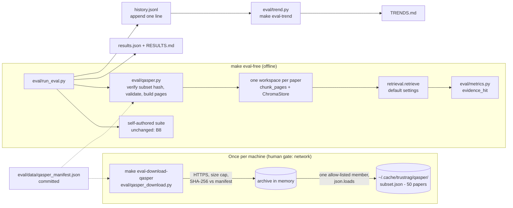

# P5 plan: public benchmark evaluation and eval trend report

Status: **APPROVED by the human on 2026-10-31** (CLAUDE.md section 5, step 1). ADRs 0009 and 0010 accepted; SPEC-GAPs 016–029 resolved with their conservative defaults.

Sources read for this plan: `CLAUDE.md`, `docs/SPEC.md` (section 1 B1–B9, P5), `docs/SPEC-GAPS.md`, `docs/adr/0001`–`0008`,
`ARCHITECTURE.md`, `THREAT_MODEL.md`, `README.md` ("Measured, not claimed", "Known limitations"), `Makefile`,
`eval/run_eval.py`, `eval/metrics.py`, `eval/corpus.py`, `eval/results/results.json`, `eval/results/RESULTS.md`,
`src/chunker.py`, `src/safety.py`, `src/models.py`, `src/vectorstore.py`, `src/retrieval.py`, `src/config.py`,
`tests/fakes.py`, `tests/conftest.py`, `tests/test_eval_metrics.py`, `.github/workflows/tests.yml`,
`.pre-commit-config.yaml`, `scripts/check_invisible_chars.py`, `.gitignore`, `.dockerignore`, `pyproject.toml`.

Facts checked while planning (commands run, read-only):
- `write_markdown(results.json)` re-renders the committed `eval/results/RESULTS.md` **byte for byte** (`identical: True`).
  This is the basis of the P5-AC4 regression test.
- `chromadb/config.py:227` has `anonymized_telemetry: bool = True`; nothing in `src/`, `eval/`, `tests/`, Docker or
  `.env.example` turns it off. Whether chromadb 1.5.9 actually sends telemetry: **not verified**.
- `scripts/check_invisible_chars.py` scans every `.json/.md/.txt/...` file under `.` with `rglob`, excluding only `.venv`
  and `.git`, so it also scans git-ignored folders.
- `requests`, `huggingface_hub` and `pyarrow` are installed only as transitive dependencies; they are **not** in
  `pyproject.toml` and must not be used.
- Qasper's download URL, archive layout, file names, JSON field names and archive size come from my memory of the
  dataset and are **not verified**. They are confirmed at the human-approved download (task T5) before tests that
  depend on them are frozen.

---

## 1. Scope

In scope:
- **Qasper loader** for 50 papers, offline after a one-time download (SPEC P5 scope bullet 1; SPEC-GAP-005).
- **Offline retrieval suite** on Qasper (recall@k, MRR at the default settings: hybrid, 800 fixed, top-4), run by
  `make eval-free` with no network calls once the data is present (**P5-AC1**).
- **Refusal metrics on Qasper**, run only via `make eval` (human gate): correct-refusal rate on unanswerable
  questions, false-refusal rate on answerable ones (SPEC P5 scope bullet 2; SPEC-GAP-005 "unanswerable questions test
  refusals"; SPEC-GAP-023).
- **Results** stored with commit, prompt versions and models: new `public_benchmark` block in `results.json` and a
  new section at the end of `RESULTS.md` (**P5-AC2**).
- **History file** `eval/results/history.jsonl`, one appended line per run of either suite (**P5-AC2**, ADR 0010).
- **Trend report** `eval/results/TRENDS.md`, last 10 runs per metric, regenerated by `make eval-trend` (**P5-AC3**,
  SPEC-GAP-006).
- **No regression of B8**: the existing `retrieval`, `ablation` and `injection` blocks and RESULTS.md sections keep
  their values and format; the `eval-free` Makefile line is unchanged (**P5-AC4**).
- **README** "Measured, not claimed" shows the Qasper numbers with dataset name, licence and credit; "Known
  limitations" updated (**P5-AC5**).
- Threat model rows and ADRs 0009/0010 for the new untrusted-data path (CLAUDE.md section 7).

Out of scope (not built in P5):
- Any change to `src/`, `api/`, `app.py`, retrieval defaults, chunking, prompts or `config.PROMPT_VERSIONS`.
- Qasper ablations (chunk size / strategy / mode grid), reranking on Qasper, answer-correctness scoring
  (Qasper Answer-F1 or similar), evidence-F1, trust-score / AUROC on Qasper (SPEC-GAP-023).
- Running the injection scanner on Qasper text (possible future false-alarm measurement; not in the spec).
- Rendering Qasper to PDF or exercising `src/loader.py` with it.
- Vendoring Qasper data into the repo; the Hugging Face `datasets` library or mirror (ADR 0009).
- CI changes (no download step in CI; SPEC-GAP-026). Dockerfile / compose changes (`eval/` is already in
  `.dockerignore`).
- A hosted dashboard, charts or images (SPEC-GAP-006).
- Changing the existing overwrite behaviour of `results.json` / `RESULTS.md` (SPEC-GAP-028).
- Product-wide ChromaDB telemetry setting (SPEC-GAP-027; eval process only).
- **New dependencies: none.** Everything uses the standard library (`urllib.request`, `hashlib`, `tarfile`, `json`,
  `difflib`) plus code already in the repo. Therefore no `pyproject.toml` change and **no lock regeneration**.

## 2. Design

### 2.1 Data flow



### 2.2 Data handling (ADR 0009)

- **Download** (`eval/qasper_download.py`, run only by `make eval-download-qasper`): fixed HTTPS URL from the manifest;
  refuse non-`https` URLs, including after redirects; stop reading beyond a byte cap; compute SHA-256 and compare with
  `archive_sha256` in the manifest; open with `tarfile` and read only `archive_member` (must be a regular file, not a
  link, under a size cap) into memory via `extractfile`; never `extractall`, never build disk paths from member names.
- **First download:** the manifest is committed with `archive_sha256: null`. The script refuses to run unless the
  human passes `--record-hash` on that first approved run, which prints the hash and writes it (and the selected paper
  ids and subset hash) into the manifest. The human checks the values and commits the manifest. Later runs verify.
- **Derive subset:** dev split (SPEC-GAP-018), paper ids sorted, the first 50 with at least one scorable question. The
  subset (`subset.json`, plain JSON, written atomically) is the only data kept; the archive is discarded.
- **Cache:** `~/.cache/trustrag/qasper/` by default, `TRUSTRAG_EVAL_DATA_DIR` overrides it (SPEC-GAP-017). Outside the
  repo, so it is never committed, never in the Docker context, never scanned by ruff or the invisible-character check.
- **Load** (`eval/qasper.py`): read `subset.json`, check its SHA-256 against `subset_sha256` in the manifest (mismatch
  → stop with a clear message), validate types, skip and count malformed records.

### 2.3 Mapping Qasper to TrustRAG (SPEC-GAP-019, -020, -021, -022)

- **Paper → pages:** page 1 = title + abstract; then one `Page` per `full_text` section
  (`section_name` + paragraphs joined by blank lines), `ocr=False`. No PDF rendering.
  `file_name = safety.sanitize_filename(f"qasper-{paper_id}.pdf")`.
- **Paper id** must match `^[A-Za-z0-9._-]{1,64}$`, otherwise the paper is rejected (counted).
- **Index:** one workspace per paper, built with `chunk_pages(pages)` at default settings and `ChromaStore`, so a
  question searches only its own paper, as in Qasper's own task.
- **Question classification** across annotators:
  - *unanswerable*: every annotation has `unanswerable: true`;
  - *answerable*: every annotation is answerable, and at least one text evidence paragraph remains after dropping
    figure/table evidence (strings starting `FLOAT SELECTED`, not verified);
  - everything else is excluded and counted by reason: `mixed_answerability`, `figure_or_table_only`, `no_evidence`.
- **Gold evidence:** union of the text evidence paragraphs from all annotations.
- **Chunk relevance** (`metrics.evidence_hit(chunk_text, paragraph, min_chars=200)`, pure): with `norm()` applied to
  both, a chunk hits a paragraph if it contains the whole paragraph, or if the longest common substring
  (`difflib.SequenceMatcher(autojunk=False).find_longest_match`) is at least `min(len(paragraph), 200)` characters.
  200 is above the 150-character chunk overlap, so a chunk that only shares the overlap tail does not count.
- **recall@4 / MRR:** a question is found if any of the top-4 chunks hits any gold paragraph; rank = first such chunk;
  same formulas and rounding as `eval_retrieval`. `eval_retrieval` gets an optional relevance function; its default
  stays the current `first_relevant_rank`, so the self-authored numbers cannot change.

### 2.4 Data models (TypedDicts in `eval/`, ADR 0004 style)

```python
class BenchmarkQuestion(TypedDict):
    id: str  # Qasper question_id, validated like paper ids
    paper_id: str
    question: str  # untrusted
    answerable: bool
    evidence: list[str]  # gold paragraphs (untrusted); empty when unanswerable


class BenchmarkPaper(TypedDict):
    paper_id: str
    file_name: str  # sanitize_filename(...)
    pages: list[Page]  # src.models.Page
    questions: list[BenchmarkQuestion]


class PublicBenchmarkResult(TypedDict, total=False):  # results.json["public_benchmark"]
    dataset: str  # "Qasper"
    version: str  # from manifest
    split: str  # "dev"
    licence: str  # "CC BY 4.0"
    source_url: str  # from manifest
    papers: int
    subset_sha256: str
    status: Literal["ok", "skipped"]
    skipped_reason: str  # fixed message, never dataset text
    retrieval: dict  # same keys as results.json["retrieval"]: questions, recall_at_k, mrr, top_k, mode
    unanswerable_questions: int
    excluded_questions: dict[str, int]  # by reason
    rejected_records: int
    answers: dict  # suite all only: answerable_questions, unanswerable_questions,
    # correct_refusal_rate, false_refusal_rate
    per_question: list[dict]  # suite all only: {"id", "answerable", "refused"}: no text


class HistoryEntry(TypedDict):  # one line of eval/results/history.jsonl
    schema: int  # 1
    run_at: str  # same as results.json
    commit: str  # git short hash, validated ^[0-9a-f]{4,40}$ or "unknown"
    commit_dirty: bool  # `git status --porcelain` non-empty
    suite: Literal["free", "all"]
    source: str  # "run" or "backfill:results.json"
    answer_model: str
    checker_model: str
    prompt_versions: dict[str, str]
    settings: dict[str, object]  # same as results.json["settings"]
    datasets: dict[str, str]  # {"self_authored": sha256(qa.jsonl), "qasper": subset_sha256}
    metrics: dict[str, float | None]  # flat dotted names, see 2.6
```

`eval/` is not in `mypy` `files` (`pyproject.toml`), so these types are checked only if the owner runs mypy on them;
they still document the contract and qa-engineer tests the shapes.

### 2.5 Files

| File | Change | Owner |
|---|---|---|
| `eval/qasper.py` | new: manifest + subset loading, validation, paper→pages, question classification | llm-eval-engineer |
| `eval/qasper_download.py` | new: the only network code; `python -m eval.qasper_download [--record-hash]` | llm-eval-engineer |
| `eval/metrics.py` | add pure `evidence_hit` | llm-eval-engineer |
| `eval/history.py` | new: `entry_from_results`, `append_entry(path)`, `load_history(path)`, backfill | llm-eval-engineer |
| `eval/trend.py` | new: `python -m eval.trend [--history P] [--out P] [--last N]`; writes `TRENDS.md` | llm-eval-engineer |
| `eval/run_eval.py` | telemetry off before imports; Qasper suite after the existing suites; `public_benchmark` block; new RESULTS.md section **appended at the end**; history append + trend regenerate | llm-eval-engineer |
| `eval/data/qasper_manifest.json` | new, committed: URL, version, split, member, licence, citation, hashes, paper ids | llm-eval-engineer (values from T5) |
| `eval/results/history.jsonl`, `eval/results/TRENDS.md` | new, generated | llm-eval-engineer |
| `Makefile` | add `eval-download-qasper`, `eval-trend`; `eval-free` and `eval` lines unchanged | devops |
| `tests/test_public_benchmark.py`, `tests/test_eval_history.py`, `tests/test_eval_baseline.py`, `tests/test_readme_benchmark.py` | new | qa-engineer |
| `tests/data/qasper_mini.json` | new synthetic fixture in Qasper shape (2–3 invented papers, ASCII only) | qa-engineer |
| `README.md`, `CHANGELOG.md`, `THREAT_MODEL.md` | docs (see T9) | llm-eval-engineer, security-reviewer reviews |
| `ARCHITECTURE.md` | "Evaluation" design note, after approval | architect |

No changes to `src/`, `api/`, `app.py`, `.github/`, `Dockerfile`, `docker-compose.yml`, `pyproject.toml`, lock files.
`.gitignore` needs no change, because the cache is outside the repo.

### 2.6 Interfaces: CLI and Make (there is no HTTP API change)

| Command | Network | Effect | Exit codes |
|---|---|---|---|
| `make eval-free` (unchanged line: `python -m eval.run_eval --suite free`) | none after download | existing suites + Qasper retrieval when subset present, else `status: skipped` + warning on stderr | 0 ok or skipped; non-zero on hash mismatch or corrupt subset |
| `make eval` (unchanged) | Claude (human gate) | as today + Qasper refusal metrics | as today |
| `make eval-download-qasper` → `python -m eval.qasper_download` | **yes (human gate)** | download, verify, derive `subset.json` | 0 ok; non-zero on non-https, size cap, hash mismatch, missing member |
| `make eval-trend` → `python -m eval.trend` | none | rewrite `eval/results/TRENDS.md` from history | 0; non-zero on malformed history line (fail loudly, never skip silently) |

History metric names (SPEC-GAP-025): `retrieval.recall_at_k`, `retrieval.mrr`,
`injection.rules_only.removed.{precision,recall,false_alarm_rate}`, and when present
`injection.combined.removed.{precision,recall,false_alarm_rate}`, `answers.{answer_accuracy,citation_accuracy,
correct_refusal_rate,false_refusal_rate,unanswerable_with_unsupported_claims}`,
`trust.{auroc_correct_vs_falsified,mean_trust_correct,mean_trust_falsified}`, `qasper.retrieval.{recall_at_k,mrr}`,
`qasper.answers.{correct_refusal_rate,false_refusal_rate}`. Ablation rows are not tracked.

TRENDS.md layout: title; one `## <metric>` section per metric (fixed order above); table
`| Run | Commit | Suite | Value | Change |` with up to N most recent runs that have the metric (newest first), `*`
after dirty commits, a note when the dataset hash differs from the previous row. Only numbers, validated commit
hashes, the suite enum and ISO timestamps are written. No generation timestamp.

## 3. Acceptance criteria → tests

| Criterion | Test file | Test name (to be written) |
|---|---|---|
| P5-AC1 | `tests/test_public_benchmark.py` | `test_public_benchmark_retrieval_runs_with_sockets_blocked` (fixture subset, FakeStore and real `ChromaStore` variant; `socket.socket.connect` patched to raise) |
| P5-AC1 | `tests/test_public_benchmark.py` | `test_loader_builds_pages_and_questions_from_fixture` |
| P5-AC1 | `tests/test_public_benchmark.py` | `test_mixed_figure_only_and_no_evidence_questions_are_excluded_and_counted` |
| P5-AC1 | `tests/test_public_benchmark.py` | `test_evidence_hit_matches_whole_and_split_paragraphs` |
| P5-AC1 | `tests/test_public_benchmark.py` | `test_overlap_tail_alone_is_not_a_hit` |
| P5-AC1 | `tests/test_public_benchmark.py` | `test_recall_and_mrr_on_fixture_match_hand_computed_values` |
| P5-AC1 | `tests/test_public_benchmark.py` | `test_missing_subset_is_reported_as_skipped_and_exits_zero` |
| P5-AC1 | `tests/test_public_benchmark.py` | `test_eval_process_turns_chroma_telemetry_off` |
| P5-AC1 | verifier (manual, recorded in `p5-report.md`) | `make eval-free` with the subset present and network off: `public_benchmark.status == "ok"` |
| P5-AC2 | `tests/test_eval_history.py` | `test_each_run_appends_one_line_with_commit_prompt_versions_and_models` |
| P5-AC2 | `tests/test_eval_history.py` | `test_append_never_rewrites_existing_lines` |
| P5-AC2 | `tests/test_eval_history.py` | `test_entry_records_dirty_flag_suite_settings_and_dataset_hashes` |
| P5-AC2 | `tests/test_eval_history.py` | `test_backfill_entry_matches_committed_results_json` |
| P5-AC2 | `tests/test_public_benchmark.py` | `test_results_json_public_benchmark_block_has_dataset_licence_and_hash` |
| P5-AC3 | `tests/test_eval_history.py` | `test_trend_report_lists_last_10_runs_per_metric` (12 synthetic runs → 10 rows each, newest first) |
| P5-AC3 | `tests/test_eval_history.py` | `test_metric_absent_from_a_run_is_skipped_for_that_metric_only` |
| P5-AC3 | `tests/test_eval_history.py` | `test_trend_command_regenerates_report_deterministically` (`python -m eval.trend --history tmp --out tmp` twice → identical) |
| P5-AC3 | `tests/test_eval_history.py` | `test_makefile_has_eval_trend_target` |
| P5-AC3 | `tests/test_eval_history.py` | `test_malformed_history_line_fails_loudly` |
| P5-AC4 | `tests/test_eval_baseline.py` | `test_results_markdown_without_public_benchmark_is_byte_identical` (committed results.json → committed RESULTS.md) |
| P5-AC4 | `tests/test_eval_baseline.py` | `test_public_benchmark_section_is_appended_after_existing_sections` |
| P5-AC4 | `tests/test_eval_baseline.py` | `test_default_relevance_is_unchanged_for_self_authored_questions` |
| P5-AC4 | `tests/test_eval_baseline.py` | `test_public_benchmark_does_not_change_config_or_settings` |
| P5-AC4 | `tests/test_eval_baseline.py` | `test_makefile_eval_free_and_eval_lines_are_unchanged` |
| P5-AC4 | verifier (manual) | `retrieval`, `ablation`, `injection` blocks of a fresh `make eval-free` equal those in the pre-phase `results.json` (B8: recall@4 1.0, MRR 0.973, rules-only figures) |
| P5-AC5 | `tests/test_readme_benchmark.py` | `test_measured_section_shows_qasper_numbers_matching_results_json` |
| P5-AC5 | `tests/test_readme_benchmark.py` | `test_measured_section_names_dataset_licence_and_credit` ("Qasper", "CC BY 4.0", citation) |

Tests use fakes and fixtures only; none downloads data or calls Claude (CLAUDE.md section 11). The real-`ChromaStore`
variant needs the cached embedding model, as `tests/test_integration_replay.py` already does in CI.

## 4. Threat model delta

Proposed new `THREAT_MODEL.md` rows (numbering continues after 19). Adding rows is a security-documentation change,
so it is presented at the human gate.

| # | Attack | Control | Test |
|---|---|---|---|
| 20 | Tampered or swapped benchmark archive (mirror compromise, MITM, changed upstream) | HTTPS only, also after redirects; SHA-256 pinned in committed manifest; subset re-hashed on every load | `test_download_rejects_non_https_url`, `test_download_rejects_hash_mismatch`, `test_tampered_subset_is_refused` |
| 21 | Malicious archive: path traversal, symlinks, tar or decompression bomb | Never `extractall`; one allow-listed member, regular file only, size caps on download and member, read into memory | `test_archive_member_outside_allow_list_or_link_is_rejected`, `test_download_and_member_size_caps` |
| 22 | Code execution through the data format (pickle, loading scripts, `datasets`) | JSON only via `json.loads`; no pickle / `datasets` / `eval` / `exec` / YAML in benchmark modules; strict type validation | `test_benchmark_modules_import_no_unsafe_loaders` (AST scan), `test_malformed_records_are_skipped_and_counted` |
| 23 | Dataset text reaches committed files or the trend report (invisible characters fail the gate; Markdown injection in reports) | Only aggregates, validated ids, enums and hashes are written; ids match an allow-list regex; file names via `safety.sanitize_filename` | `test_results_and_history_contain_no_dataset_text` (fixture with zero-width space U+200B, soft hyphen U+00AD, Markdown and `<script>` written as escapes), `test_paper_ids_outside_allow_list_are_rejected` |
| 24 | Injection text inside a benchmark paper steers the model during `make eval` and skews the numbers | Same controls as uploads: escaped prompt context and grounding rules (`src/generator.py`); only the refusal metric is read from the answer; impact limited to eval numbers. Scanner is not run on benchmark text (out of scope) | existing `test_prompt_tags_cannot_be_broken_even_with_a_raw_evil_name`; accepted limit, noted in "Not defended against" |
| 25 | "Offline" benchmark leaks data over the network (telemetry, accidental fetch) | Telemetry off in the eval process; network code only in `eval/qasper_download.py` | `test_public_benchmark_retrieval_runs_with_sockets_blocked`, `test_eval_process_turns_chroma_telemetry_off` |

## 5. Tasks

| # | Task | Owner | Depends on | Parallel with |
|---|---|---|---|---|
| T0 | Approve this plan, ADRs 0009 and 0010, and SPEC-GAPs 016–029 | **human** | – | – |
| T1 | Write failing tests and the synthetic fixture (section 3, section 4); run them; record failure output | qa-engineer | T0 | T2 |
| T2 | Makefile targets `eval-download-qasper`, `eval-trend` | devops | T0 | T1 |
| T3a | `eval/qasper.py`, `eval/qasper_download.py`, `metrics.evidence_hit`, manifest skeleton (`archive_sha256: null`) | llm-eval-engineer | T1 | T3b |
| T3b | `eval/history.py`, `eval/trend.py` | llm-eval-engineer (second instance) | T1 | T3a |
| T4 | `eval/run_eval.py` integration (telemetry off, Qasper suite, results block, RESULTS.md section, history, trend) | llm-eval-engineer | T3a, T3b | – |
| T5 | **Human-approved download**: confirm URL, licence page, archive size, then run `make eval-download-qasper` with `--record-hash`; review manifest values | **human** (llm-eval-engineer prepares the exact command) | T3a | T4 |
| T6 | Confirm Qasper field names against the real file; adjust fixture/tests if the shape differs (record what changed) | llm-eval-engineer + qa-engineer | T5 | – |
| T7 | Backfill one history entry from the committed `results.json`; run `make eval-free`; `make eval-trend` | llm-eval-engineer | T4, T6 | – |
| T8 | Optional: `make eval` for Qasper refusal metrics (**cost, human gate**) | **human** approves | T7 | – |
| T9 | README "Measured, not claimed" (Qasper row(s), dataset name, CC BY 4.0, citation, link), "Known limitations"; CHANGELOG; THREAT_MODEL rows 20–25 | llm-eval-engineer (security-reviewer reviews threat rows) | T7 | T10 |
| T10 | ARCHITECTURE.md "Evaluation" design note | architect | T7 | T9 |
| T11 | Review the phase diff | code-reviewer **and** security-reviewer | T9, T10 | each other |
| T12 | Fix confirmed findings; affected tests only | owners | T11 | – |
| T13 | Full quality gate from a clean state, AC checks incl. manual AC1/AC4 steps; write `docs/phases/p5-report.md` | verifier | T12 | – |
| T14 | Human gate: report, SPEC-GAPs, findings, git commands | manager → **human** | T13 | – |

Note for T13: running `make eval-free` overwrites `results.json` / `RESULTS.md` and drops the answer/trust sections of
the last full run (SPEC-GAP-028). The verifier should compare the B8 blocks and then report which result files the
human should commit.

## 6. Human gates expected

1. Approve this plan, ADR 0009 and ADR 0010 status change (Proposed → Accepted), SPEC-GAPs 016–029 (T0).
2. **Network/data download** of Qasper: confirm URL, licence, size and SHA-256; run the download (T5).
3. **Cost:** optional `make eval` for Qasper refusal metrics; roughly one Sonnet call per scorable question of the 50
   papers plus the existing suite (count and cost **not verified** until T6) (T8).
4. New `THREAT_MODEL.md` rows 20–25 (security documentation) (T9/T14).
5. Commit (T14). Expected not needed: package installs, lock regeneration, CI or Docker changes. If any of these
   turns out to be necessary, the owner stops and asks.

## 7. New SPEC-GAPs

Added to `docs/SPEC-GAPS.md` as 016–029 (status open):

| ID | Question | Conservative default |
|---|---|---|
| 016 | How Qasper is obtained (download or vendored) | One-time human-approved stdlib download; not vendored; URL + SHA-256 + paper ids in committed manifest; values confirmed at T5 |
| 017 | Where the data is cached | `~/.cache/trustrag/qasper/`, override `TRUSTRAG_EVAL_DATA_DIR`; outside the repo because the invisible-char check scans git-ignored folders |
| 018 | Which split and which 50 papers | dev split; sorted ids; first 50 with ≥1 scorable question; frozen in the manifest |
| 019 | Answerability when annotators disagree | Unanswerable only if all annotations say so; answerable only if all are answerable and text evidence exists; else excluded and counted |
| 020 | Evidence paragraph → chunk-level hit | Containment, or longest common normalised substring ≥ min(len, 200 chars); figure/table evidence dropped; union of annotators |
| 021 | One workspace per paper or one for all 50 | One per paper (Qasper's task setting) |
| 022 | Qasper JSON → `Page` mapping | Page 1 = title + abstract; one page per section; no PDF rendering |
| 023 | Which answer-level metrics on Qasper | Refusal metrics only (correct and false refusal), answer generation only; no Answer-F1, no trust/AUROC |
| 024 | History format, location, committed or not, backfill | `eval/results/history.jsonl`, append-only, committed; both suites append; `commit_dirty` recorded; one backfilled entry from current `results.json` |
| 025 | Which metrics the trend report tracks | List in plan section 2.6; ablations excluded |
| 026 | Behaviour when the subset is missing (CI has no data) | `status: skipped`, warning, exit 0; CI unchanged; AC1 shown by verifier locally |
| 027 | ChromaDB telemetry is on by default and may break "no network calls" | Turn it off in the eval process only; product-wide setting is a separate human decision |
| 028 | `make eval-free` overwrites results from the last full run | Unchanged in P5; history is the durable record; human picks which result files to commit |
| 029 | No agent owns `THREAT_MODEL.md` / README edits | llm-eval-engineer drafts, security-reviewer reviews threat rows, human approves |

## 8. Security review of the plan (security-reviewer, read-only)

Result: no critical or high findings; 5 medium, 8 low. No control in `src/` or `api/` is changed. Adding
THREAT_MODEL rows 20-25 is a human gate. Amendments below are binding for the build step unless the human rejects
them. Not verified by the reviewer: Qasper URL, archive format (tar or zip), size, member and field names, whether
an independent upstream SHA-256 exists, DNS behaviour under the socket test, and any P5 code (none exists yet).

| ID | Sev | Plan section | Amendment | New test (qa-engineer) |
|---|---|---|---|---|
| M1 | medium | 2.2 first download, row 20 | `--record-hash` exits non-zero unless `archive_sha256` is null. Re-pinning is a hand edit of the manifest in a reviewed PR. Row 20 states trust-on-first-use: the first download is unverified and the human compares the size with the upstream page. | `test_record_hash_refuses_when_hash_already_pinned` |
| M2 | medium | 2.2 download, row 20 | Custom `HTTPRedirectHandler.redirect_request` rejects any non-`https` target before the request is sent; cap redirects; default verified SSL context only; reject `file:`, `ftp:`, `data:` up front. | `test_download_rejects_redirect_to_http`, `test_download_uses_verified_tls_context` |
| M3 | medium | 2.2 download, row 21 | Hash the bytes before `tarfile.open`. Cap member count and total decompressed bytes. Reject duplicate allow-listed names and absolute or `..` names. Check `member.isreg()` before `extractfile`. Read with `read(cap + 1)`; do not trust `member.size`. Same rules for `zipfile` if the archive is a zip. | extend `test_archive_member_outside_allow_list_or_link_is_rejected` (hardlink, duplicate); `test_archive_member_count_and_decompressed_size_caps` |
| M4 | medium | rows 23, 25 | AST test: only `eval/qasper_download.py` imports `urllib`, `http`, `socket`, `httpx`, `requests`, `huggingface_hub`, `ftplib`. `load_history` validates every field (commit regex, suite enum, ISO timestamp, finite-or-null metrics) and fails loudly. No-dataset-text test also covers `RESULTS.md` and `TRENDS.md`. | `test_only_download_module_imports_network_libraries`, `test_history_line_with_markdown_or_html_in_fields_is_rejected`, extended `test_results_and_history_contain_no_dataset_text` |
| M5 | medium | 2.4, 2.5, rows 19, 23 | `scripts/check_invisible_chars.py` `SUFFIXES` lacks `.jsonl`. Default: the history writer uses `json.dumps(..., ensure_ascii=True, allow_nan=False)`. Adding `.jsonl` to `SUFFIXES` changes a row-19 control: human gate, optional. | `test_history_lines_are_ascii_and_strict_json` (+ flags U+200B in `.jsonl` if the script is changed) |
| L1 | low | 2.2 cache, GAP-017 | Refuse a data dir that resolves inside the repo; create it 0o700; write via temp file plus `os.replace`. | `test_data_dir_inside_repo_is_refused` |
| L2 | low | 2.2 load | Read bytes once, hash those bytes, then `json.loads` them. Report `RecursionError`/`ValueError` and `NaN`/`Infinity` (`parse_constant`) as corrupt. | `test_deeply_nested_or_nan_json_is_reported_as_corrupt` |
| L3 | low | 2.6, row 23 | Error and warning text contains only counts, validated ids and fixed strings; never record content. | capsys assertion with a malicious fixture |
| L4 | low | row 24 | Cite `tests/test_claude_code.py` (`--tools ""` assertion) in row 24. Qasper answers store only id, answerable, refused; no `verify_answer` call; no answer or chunk text in `results.json`. | `test_qasper_answers_store_only_id_answerable_refused_and_skip_fact_check` |
| L5 | low | GAP-027, row 25 | Keep telemetry off as defence in depth (chromadb 1.5.9 `capture` is a no-op). The ONNX model download on a fresh machine is a network call: AC1 manual check runs with the model cached and the network off. Note this in row 25. | manual check by verifier |
| L6 | low | 2.3 | Paper-id regex becomes `^[A-Za-z0-9][A-Za-z0-9._-]{0,63}$`. | extend id-validation test |
| L7 | low | ADR 0009 | Manifest edits are security-relevant: reviewer checklist, CODEOWNERS if the human wants it. Note in row 20. | none (process) |
| L8 | low | history | No absolute cache path, home directory or `git status` output in history or results; only the `commit_dirty` bool. | `test_no_home_path_in_written_files` |

Extra human decisions from this review: (a) M5 option, add `.jsonl` to the invisible-character gate or rely on
`ensure_ascii`; (b) whether to add CODEOWNERS for `eval/data/qasper_manifest.json` (CI/repo config, human gate).
