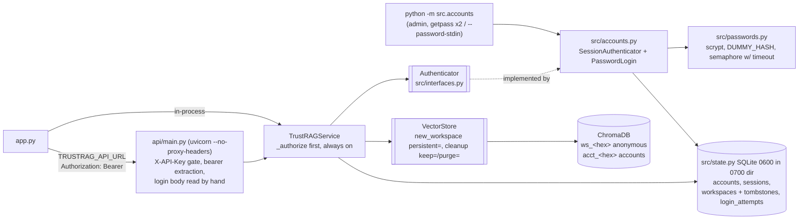

# P6 plan: user accounts and persistent workspaces

Status: **DRAFT — awaiting human approval** (CLAUDE.md section 5, step 1). ADRs 0011 and 0012 are `Proposed`;
SPEC-GAPs 031–056 are open with conservative defaults. Revised 2026-11-02 to fold in the security-reviewer's review
of the plan (section 9); nothing has been approved yet.

Human decisions already recorded (2026-11-01):
- SPEC-GAP-003 → local passwords (username + password, slow hash, rate-limited timing-safe login, server-side
  sessions). Resolved, design in ADR 0011.
- SPEC-GAP-004 → anonymous workspaces kept 24 h (as today); account workspaces never auto-deleted, deleted only by the
  owner. Resolved, design in ADR 0012.
- SPEC-GAP-008 constraint stands → auth behind one interface (`Authenticator`, ADR 0011) so P8 SSO can plug in.

Sources read for this plan: `CLAUDE.md`, `docs/SPEC.md` (B1–B9, P6, P7, P8), `docs/SPEC-GAPS.md`, `docs/adr/README.md`,
ADRs 0004, 0005, 0007, 0010 in full (0001–0003, 0006, 0008, 0009 by index title only), `ARCHITECTURE.md`,
`THREAT_MODEL.md`, `SECURITY.md`, `docs/phases/p5-plan.md` (format), `src/state.py`, `src/settings.py`,
`src/config.py`, `src/interfaces.py`, `src/service.py`, `src/models.py`, `src/vectorstore.py`, `src/api_client.py`,
`api/main.py`, `app.py`, `tests/fakes.py`, `tests/conftest.py`, parts of `tests/test_architecture.py` and
`tests/test_security.py`, `pyproject.toml`, `requirements*.lock` (grep), `docker-compose.yml`, `Dockerfile`,
`.env.example`, `.streamlit/config.toml`, `.github/workflows/tests.yml`, `Makefile` (targets), `README.md` (grep for run
commands), `chromadb/api/segment.py::check_index_name`, `uvicorn.config.Config`.

Facts checked while planning (commands run, read-only; probes used fakes and a scratch `CHROMA_DIR`):
- `.venv/bin/python`: Python 3.11.17, OpenSSL 3.6.4, `hashlib.scrypt` present; `scrypt(n=2**17, r=8, p=1)` took
  **0.307 s** on this machine.
- Not importable: `argon2`, `passlib`, `pwdlib`, `cryptography`, `nacl`, `extra_streamlit_components`,
  `streamlit_cookies_manager`. Importable: `bcrypt` 5.0.0 (required by `chromadb` only), `itsdangerous` (transitive).
- Streamlit 1.66.1: `st.context` has `cookies`, `headers`, `ip_address` (read-only), no cookie setter. The
  `ip_address` docstring: "should not be used for security measures because it can easily be spoofed. When a user
  accesses the app through `localhost`, the IP address is `None`."
- uvicorn 0.54.0: `Config` defaults `proxy_headers=True`, `forwarded_allow_ips = $FORWARDED_ALLOW_IPS or
  "127.0.0.1,::1"`; CLI has `--proxy-headers / --no-proxy-headers` and `--forwarded-allow-ips`.
- The API's uvicorn command lives in `docker-compose.yml` (`api.command`) and `README.md:237`; the `Dockerfile` `CMD` runs
  Streamlit only → the proxy-header fix touches **compose + README, not the Dockerfile**; `Makefile` has no uvicorn line.
- Current API (fakes): `GET /v1/workspaces` → `405 {"detail":"Method Not Allowed"}`, `Allow: POST`;
  `/v1/auth/login`, `/v1/auth/me` → `404 {"detail":"Not Found"}`; `Authorization` header ignored.
- FastAPI 0.162.0 echoes the rejected value in 422 bodies (`"input": "SSSS…"`).
- `src/vectorstore.py`: cleanup filters on `name.startswith("ws_")`; `_WORKSPACE_ID = ^[a-f0-9]{32}$`. ChromaDB names: 3–63
  chars, alnum at both ends, `[a-zA-Z0-9._-]` (`check_index_name`). Whether ChromaDB 1.5.9 calls `check_index_name` on
  every create path: **not verified** (`acct_<32 hex>` satisfies it either way).
- Unrelated observation (not investigated): `requirements.lock` pins `starlette==1.9.0`, `requirements-dev.lock` 1.10.0.
- Not verified: scrypt in the Docker image; OWASP scrypt figures (from memory).

---

## 1. Scope

In scope:
- **Account model** (SPEC P6 scope bullet 1; SPEC-GAP-003): admin-created username/password accounts, scrypt hashes,
  canonical usernames (SPEC-GAP-031, -032, -033, -037, -055).
- **Login and logout** (SPEC P6 scope bullet 1): API routes and Streamlit sign-in; server-side hashed sessions;
  atomically rate-limited, timing-safe and enumeration-safe login (**P6-AC2**).
- **Per-user workspaces that survive browser refresh** (SPEC P6 scope bullet 1): ownership in SQLite, distinct
  `acct_` collections, list / create / delete own workspaces; owner-only list files, upload, ask, delete
  (**P6-AC1**, service and API level).
- **Anonymous mode unchanged** (SPEC P6 scope bullet 2; **P6-AC3**; B5, B7) — golden-file equality; accounts opt-in
  (SPEC-GAP-039, -042, -047).
- **Retention** (**P6-AC5**; SPEC-GAP-004): account workspaces exempt from the 24 h cleanup (also under v1.0 rollback
  or flag-off); deleted only by owner, tombstoned.
- **Threat model** rows for account takeover, enumeration, session theft and the review's additional attacks, each
  with a test (**P6-AC4**).
- **Auth interface for P8** (SPEC-GAP-008).
- Launch API with `--no-proxy-headers` (compose + README) (SPEC-GAP-048).
- ADRs 0011, 0012; README, CHANGELOG (incl. rollback warning), SECURITY.md, ARCHITECTURE.md.

Out of scope (not built in P6):
- SSO / OIDC / `st.login` (P8), magic links, email, password reset by email, MFA, breached-password checks.
- Public sign-up; self-service password change; account deletion (SPEC-GAP-031, -037).
- Staying signed in across a Streamlit refresh (SPEC-GAP-035).
- Claiming anonymous workspaces; sharing between accounts; roles/admin UI (SPEC-GAP-040).
- Workspace names, per-account storage quotas, per-account question limits (SPEC-GAP-041).
- HTTPS, security headers, trusted-proxy configuration (P8).
- Redis / Postgres backends (P7; SPEC-GAP-043). HMAC-keyed rate-limit keys (SPEC-GAP-050).
- Any change to prompts, retrieval, scanner, `config.PROMPT_VERSIONS`, `eval/` → **no `make eval`**.
- Changing `APP_PASSWORD` / `API_KEY` behaviour, the hourly call limit, `MAX_LOGIN_ATTEMPTS` / `LOGIN_LOCKOUT_SECONDS`.
- CI workflow and `Dockerfile` changes (none needed).
- **New dependencies: none recommended** (stdlib `hashlib.scrypt`, section 2.8).

## 2. Design

### 2.1 Overview



Login sequence (ADR 0011):

```mermaid
sequenceDiagram
    participant C as Client
    participant L as PasswordLogin
    participant S as state.py
    participant P as passwords.py
    C->>L: login(raw body ≤ 4 KiB, client_key)
    L->>L: 1. parse + shape + canonical username (isascii → lower → fullmatch); bad → same 401 later
    L->>S: 2. reserve(user key?, client key?, global) in one BEGIN IMMEDIATE: prune, count, refuse or insert
    S-->>L: refused → 429 + Retry-After (no KDF)
    L->>S: 3. get_account(canonical)
    L->>P: 4. acquire semaphore (5 s timeout → refund + same 429)
    L->>P: 5. one scrypt vs hash or DUMMY_HASH, compare_digest
    alt ok and enabled
        L->>S: 6. tx: re-check disabled, refund user/client rows, create session, cap sessions, rehash if params differ
        L-->>C: 200 SessionInfo
    else unknown / wrong / disabled / bad shape
        L-->>C: 401 "Wrong username or password." (reservation stays as failure)
    end
```

### 2.2 Data model changes (TypedDicts in `src/models.py`, ADR 0004)

```python
class Principal(TypedDict):
    account_id: str  # 32 lowercase hex chars, random; never the username
    username: str  # canonical form


class SessionInfo(TypedDict):
    token: str  # returned once at login; only sha256(token) is stored
    username: str
    expires_at: float  # absolute expiry, epoch seconds


class WorkspaceInfo(TypedDict):
    workspace: str  # "acct-<32 hex>" for account workspaces (opaque to clients, SPEC-GAP-053)
    created_at: float


class WorkspaceList(TypedDict):
    workspaces: list[WorkspaceInfo]
```

Existing models are unchanged.

### 2.3 SQLite schema (`src/state.py`, additive, ADR 0005 / 0012)

Added to `_conn()`'s initialisation list. On open: `CHROMA_DIR` created/tightened to 0700; DB, `-wal`, `-shm` created
or tightened to 0600 (SPEC-GAP-044).

```sql
CREATE TABLE IF NOT EXISTS accounts (
  account_id TEXT PRIMARY KEY, username TEXT NOT NULL UNIQUE, password_hash TEXT NOT NULL,
  created REAL NOT NULL, disabled INTEGER NOT NULL DEFAULT 0, password_changed REAL NOT NULL);
CREATE TABLE IF NOT EXISTS sessions (
  token_hash TEXT PRIMARY KEY, account_id TEXT NOT NULL, created REAL NOT NULL,
  last_seen REAL NOT NULL, expires REAL NOT NULL);
CREATE INDEX IF NOT EXISTS sessions_account ON sessions (account_id);
CREATE TABLE IF NOT EXISTS workspaces (
  workspace TEXT PRIMARY KEY, account_id TEXT NOT NULL, created REAL NOT NULL,
  deleted INTEGER NOT NULL DEFAULT 0);
CREATE INDEX IF NOT EXISTS workspaces_account ON workspaces (account_id);
CREATE TABLE IF NOT EXISTS login_attempts (key TEXT NOT NULL, ts REAL NOT NULL, attempt TEXT NOT NULL);
CREATE INDEX IF NOT EXISTS login_attempts_key_ts ON login_attempts (key, ts);
```

New `state` functions (names proposed; qa-engineer fixes them in test docstrings, as in P5 SPEC-GAP-030):
`create_account`, `get_account_by_username`, `set_password_hash` (sets `password_changed`, deletes sessions),
`set_disabled` (deletes sessions on disable), `list_accounts`, `create_session(token_hash, account_id, …, max_per_account)`
(re-checks `disabled` in the same transaction; revokes oldest over cap), `get_session_principal(token_hash, now)` (joins
`accounts`; `None` if expired, disabled, or `created < password_changed`; deletes expired), `touch_session` (≤ once per
60 s), `delete_session`, `prune_expired(now)`, `add_owned_workspace(workspace, account_id, limit)` (cap on live rows),
`workspace_record(workspace) -> (account_id, deleted) | None`, `list_owned_workspaces(account_id)`,
`live_owned_ids()`, `tombstoned_ids()`, `tombstone_workspace`, `reserve_login_attempt(keys, limits, now) -> (attempt_id |
None, retry_after)` (one `BEGIN IMMEDIATE`: prune, count, refuse or insert), `refund_login_attempt(attempt_id, keys)`.

### 2.4 Interfaces and modules

| Module | Change | Owner |
|---|---|---|
| `src/interfaces.py` | `Authenticator` Protocol (`resolve`, `start_session`, `logout`); `VectorStore.new_workspace(self, *, persistent: bool = False)`; `VectorStore.cleanup(self, *, keep: frozenset[str] = frozenset(), purge: frozenset[str] = frozenset())` | backend |
| `src/passwords.py` (new) | `hash_password`, `verify_password` (one scrypt, `compare_digest`), `needs_rehash(encoded)`, `DUMMY_HASH` (current params), `kdf_slot(timeout)` context manager over `BoundedSemaphore(KDF_MAX_CONCURRENT)` raising `KdfBusy`, `canonical_username(raw) -> str \| None` (isascii → lower → fullmatch), `check_password_policy` | backend |
| `src/accounts.py` (new) | `SessionAuthenticator`, `PasswordLogin.login(raw_body: bytes, client_key: str \| None) -> SessionInfo` raising `LoginFailed` / `LoginRateLimited(retry_after)`; admin CLI `main(argv, *, getpass=…, stdin=…)`: `create`, `set-password`, `disable`, `enable`, `list`; password typed twice; non-TTY refused unless `--password-stdin`; fixed error strings; exit 0/1 | backend |
| `src/service.py` | inject `authenticator` and `password_login`; every existing method gains keyword-only `session: str \| None = None`; **`_authorize` is the first statement** of `list_files`, `count`, `clear`, `upload` (before size check / loader / OCR / scanner), `ask` (before retrieval); `upload` re-authorises after `add_chunks` (race with delete → clear + `WorkspaceNotFound`); `new_workspace` with a principal → `store.new_workspace(persistent=True)` + ownership row; every `new_workspace` calls `store.cleanup(keep=live_owned_ids(), purge=tombstoned_ids())` (**regardless of `ACCOUNTS_ENABLED`**); new `list_workspaces`, `login`, `logout`; owner `clear` = tombstone then `store.clear` | backend |
| `src/vectorstore.py` | `new_workspace_id(persistent)`: `acct-<hex>` / `<hex>`; `_collection_name` accepts `^[a-f0-9]{32}$` → `ws_…` and `^acct-[a-f0-9]{32}$` → `acct_…`, nothing else; `cleanup_old_workspaces(keep, purge)`: `ws_*` by age (unchanged) minus `keep`; `acct_*` only if in `purge` | backend |
| `src/api_client.py` | `session` kwarg → bearer per request; `login(username, password)`, `logout`, `list_workspaces`; maps 401 → `NotAuthenticated` / `LoginFailed`, 429 → `LoginRateLimited`, 409 on create → `WorkspaceLimitReached` | backend |
| `src/settings.py` / `src/config.py` | settings, **all `gt=0` with upper bounds** (SPEC-GAP-034, -036, -041, -049, -051): `accounts_enabled=False`, `session_idle_minutes=120 (le 1440)`, `session_max_hours=24 (le 720)`, `login_max_failures_per_user=5 (le 100)`, `login_max_failures_per_client=20 (le 1000)`, `login_window_minutes=15 (le 1440)`, `login_max_per_second=5 (le 100)`, `max_workspaces_per_account=10 (le 1000)`, `max_sessions_per_account=10 (le 100)`; constants `SCRYPT_N/R/P/MAXMEM`, `KDF_MAX_CONCURRENT=2`, `KDF_WAIT_SECONDS=5`, `LOGIN_BODY_MAX_BYTES=4096`, `PASSWORD_MIN_CHARS=12`, `PASSWORD_MAX_CHARS=1024` | backend |
| `api/main.py` | auth routes (2.5); `/v1/auth/login` reads `request` body by hand (no pydantic model); `optional_session(request)` reads `Authorization` from `request.headers` and validates the token **before** any workspace lookup; handlers: `NotAuthenticated` 401 + `WWW-Authenticate: Bearer`, `LoginFailed` 401, `LoginRateLimited` 429 + `Retry-After`, `WorkspaceLimitReached` 409; metrics middleware records `/v1/auth/*` with `status="-"` (SPEC-GAP-052); flag gates **only** auth routes, session use and `GET /v1/workspaces` | backend |
| `app.py` | flag off: existing code path unchanged (workspace created on first load). Flag on: after the `APP_PASSWORD` gate a choice "Sign in" / "Continue without an account" — the anonymous `new_workspace()` runs only after the choice (SPEC-GAP-047); on sign-in, sign-out and session expiry **clear every `st.session_state` key except `authenticated`, `failed_logins`, `locked_until`**; switching workspace resets `last_result`, `scan_reports`, `processed_files`, `files_added`, uploader key; expired session → sign-in screen, never anonymous; per-client limit keyed on `st.context.ip_address` only when not `None` | backend |
| `docker-compose.yml` | `api.command` gains `--no-proxy-headers` | devops (**human gate**) |
| `README.md` | uvicorn run command gains `--no-proxy-headers`; accounts how-to; back up `chroma_db/`; rollback warning | backend drafts |
| `tests/fakes.py` | `FakeStore.new_workspace(*, persistent=False)`, `cleanup(*, keep=…, purge=…)` (records args); fake authenticator | qa-engineer |
| `.env.example` | new settings, commented | devops |

### 2.5 HTTP API contract changes

All routes keep the `X-API-Key` dependency when `API_KEY` is set. When `ACCOUNTS_ENABLED=false`: `/v1/auth/*` →
`404 {"detail":"Not Found"}`, `GET /v1/workspaces` → `405 {"detail":"Method Not Allowed"}` + `Allow: POST`, and the
`Authorization` header is ignored; the ownership checks still apply (an `acct-` id is 404 for everyone).

| Method, path | Request | Success | Errors |
|---|---|---|---|
| `POST /v1/auth/login` (new) | raw body ≤ 4096 bytes, JSON `{username: str, password: str}` | `200 SessionInfo` | `401 {"detail":"Wrong username or password."}` for unknown user, wrong password, disabled account, **and every bad shape** (invalid JSON, non-object, missing / non-string fields, over-long password, oversized body, non-ASCII or invalid username); never 422, never echoes input; `429 {"detail":"Too many sign-in attempts. Please try again later."}` + `Retry-After` for per-user, per-client, global cap and KDF-busy |
| `POST /v1/auth/logout` (new) | bearer | `204` (also for unknown/expired tokens) | — |
| `GET /v1/auth/me` (new) | bearer | `200 {"username": …}` | `401 {"detail":"Your session has expired. Please sign in again."}` + `WWW-Authenticate: Bearer` |
| `GET /v1/workspaces` (new) | bearer required | `200 WorkspaceList` (own live rows only) | `401` |
| `POST /v1/workspaces` | none → anonymous (v1.0) / bearer → `acct-` workspace | `201 {"workspace": …}` | `401` invalid token; `409 {"detail":"You already have the maximum of N workspaces. Delete one first."}` |
| `GET/POST /v1/workspaces/{ws}/documents`, `POST …/questions`, `DELETE /v1/workspaces/{ws}` | optional bearer | unchanged | `401` for any invalid/malformed/expired token — **checked before the id**, so identical for owned, unknown and malformed ids; `404 "Workspace not found."` when not authorised (identical to unknown id); authorisation runs before the 409 empty-workspace check and before any upload processing |
| `/health`, `/metrics` | unchanged (auth paths recorded with `status="-"`) | | |

Token only via the `Authorization` header (never query, never cookie); malformed header or token > 512 chars → 401.

### 2.6 Authorisation rule (single function, always on — ADR 0012)

| Workspace id | Record | Caller | Result |
|---|---|---|---|
| `acct-<hex>` | live, owner A | session of A | allowed |
| `acct-<hex>` | live, owner A | session of B / anonymous | 404 |
| `acct-<hex>` | tombstoned or missing | anyone | 404 (fail closed) |
| `<hex>` | none | anonymous | allowed — v1.0 path |
| `<hex>` | none | any session | 404 (SPEC-GAP-040) |
| `<hex>` | a row exists (should not happen) | — | treated as `acct-` (defensive) |

Invalid, expired or revoked token → 401, never a silent fallback to anonymous.

### 2.7 Retention and rollback (P6-AC5, ADR 0012)

- Every `new_workspace()` → `store.cleanup(keep=live_owned_ids(), purge=tombstoned_ids())`: `ws_*` older than 24 h
  deleted as today; `acct_*` never by age; tombstoned `acct_*` deleted.
- Owner delete: tombstone row → `store.clear`; racing upload re-authorises after write and clears.
- Disabling an account revokes sessions; workspaces kept.
- Flag off or rollback to v1.0: `acct_*` collections are neither deleted (v1.0 cleanup is `ws_`-only) nor reachable
  (v1.0 rejects `acct-` ids). CHANGELOG/README rollback warning (SPEC-GAP-054).

### 2.8 Dependencies

**Recommendation: stdlib `hashlib.scrypt`, no new dependency, no lock regeneration** (ADR 0011). Alternatives, each a
human gate: Argon2id via `argon2-cffi` (not installed, version not verified; pin + install + lock regeneration);
`bcrypt` (transitive only; direct pin + lock regeneration; 72-byte limit).

### 2.9 Files touched

| File | Change | Owner |
|---|---|---|
| `src/models.py`, `src/interfaces.py`, `src/state.py`, `src/settings.py`, `src/config.py`, `src/service.py`, `src/vectorstore.py`, `src/api_client.py`, `api/main.py`, `app.py` | modified (2.4) | backend |
| `src/passwords.py`, `src/accounts.py` | new | backend |
| `tests/test_accounts.py`, `tests/test_ownership.py`, `tests/test_anonymous_mode.py`, `tests/test_ui_accounts.py` | new | qa-engineer |
| `tests/test_security.py` | new section "P6 accounts" | qa-engineer |
| `tests/fakes.py` | store kwargs, fake authenticator | qa-engineer |
| `tests/data/p6_anonymous_golden.json` | new; recorded from **pre-P6** code (T1a) | qa-engineer |
| `docker-compose.yml` | `--no-proxy-headers` on the `api` command | devops (human gate) |
| `.env.example` | new settings, commented | devops |
| `THREAT_MODEL.md` | rows 26–42, "Not defended against" (human gate) | backend drafts, security-reviewer reviews |
| `README.md`, `CHANGELOG.md`, `SECURITY.md` | accounts how-to, run command, backup, rollback warning, limits | backend drafts |
| `ARCHITECTURE.md` | Clients / API / State / Trust boundaries, after approval | architect |

Not touched: `eval/`, prompts, `.github/`, `Dockerfile`, `pyproject.toml`, lock files, `Makefile`, `CLAUDE.md`, `.claude/`.

## 3. Acceptance criteria → tests

| Criterion | Test file | Test name (to be written) |
|---|---|---|
| P6-AC1 (service) | `tests/test_ownership.py` | `test_service_user_lists_only_own_workspaces` |
| P6-AC1 (service) | `tests/test_ownership.py` | `test_service_user_cannot_query_other_users_workspace` |
| P6-AC1 (service) | `tests/test_ownership.py` | `test_service_user_cannot_delete_other_users_workspace` |
| P6-AC1 (service) | `tests/test_ownership.py` | `test_service_user_cannot_list_files_count_or_upload_to_other_users_workspace` |
| P6-AC1 (service) | `tests/test_ownership.py` | `test_service_anonymous_caller_cannot_reach_account_workspace` |
| P6-AC1 (service) | `tests/test_ownership.py` | `test_service_signed_in_user_cannot_reach_unowned_workspace` |
| P6-AC1 (service) | `tests/test_ownership.py` | `test_service_rejects_expired_revoked_and_unknown_sessions` |
| P6-AC1 (service) | `tests/test_ownership.py` | `test_service_workspace_cap_per_account` |
| P6-AC1 (service) | `tests/test_ownership.py` | `test_upload_or_ask_to_foreign_workspace_makes_zero_llm_calls` (review #10; FakeLLM call count 0, oversized upload to a foreign id gives 404 not 413) |
| P6-AC1 (service) | `tests/test_ownership.py` | `test_acct_id_without_live_row_is_refused` (fail closed) |
| P6-AC1 (API) | `tests/test_ownership.py` | `test_api_user_lists_only_own_workspaces` |
| P6-AC1 (API) | `tests/test_ownership.py` | `test_api_other_users_workspace_is_404_on_every_route` (parametrised; body equals unknown-id 404) |
| P6-AC1 (API) | `tests/test_ownership.py` | `test_api_anonymous_request_to_account_workspace_is_404` |
| P6-AC1 (API) | `tests/test_ownership.py` | `test_api_question_to_foreign_empty_workspace_is_404_not_409` |
| P6-AC1 (API) | `tests/test_ownership.py` | `test_invalid_bearer_gives_identical_401_for_owned_unknown_and_malformed_ids` (review #15) |
| P6-AC1 (API) | `tests/test_ownership.py` | `test_api_list_workspaces_requires_session` |
| P6-AC1 (API) | `tests/test_ownership.py` | `test_api_client_forwards_session_and_maps_errors` |
| P6-AC2 | `tests/test_accounts.py` | `test_password_hash_is_salted_scrypt_with_configured_params` |
| P6-AC2 | `tests/test_accounts.py` | `test_dummy_hash_uses_current_kdf_params` (review #12; **primary timing-safety proof**) |
| P6-AC2 | `tests/test_accounts.py` | `test_login_rehashes_when_params_change` (review #12) |
| P6-AC2 | `tests/test_accounts.py` | `test_verify_password_uses_compare_digest` |
| P6-AC2 | `tests/test_accounts.py` | `test_password_policy_bounds_and_username_rules` |
| P6-AC2 | `tests/test_accounts.py` | `test_username_variants_share_one_rate_limit_bucket` (review #7; `Alice`/`ALICE`/`alice` share; Kelvin-sign and other non-ASCII rejected before `lower()`) |
| P6-AC2 | `tests/test_accounts.py` | `test_state_db_never_contains_plain_password_or_token` |
| P6-AC2 | `tests/test_accounts.py` | `test_session_token_stored_only_as_sha256` |
| P6-AC2 | `tests/test_accounts.py` | `test_logs_never_contain_password_token_or_submitted_username` |
| P6-AC2 | `tests/test_accounts.py` | `test_login_is_rate_limited_per_username` |
| P6-AC2 | `tests/test_accounts.py` | `test_login_is_rate_limited_per_client_address` |
| P6-AC2 | `tests/test_accounts.py` | `test_login_rate_limit_is_shared_across_processes` |
| P6-AC2 | `tests/test_accounts.py` | `test_concurrent_wrong_logins_run_kdf_at_most_limit_times` (review #1; threads and processes, KDF spy; successful login refunds) |
| P6-AC2 | `tests/test_accounts.py` | `test_login_runs_kdf_exactly_once_for_unknown_wrong_and_disabled` |
| P6-AC2 | `tests/test_accounts.py` | `test_login_timing_does_not_depend_on_username_existence` (secondary; medians, ratio 0.67–1.5) |
| P6-AC2 | `tests/test_accounts.py` | `test_api_login_validation_error_does_not_echo_password` (review #6; parametrised: invalid JSON, non-object, missing field, non-string, 1025-char password, > 4096-byte body, non-ASCII username → all `401` fixed body, no password bytes in response) |
| P6-AC2 | `tests/test_accounts.py` | `test_admin_cli_reads_password_with_getpass_not_argv` (review #14: typed twice; mismatch fails; non-TTY refused without `--password-stdin`; fixed error strings) |
| P6-AC2 | `tests/test_accounts.py` | `test_state_db_dir_and_files_are_owner_only` (review #11; dir 0700, DB/-wal/-shm 0600, pre-existing 0644 files tightened on open; skipped on Windows) |
| P6-AC2 | `tests/test_accounts.py` | `test_scrypt_is_available_with_required_params` |
| P6-AC2 | `tests/test_accounts.py` | `test_new_settings_reject_zero_negative_and_huge_values` (review #16) |
| P6-AC2 | `tests/test_accounts.py` | `test_x_forwarded_for_does_not_change_login_client_key` (review #3; app never reads XFF; compose `api.command` and README uvicorn line contain `--no-proxy-headers`) |
| P6-AC3 | `tests/test_anonymous_mode.py` | `test_anonymous_api_responses_match_v1_golden` (flag false/true) |
| P6-AC3 | `tests/test_anonymous_mode.py` | `test_new_paths_answer_as_v1_when_accounts_disabled` |
| P6-AC3 | `tests/test_anonymous_mode.py` | `test_authorization_header_ignored_when_accounts_disabled` |
| P6-AC3 | `tests/test_anonymous_mode.py` | `test_existing_operations_openapi_schema_unchanged` |
| P6-AC3 | `tests/test_anonymous_mode.py` | `test_anonymous_workspaces_still_expire_after_24h` |
| P6-AC3 | `tests/test_anonymous_mode.py` | `test_service_default_signatures_unchanged_for_anonymous_callers` |
| P6-AC3 | `tests/test_ui_accounts.py` | `test_ui_first_load_unchanged_when_accounts_disabled` (Streamlit `AppTest`; workspace created on first load as v1.0) |
| P6-AC3 | existing | `test_workspaces_are_isolated`, `test_workspace_ids_are_validated`, `test_api_end_to_end`, `test_api_errors_are_user_safe`, `test_api_key_is_enforced_when_configured` unchanged and green |
| P6-AC4 | `tests/test_security.py` | every section-4 test not listed elsewhere: `test_login_failures_are_indistinguishable`, `test_rate_limit_response_identical_for_unknown_user`, `test_no_signup_route_exists`, `test_token_never_accepted_from_query_or_cookie`, `test_session_expires_idle_and_absolute`, `test_logout_and_password_reset_revoke_sessions`, `test_resolve_rejects_session_of_disabled_account_or_older_than_password_change` (review #5), `test_login_issues_new_token_each_time_and_ignores_presented_token`, `test_session_cap_per_account_revokes_oldest` (review #17), `test_rate_limited_login_does_not_run_kdf`, `test_kdf_saturation_fails_fast_and_other_routes_stay_responsive` (review #4), `test_global_login_rate_cap` (review #4), `test_api_ignores_cookies_for_authentication`, `test_metrics_do_not_expose_login_outcomes` (review #18) |
| P6-AC4 | `tests/test_ui_accounts.py` | `test_ui_sign_out_clears_answer_sources_and_workspace` (review #9), `test_ui_expired_session_does_not_fall_back_to_anonymous` (review #9), `test_ui_workspace_switch_resets_results`, `test_ui_without_client_address_does_not_share_one_lockout_bucket` (review #3) |
| P6-AC4 | `tests/test_security.py` | `test_threat_model_lists_p6_rows_with_existing_tests` |
| P6-AC5 | `tests/test_ownership.py` | `test_account_workspaces_survive_cleanup_past_24h` (real `ChromaStore`, tmp dir) |
| P6-AC5 | `tests/test_ownership.py` | `test_service_passes_owned_and_tombstoned_ids_to_cleanup` |
| P6-AC5 | `tests/test_ownership.py` | `test_disabling_accounts_neither_deletes_nor_exposes_owned_workspaces` (review #2; flag on → create + upload → flag off → cleanup with `max_age_hours=0`, anonymous access → data intact, 404) |
| P6-AC5 | `tests/test_ownership.py` | `test_v1_cleanup_does_not_touch_owned_collections` (review #2; v1.0-equivalent cleanup call without kwargs leaves `acct_*`; v1.0 id regex rejects `acct-` ids) |
| P6-AC5 | `tests/test_ownership.py` | `test_deleted_owned_workspace_id_is_404_for_anonymous_and_owner` (review #8) |
| P6-AC5 | `tests/test_ownership.py` | `test_upload_racing_owner_delete_never_leaves_reachable_data` (review #8; delete injected between authorisation and `add_chunks`) |
| P6-AC5 | `tests/test_ownership.py` | `test_disabled_account_keeps_workspaces` |

Tests use fakes, `TestClient`, Streamlit's `AppTest` (`streamlit.testing.v1`; availability in 1.66.1 **not verified**,
qa-engineer checks before relying on it) and the autouse tmp state DB. No test calls Claude. Real-`ChromaStore` tests
follow the existing pattern. Scrypt-heavy tests may lower `config.SCRYPT_N`, except
`test_password_hash_is_salted_scrypt_with_configured_params`, `test_dummy_hash_uses_current_kdf_params` and the timing test.

## 4. Threat model delta (draft — `THREAT_MODEL.md` is edited during build, human gate)

New actor: **Account holder of the same deployment**. New asset: **account credentials and session tokens**.

| # | Attack | Control | Test |
|---|---|---|---|
| 26 | **Account takeover** by online guessing / credential stuffing | Atomic per-username (5) and per-client (20) limits per 15 min, shared across processes, before the KDF; slow scrypt; min 12 chars; admin-created accounts | `test_login_is_rate_limited_per_username`, `test_login_is_rate_limited_per_client_address`, `test_login_rate_limit_is_shared_across_processes` |
| 27 | **Account takeover** after the state DB leaks (offline cracking) | Salted scrypt; dir 0700, files 0600; tokens SHA-256 only; rehash on parameter change | `test_password_hash_is_salted_scrypt_with_configured_params`, `test_state_db_never_contains_plain_password_or_token`, `test_state_db_dir_and_files_are_owner_only`, `test_login_rehashes_when_params_change` |
| 28 | **Username enumeration** via responses, timing, lockout or sign-up | Identical 401 status/body/headers for unknown / wrong / disabled / bad shape; one KDF run on `DUMMY_HASH` with identical params (time equal up to one indexed lookup); identical 429; no sign-up | `test_login_failures_are_indistinguishable`, `test_login_runs_kdf_exactly_once_for_unknown_wrong_and_disabled`, `test_dummy_hash_uses_current_kdf_params`, `test_login_timing_does_not_depend_on_username_existence`, `test_rate_limit_response_identical_for_unknown_user`, `test_no_signup_route_exists` |
| 29 | **Session theft / replay** (DB, logs, URLs, errors, old token) | 256-bit tokens; SHA-256 at rest; header only; idle 2 h / absolute 24 h; logout / reset / disable revoke; ≤ 10 sessions per account | `test_session_token_stored_only_as_sha256`, `test_logs_never_contain_password_token_or_submitted_username`, `test_token_never_accepted_from_query_or_cookie`, `test_session_expires_idle_and_absolute`, `test_logout_and_password_reset_revoke_sessions`, `test_session_cap_per_account_revokes_oldest` |
| 30 | **Session fixation** | Server-issued tokens only, new at every login | `test_login_issues_new_token_each_time_and_ignores_presented_token` |
| 31 | **Cross-account access (IDOR)** | `_authorize` first in every service method; 404 = not found; token checked before id | `test_api_other_users_workspace_is_404_on_every_route`, `test_service_user_cannot_delete_other_users_workspace`, `test_api_question_to_foreign_empty_workspace_is_404_not_409`, `test_invalid_bearer_gives_identical_401_for_owned_unknown_and_malformed_ids` |
| 32 | **Anonymous path reaches account data**, incl. ids freed by owner delete | `acct-` ids need a live owner row (fail closed); delete tombstones, never frees the id; upload re-authorises after write; tombstoned data purged | `test_api_anonymous_request_to_account_workspace_is_404`, `test_acct_id_without_live_row_is_refused`, `test_deleted_owned_workspace_id_is_404_for_anonymous_and_owner`, `test_upload_racing_owner_delete_never_leaves_reachable_data` |
| 33 | **Retention bypass**: 24 h cleanup deletes account data | `acct_` prefix never deleted by age; `keep` set; purge only tombstoned | `test_account_workspaces_survive_cleanup_past_24h`, `test_service_passes_owned_and_tombstoned_ids_to_cleanup` |
| 34 | **Credential leakage via side channels** (422 echo, argv / shell history / piped stdin, logged usernames, metrics) | Login body parsed by hand, fixed 401; CLI `getpass` twice / `--password-stdin` only; no submitted usernames in logs; auth metrics without status | `test_api_login_validation_error_does_not_echo_password`, `test_admin_cli_reads_password_with_getpass_not_argv`, `test_logs_never_contain_password_token_or_submitted_username`, `test_metrics_do_not_expose_login_outcomes` |
| 35 | **CSRF** with a signed-in browser | API reads no cookies (bearer only); Streamlit XSRF protection unchanged | `test_api_ignores_cookies_for_authentication` |
| 36 | **Rate-limit race**: many concurrent wrong guesses all pass the check before any is recorded | Check and reservation in one `BEGIN IMMEDIATE`; success refunds | `test_concurrent_wrong_logins_run_kdf_at_most_limit_times` |
| 37 | **Session survives disable / password change** (login racing the admin action) | `resolve` joins `accounts`: rejects disabled or `created < password_changed`; `create_session` re-checks `disabled` in-transaction | `test_resolve_rejects_session_of_disabled_account_or_older_than_password_change` |
| 38 | **Flag toggle or v1.0 rollback deletes or exposes account workspaces** | Ownership checks and cleanup keep/purge always on; `acct_` collections ignored by v1.0 cleanup; `acct-` ids rejected by v1.0 id check; rollback warning | `test_disabling_accounts_neither_deletes_nor_exposes_owned_workspaces`, `test_v1_cleanup_does_not_touch_owned_collections` |
| 39 | **UI leftovers**: next person at a shared browser sees the previous user's answer, sources or workspace; expired session silently becomes anonymous | Clear all session state except `APP_PASSWORD` keys on sign-in / sign-out / expiry; reset on workspace switch; expiry → sign-in screen | `test_ui_sign_out_clears_answer_sources_and_workspace`, `test_ui_expired_session_does_not_fall_back_to_anonymous`, `test_ui_workspace_switch_resets_results` |
| 40 | **Unauthorised upload/ask spends the owner's Claude quota** (OCR, scanner, answer calls on a foreign workspace) | Authorise before size check, loader, OCR, scanner, retrieval | `test_upload_or_ask_to_foreign_workspace_makes_zero_llm_calls` |
| 41 | **Username canonicalisation**: `Alice` / `ALICE` / look-alike Unicode get separate rate-limit buckets or reach another account | `isascii()` before `lower()`, `fullmatch`; one canonical value for key, lookup and CLI | `test_username_variants_share_one_rate_limit_bucket` |
| 42 | **Login flood** (memory-hard KDF exhausts memory or stalls workers; spoofed client address) | Global 5/s cap before KDF; semaphore with 5 s timeout → 429; uvicorn `--no-proxy-headers`; app never reads XFF; UI client limit only when address known | `test_rate_limited_login_does_not_run_kdf`, `test_global_login_rate_cap`, `test_kdf_saturation_fails_fast_and_other_routes_stay_responsive`, `test_x_forwarded_for_does_not_change_login_client_key`, `test_ui_without_client_address_does_not_share_one_lockout_bucket` |

Proposed additions to "Not defended against":
- **Targeted lockout**: anyone who knows a username can block its sign-in for up to 15 minutes (rolling).
- **Global sign-in lockout under a flood**: the global cap and KDF timeout make sign-in fail for everyone while a
  flood lasts (other routes stay up).
- **Shared or spoofable client address**: in compose all UI sign-ins share the UI container's address at the API;
  Streamlit's `ip_address` is spoofable and `None` on localhost. The per-username limit is the main control.
- **Rate-limit keys are pseudonyms, not secrets**: `sha256(username)` can be reversed with a username list (SPEC-GAP-050).
- **Plain HTTP on a network** until P8 (default binding stays localhost). **No MFA, no breached-password check.**
- **State DB loss** makes account workspaces unreachable (not deleted); recovery is manual.
- "Shared-password access" bullet updated: per-user accounts exist when `ACCOUNTS_ENABLED=true`; audit = JSON log
  events only (SPEC-GAP-045).

## 5. Tasks

| # | Task | Owner | Depends on | Parallel with |
|---|---|---|---|---|
| T0 | Approve plan, ADR 0011 and 0012, SPEC-GAPs 031–056, scrypt, compose change | **human** | – | – |
| T1a | **Before any production change**: record `tests/data/p6_anonymous_golden.json` from current `main` | qa-engineer | T0 | T2 |
| T1b | Failing tests for sections 3 and 4 (+ fakes); confirm `streamlit.testing.v1.AppTest` exists; run; record failure output | qa-engineer | T1a | T2 |
| T2 | `.env.example` settings; `docker-compose.yml` `api.command` += `--no-proxy-headers` | devops | T0 | T1a, T1b |
| T3a | `src/passwords.py`, settings/config, models, interfaces | backend | T1b | T3b |
| T3b | `src/state.py` schema, functions, atomic reservation, file/dir modes | backend (second instance) | T1b | T3a |
| T4 | `src/accounts.py` (authenticator, login, CLI) | backend | T3a, T3b | T5a |
| T5a | `src/vectorstore.py` id formats, `keep`/`purge`; `src/service.py` authorisation-first, tombstones, retention | backend | T3a, T3b | T4 |
| T5b | `api/main.py` routes, hand-parsed login, handlers, metrics label; `src/api_client.py` | backend | T4, T5a | – |
| T6 | `app.py` sign-in / workspace selector / sign-out / state clearing | backend | T5b | T7 |
| T7 | Drafts: THREAT_MODEL rows 26–42 + limits; README (accounts, run command, backup, rollback), SECURITY.md, CHANGELOG | backend (security-reviewer reviews) | T5b | T6 |
| T8 | ARCHITECTURE.md design sections | architect | T5b | T6, T7 |
| T9 | Review the phase diff | code-reviewer **and** security-reviewer | T6, T7, T8 | each other |
| T10 | Fix confirmed findings; affected tests only | owners | T9 | – |
| T11 | Full quality gate incl. `make eval-free` **and `docker compose build`** (compose file changed); `test_scrypt_is_available_with_required_params` in the image if allowed; `docs/phases/p6-report.md` | verifier | T10 | – |
| T12 | Human gate: report, SPEC-GAPs, findings, git commands | manager → **human** | T11 | – |

llm-eval-engineer: **no tasks**.

## 6. Human gates expected

1. **T0**: approve plan, ADRs 0011/0012, SPEC-GAPs 031–056; scrypt (recommended) vs Argon2id (dependency gate).
2. **Deployment config**: `docker-compose.yml` `api.command` gains `--no-proxy-headers` (and the README run command).
   The `Dockerfile` is **not** changed (its `CMD` runs Streamlit). Behind a real reverse proxy (P8) the trusted-proxy
   list is a separate human decision.
3. **Security controls**: `THREAT_MODEL.md` rows 26–42 and "Not defended against"; `SECURITY.md`.
4. **Existing deployments / data**: first start adds tables and tightens `chroma_db/` to 0700 and the state files to
   0600 — back up `chroma_db/` first. Rolling back to v1.0 after accounts were used hides (does not delete) account
   workspaces; deleting `acct_*` collections by hand is a data-deletion human gate.
5. **Creating real accounts** (`python -m src.accounts create …`, as the service user).
6. **Commit** (T12).
Not expected: package installs, lock regeneration, CI or Dockerfile changes, `make eval`.

## 7. Risks

| Risk | Mitigation |
|---|---|
| Anonymous behaviour drifts (P6-AC3) | Golden from pre-P6 code; flag off by default; UI flag-off path untouched (`test_ui_first_load_unchanged_when_accounts_disabled`) |
| Authorisation forgotten on a route or placed after side effects | `_authorize` first statement; every-route test; zero-LLM-calls test |
| Timing test flaky | Primary proof is structural (`DUMMY_HASH` params + one KDF run) |
| Login flood exhausts memory / workers | Global cap, semaphore timeout, rate limit before KDF |
| SQLite write contention | `touch_session` ≤ once per 60 s; prune only at login |
| State DB treated as a cache by operators | README, ADR 0012, SPEC-GAP-044 |
| Rollback surprises users (workspaces vanish) | CHANGELOG/README warning; data kept |
| Opaque-id change breaks third-party clients that validate 32-hex ids | Only for account workspaces (new); SPEC-GAP-053 |
| P7 Redis plan vs durable tables | SPEC-GAP-043 |

## 8. New SPEC-GAPs

Added to `docs/SPEC-GAPS.md` (status open). 031–046 from the first draft (some refined on 2026-11-02), 047–056 from
the security review:

| ID | Question | Conservative default |
|---|---|---|
| 031 | Open sign-up or admin-created accounts | Admin CLI only |
| 032 | Password policy | 12–1024 chars, not equal to username |
| 033 | Username rules | `isascii()` then lowercase then `fullmatch ^[a-z0-9][a-z0-9._-]{2,31}$`; one canonical value everywhere |
| 034 | Session lifetime | Idle 2 h, absolute 24 h |
| 035 | Stay signed in across Streamlit refresh | No |
| 036 | Rate-limit numbers, keys, proxies | 5/user, 20/client per 15 min; reservation is atomic; no XFF trust; UI client limit only when address known |
| 037 | Account management | Admin CLI create / set-password / disable / enable / list |
| 038 | `APP_PASSWORD` / `API_KEY` | Unchanged outer gates |
| 039 | Accounts on by default? | No; the flag gates sign-in only — ownership checks always on |
| 040 | Signed-in access to unowned ids | No |
| 041 | Workspace metadata, count, quota | id + created; 10 per account; no quota |
| 042 | "Anonymous mode unchanged" | Golden equality, additive OpenAPI |
| 043 | (P7) Account tables vs Redis | Decide in P7 |
| 044 | State DB permissions | Dir 0700, DB/-wal/-shm 0600, tightened on open |
| 045 | Audit | JSON log events only |
| 046 | DELETE of an account workspace | Tombstone, then clear vectors; id never reused |
| 047 | UI first page when accounts are enabled | Sign-in / "Continue without an account" choice first; anonymous workspace created after the choice; flag off unchanged |
| 048 | Trusted proxy headers | `--no-proxy-headers` in compose and README; app never reads XFF; trusted list decided in P8 |
| 049 | Global login cap and KDF wait | 5 attempts/s across processes; 5 s semaphore wait; both → same 429 + `Retry-After` |
| 050 | Rate-limit key hashing | Plain SHA-256 (pseudonymous); claim of "no raw usernames" dropped; HMAC with a deployment secret only by later decision |
| 051 | Session cap and pruning | 10 per account, oldest revoked; expired sessions/attempts pruned at login |
| 052 | `/metrics` on auth paths | Record `/v1/auth/*` with `status="-"` |
| 053 | Account workspace id format | `acct-<32 hex>` → collection `acct_<32 hex>`; ids are opaque |
| 054 | Rollback to v1.0 / flag off after accounts were used | Account workspaces hidden, not deleted; documented warning |
| 055 | Admin CLI non-interactive use and user | Non-TTY needs `--password-stdin`; run as the service user |
| 056 | Data written into a workspace while its owner deletes it | Re-authorise after write and clear; cleanup purges tombstoned `acct_` collections |

## 9. Security review of the plan (2026-11-02)

Reviewer: security-reviewer (read-only), findings relayed by the manager. Result: 2 high, 8 medium, 8 low. All
accepted; no finding rejected. Where the reviewer offered options, the chosen one is stated. Not verified by me:
any P6 code (none exists yet).

| # | Sev | Finding | How it was handled | Test(s) | Threat row / gap |
|---|---|---|---|---|---|
| 1 | high | Login rate-limit check and record were separate → concurrent wrong guesses all pass | Reserve in the same `BEGIN IMMEDIATE` as the check; success refunds; failure keeps the reservation | `test_concurrent_wrong_logins_run_kdf_at_most_limit_times` | 36 |
| 2 | high | Flag toggle or v1.0 rollback deletes (24 h cleanup) or exposes (anonymous capability) owned workspaces | Ownership checks and keep/purge always on, flag gates only sign-in; account workspaces use id `acct-<hex>` and collection `acct_<hex>` (v1.0 cleanup only touches `ws_`, v1.0 id regex rejects `acct-`) — verified against `src/vectorstore.py`; `acct-` id without live row refused; rollback warning in CHANGELOG/README | `test_disabling_accounts_neither_deletes_nor_exposes_owned_workspaces`, `test_v1_cleanup_does_not_touch_owned_collections`, `test_acct_id_without_live_row_is_refused` | 38; 053, 054 |
| 3 | medium | uvicorn trusts `X-Forwarded-For` from loopback by default (verified 0.54.0); UI "unknown" bucket = global lockout | `--no-proxy-headers` in `docker-compose.yml` and README (the `Dockerfile` `CMD` runs Streamlit, so it is unchanged); ADR 0011 statement corrected; UI per-client limit only when `ip_address` is not `None`; residual shared/spoofable address recorded under "Not defended against" | `test_x_forwarded_for_does_not_change_login_client_key`, `test_ui_without_client_address_does_not_share_one_lockout_bucket` | 42; 036, 048; human gate 2 |
| 4 | medium | KDF semaphore can stall worker threads | Semaphore acquire with 5 s timeout → refund + same 429 + `Retry-After`; global 5/s cap before the KDF (chose 429 for both, so one response shape) | `test_kdf_saturation_fails_fast_and_other_routes_stay_responsive`, `test_global_login_rate_cap` | 42; 049 |
| 5 | medium | Session can be issued after disable / set-password | `resolve` joins `accounts`, rejects disabled or `created < password_changed`; `create_session` re-checks `disabled` in-transaction | `test_resolve_rejects_session_of_disabled_account_or_older_than_password_change` | 37 |
| 6 | medium | 422 echoes the password (verified) | No pydantic body model; body ≤ 4 KiB read and parsed in code; any bad shape → same fixed 401 | `test_api_login_validation_error_does_not_echo_password` (parametrised) | 34 |
| 7 | medium | Username canonicalisation (case, Unicode folding) splits buckets | `isascii()` before `lower()`, `re.fullmatch`; one canonical value for key, lookup, CLI | `test_username_variants_share_one_rate_limit_bucket` | 41; 033 |
| 8 | medium | Owner-deleted id becomes anonymous | Tombstone (`deleted=1`) instead of row removal; with #2, `acct-` ids fail closed; upload re-authorises after write; cleanup purges tombstoned data | `test_deleted_owned_workspace_id_is_404_for_anonymous_and_owner`, `test_upload_racing_owner_delete_never_leaves_reachable_data` | 32; 046, 056 |
| 9 | medium | Streamlit leftovers after sign-out / expiry; anonymous fallback | Clear all session keys except `APP_PASSWORD` keys on sign-in / sign-out / expiry; reset on workspace switch; expiry → sign-in screen. Checked against P6-AC3: deferring the anonymous `new_workspace()` changes the first page load, so it applies **only when `ACCOUNTS_ENABLED=true`**; flag off keeps v1.0 (B5 unchanged); the enabled case is SPEC-GAP-047 | `test_ui_sign_out_clears_answer_sources_and_workspace`, `test_ui_expired_session_does_not_fall_back_to_anonymous`, `test_ui_workspace_switch_resets_results`, `test_ui_first_load_unchanged_when_accounts_disabled` | 39; 047 |
| 10 | medium | Authorisation after side effects spends quota | `_authorize` first in every service method (before size check, loader, OCR, scanner, retrieval) | `test_upload_or_ask_to_foreign_workspace_makes_zero_llm_calls` | 40 |
| 11 | low | File modes incomplete | Dir 0700; DB, `-wal`, `-shm` 0600, tightened on open for upgrades | `test_state_db_dir_and_files_are_owner_only` | 27; 044 |
| 12 | low | Parameter drift breaks timing equality | Rehash on login when params differ; `DUMMY_HASH` params-equality test is the primary timing proof | `test_login_rehashes_when_params_change`, `test_dummy_hash_uses_current_kdf_params` | 27, 28 |
| 13 | low | "Raw usernames not stored" claim false for SHA-256 keys; table growth | Chose to drop the claim (no new secret to manage); global prune at every reservation | covered by `test_concurrent_wrong_logins_run_kdf_at_most_limit_times` (prune) | "Not defended against"; 050 |
| 14 | low | CLI password handling | Non-TTY refused without `--password-stdin`; confirm twice; fixed errors; run as service user | `test_admin_cli_reads_password_with_getpass_not_argv` | 34; 055 |
| 15 | low | "Indistinguishable" overstated; bearer 401 vs id | Wording now "same status/body/headers; same KDF work; time equal up to one indexed lookup"; token checked before id | `test_invalid_bearer_gives_identical_401_for_owned_unknown_and_malformed_ids` | 28, 31 |
| 16 | low | Settings lack bounds | All new integer settings `gt=0` with upper bounds | `test_new_settings_reject_zero_negative_and_huge_values` | – |
| 17 | low | Unbounded sessions / attempts / body | ≤ 10 sessions per account (oldest revoked); global prune of expired rows at login; 4 KiB login body cap | `test_session_cap_per_account_revokes_oldest`, `test_api_login_validation_error_does_not_echo_password` (oversized case) | 29; 051 |
| 18 | low | `/metrics` status label counts login outcomes | Proposed default: record `/v1/auth/*` with `status="-"` (human may accept the leak instead) | `test_metrics_do_not_expose_login_outcomes` | 34; 052 |
