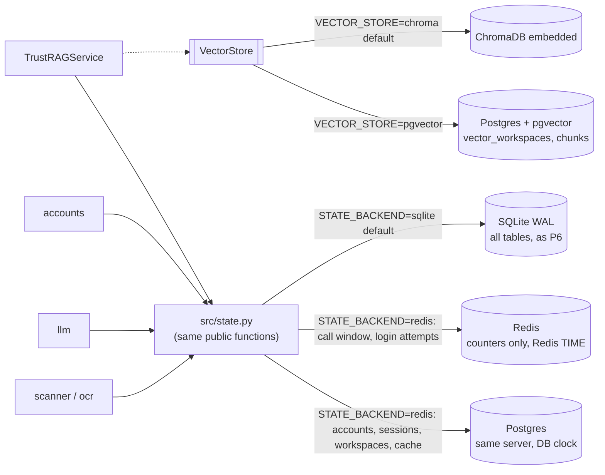

# P7 plan: server-based storage (pgvector, Redis) for multi-host

Status: **DRAFT, awaiting human approval** (CLAUDE.md section 5, step 1). Revised 2026-11-05 to fold in the
security-reviewer's review of the plan (section 8, findings 1–14). Nothing in this plan is built until the human
approves it at T0, including the decision on SPEC-GAP-062 (where durable account state lives in server mode).

Sources read for this plan: `CLAUDE.md`; `docs/SPEC.md` (B1–B9, P7, P8); `docs/SPEC-GAPS.md` (001–061, especially
009 and 043, 044, 048, 050, 059, 060); `docs/adr/README.md`; ADRs 0003, 0005, 0011, 0012 in full; `ARCHITECTURE.md`;
`THREAT_MODEL.md` (rows 1–42 and "Not defended against"); `docs/phases/p6-plan.md` (sections 1, 3, 5–8, format) and
`docs/phases/p5-plan.md` (headings, format); `src/interfaces.py`, `src/state.py`, `src/vectorstore.py`,
`src/settings.py`, `src/config.py`, `src/service.py` (lines 55–135), `src/llm.py` (`call_claude`),
`src/accounts.py` (`start_session`, `PasswordLogin.login`), `src/retrieval.py` (head),
`src/injection_scanner.py` (grep `LLMError`), `api/main.py` (error handlers, `/health`); `tests/conftest.py`,
`tests/fakes.py` (outline), `tests/test_architecture.py` (process rate-limit test), `tests/test_security.py`
(`test_workspaces_are_isolated`, `test_docker_and_ci_use_pins`, test list), `tests/test_eval_baseline.py` (test
list); `eval/run_eval.py` (`STORE`, `build_index`, `eval_retrieval`, `main`), `eval/qasper.py` (store usage),
`eval/results/RESULTS.md`; `docker-compose.yml`, `Dockerfile`, `.dockerignore`, `.gitignore`,
`.github/workflows/tests.yml`, `pyproject.toml`, `Makefile`, `.env.example`, `requirements.lock` (head, grep). `.env`
was not read.

Facts checked while planning (read-only commands):
- `.venv/bin/python --version` → Python 3.11.17. `pip list`: `chromadb 1.5.9`, `numpy 2.4.6`, `onnxruntime 1.31.0`.
- Not importable in `.venv` (`ModuleNotFoundError`): `psycopg`, `psycopg2`, `psycopg_pool`, `pgvector`, `redis`,
  `fakeredis`, `asyncpg`, `sqlalchemy`, `testcontainers`. None appears in `requirements*.lock`.
- ChromaDB `DefaultEmbeddingFunction()(['hello world'])` → 384 floats, L2 norm 1.0 (model already cached).
- Callers of `src/state.py` (grep): `src/llm.py` (`try_acquire_call`, refused when the return is truthy: `if wait:`),
  `src/ocr.py` and `src/injection_scanner.py` (caches), `src/accounts.py` (accounts, sessions, login reservation),
  `src/service.py` (ownership). All are module-level function calls.
- `src/injection_scanner.py:234` catches `LLMError` only. `src/accounts.py::PasswordLogin.login` calls
  `refund_login_attempt` **after** `start_session`.
- `eval/run_eval.py` builds its indexes with `vectorstore.new_workspace_id()` / `vectorstore.add_chunks(...)` (module
  functions, ChromaDB only) and retrieves through `STORE = vectorstore.ChromaStore()`. `eval/qasper.py` already takes
  a `VectorStore` argument.
- `api/main.py` maps every `ValueError` to `404 {"detail":"Workspace not found."}` and `LLMError` to 503.
- `docker-compose.yml`: `api` and `ui` both use `env_file: .env`, default network. `.gitignore` and `.dockerignore`
  list `.env` only (not `.env.server`).
- `tests/test_security.py::test_docker_and_ci_use_pins` checks the Dockerfile digests and workflow `uses:` SHAs only,
  not compose `image:` lines or workflow `services:` images.
- `tests/test_eval_baseline.py::test_makefile_eval_free_and_eval_lines_are_unchanged` pins the existing Makefile
  lines (new targets are allowed).
- Not verified (no server available, nothing installed): every Postgres, pgvector and Redis behaviour this plan
  relies on (operators, locking, timeouts, Lua `TIME`, Lua number replies, config directives), psycopg 3 and redis-py
  defaults, package versions and typing, image tags and digests, Compose file-based secrets and `internal` networks.
  Each is either a SPEC-GAP or exercised by a named test.

---

## 1. Scope

In scope:
- **pgvector `VectorStore`** selected by settings (SPEC P7 scope bullet 1): `PgVectorStore` behind the unchanged
  `VectorStore` protocol, same embeddings, exact cosine search (ADR 0013; SPEC-GAP-063, -066, -067, -076).
- **Redis state backend** selected by settings (SPEC P7 scope bullet 1): call limit and login rate limit in Redis
  behind the unchanged `src/state.py` functions, Redis clock, fail closed (ADR 0014; SPEC-GAP-068–070, -080, -083).
- **Durable state and caches in server mode** (consequence of the P7 goal and SPEC-GAP-043; human decision
  SPEC-GAP-062): accounts, sessions, ownership, tombstones and the OCR/scan caches in Postgres, every P6 atomicity
  guarantee kept (ADR 0015, ADR 0014; SPEC-GAP-084).
- **Defaults unchanged** (SPEC P7 scope bullet 2; SPEC-GAP-009): ChromaDB + SQLite remain the default; with default
  settings, behaviour, files and the default `docker compose up` are unchanged (B1–B9, P6-AC3 golden file).
- **Compose profile** adding Postgres and Redis (SPEC P7 scope bullet 2; SPEC-GAP-078) plus two server API containers
  for the integration test.
- **P7-AC1**: the same service and security suites pass against both backends (SPEC-GAP-079).
- **P7-AC2**: rate limit shared across two API containers, integration test (SPEC-GAP-072).
- **P7-AC3**: retrieval eval on pgvector within 1 point of the ChromaDB baseline, or explained (SPEC-GAP-073).
- **P7-AC4**: ADRs 0013, 0014, 0015 amend ADRs 0003, 0005 (and 0012) (written with this plan, `Proposed`).
- Docs: THREAT_MODEL rows for the new attack surface (section 4), README (server mode, backups, no migration, NTP not
  required for limits but recommended), CHANGELOG, `.env.example`, `.env.server.example`, ARCHITECTURE.md design
  sections (after approval).

Out of scope:
- Making pgvector / Redis the default (SPEC-GAP-009).
- Data migration tools between backends (SPEC-GAP-074).
- ANN vector indexes (HNSW / IVFFlat) (SPEC-GAP-066).
- Redis Cluster / Sentinel, Redis ACL users, Postgres replication, pool packages, ORMs (SPEC-GAP-064, -080, -088).
- TLS between containers, cloud deployment, platform secret stores, reverse proxy / trusted-proxy list, SSO (P8).
- A server-mode UI service in compose (SPEC-GAP-078); a readiness endpoint or any change to `/health` (SPEC-GAP-081).
- Changing local-mode cache retention (SPEC-GAP-084), new embedding models, prompt changes, retrieval changes (no
  `PROMPT_VERSIONS` bump).
- Changing any P6 control's numbers (rate limits, session lifetimes, caps) or SPEC-GAP-059 (shared UI bucket).
- `make eval` (paid); the pgvector eval is free (retrieval only).

---

## 2. Design

### 2.1 Overview



Two coherent profiles only in P7 (SPEC-GAP-063):

| Profile | `VECTOR_STORE` | `STATE_BACKEND` | Needs | Hosts |
|---|---|---|---|---|
| **local** (default) | `chroma` | `sqlite` | nothing | one |
| **server** | `pgvector` | `redis` | `DATABASE_URL`, `REDIS_URL` | many |

Any other combination, or a server setting without its URL, fails at startup (`Settings` validation) with a clear
message that names the setting but never echoes a URL.

### 2.2 Where each piece of state lives (ADR 0014, ADR 0015)

| Data (P6 name) | local | server | Clock in server mode | Why |
|---|---|---|---|---|
| Model-call window (`calls`) | SQLite | Redis ZSET, Lua | Redis `TIME` | shared counter; P7-AC2 |
| Login attempts (`login_attempts`) | SQLite | Redis ZSET per key, Lua | Redis `TIME` | atomic multi-key reservation |
| OCR / scan caches (`cache`) | SQLite, no expiry | **Postgres `cache`, 24 h TTL** | DB clock | keeps Redis bounded; limits page-text retention (review 3, 4b) |
| Accounts | SQLite | **Postgres** | DB clock | durable; never in Redis (SPEC-GAP-043) |
| Sessions | SQLite | **Postgres** | DB clock | same transaction as the account re-check |
| Workspace ownership + tombstones | SQLite | **Postgres** | DB clock | durable; tombstones forever |
| Chunks + embeddings | ChromaDB | **Postgres + pgvector** | DB clock (24 h cutoff) | shared across hosts |

Clock rule (SPEC-GAP-070, review finding 2): in server mode the `now` arguments of `src/state.py` functions are
ignored; Redis scripts use `TIME`, Postgres statements use the database clock. `config.STATE_CLOCK` (`"store"` by
default; a module constant, **not** a `Settings` field) is set to `"caller"` only by tests that freeze time.

### 2.3 Data model changes

- **TypedDicts (`src/models.py`, ADR 0004): none.** Return shapes of `src/state.py` are unchanged.
- **New exception** `StorageUnavailable(Exception)` in `src/state.py` (not a `ValueError`; SPEC-GAP-069).
- **Postgres** (schema `trustrag`, owned by role `trustrag_app`; `vector` extension in `public`; `search_path =
  trustrag, public`; tables created by the app under `pg_advisory_lock`; SPEC-GAP-077, -086):

```sql
-- durable state (ADR 0015): same columns as src/state.py _P6_SCHEMA
accounts   (account_id TEXT PRIMARY KEY, username TEXT NOT NULL UNIQUE, password_hash TEXT NOT NULL,
            created DOUBLE PRECISION NOT NULL, disabled INTEGER NOT NULL DEFAULT 0,
            password_changed DOUBLE PRECISION NOT NULL)
sessions   (token_hash TEXT PRIMARY KEY, account_id TEXT NOT NULL, created DOUBLE PRECISION NOT NULL,
            last_seen DOUBLE PRECISION NOT NULL, expires DOUBLE PRECISION NOT NULL,
            seq BIGINT GENERATED ALWAYS AS IDENTITY)          -- replaces SQLite rowid in the cap tie-break
            + INDEX sessions_account (account_id)
workspaces (workspace TEXT PRIMARY KEY, account_id TEXT NOT NULL, created DOUBLE PRECISION NOT NULL,
            deleted INTEGER NOT NULL DEFAULT 0) + INDEX workspaces_account (account_id)
-- caches (ADR 0014), entries older than SERVER_CACHE_TTL_HOURS are ignored and deleted on write
cache      (namespace TEXT NOT NULL, key TEXT NOT NULL, value TEXT NOT NULL, created DOUBLE PRECISION NOT NULL,
            PRIMARY KEY (namespace, key))
-- vectors (ADR 0013)
vector_workspaces (workspace TEXT PRIMARY KEY, created DOUBLE PRECISION NOT NULL)
chunks (workspace TEXT NOT NULL, id TEXT NOT NULL, text TEXT NOT NULL, file_name TEXT NOT NULL,
        page INTEGER NOT NULL, embedding vector(384) NOT NULL, PRIMARY KEY (workspace, id))
        + INDEX chunks_file (workspace, file_name)
```

- **Redis keys** (prefix `config.REDIS_PREFIX`, default `trustrag:{t}:`): `calls` (ZSET), `login:<key>` (ZSET per
  rate-limit key, already `sha256(...)` or `global`). Nothing else. Script replies are `{status, retry_after_string}`,
  never bare numbers (review finding 8).
- **Test isolation:** `config.PG_SCHEMA` (default `trustrag`) and `config.REDIS_PREFIX` are monkeypatched per test to
  `test_<32 hex>` / `trustrag-test:<32 hex>:`; teardown guards in SPEC-GAP-089.

### 2.4 Settings, config and module changes

`src/settings.py` (new fields, validated; SPEC-GAP-063):

| Setting | Type / default | Rule |
|---|---|---|
| `vector_store` | `Literal["chroma","pgvector"]` = `"chroma"` | |
| `state_backend` | `Literal["sqlite","redis"]` = `"sqlite"` | |
| `database_url` | `str` = `""` | required when `pgvector` or `redis`; scheme `postgresql://` or `postgres://`; never echoed in errors |
| `redis_url` | `str` = `""` | required when `redis`; scheme `redis://` or `rediss://`; never echoed |
| model validator | | only `chroma`+`sqlite` or `pgvector`+`redis` |

`src/config.py` constants (not settings): `VECTOR_STORE`, `STATE_BACKEND`, `DATABASE_URL`, `REDIS_URL` (from
settings, read at call time), `PG_SCHEMA = "trustrag"`, `REDIS_PREFIX = "trustrag:{t}:"`, `EMBEDDING_DIM = 384`,
`STATE_CLOCK = "store"`, `SERVER_CACHE_TTL_HOURS = 24`, `PG_LOCK_TIMEOUT_MS = 5000`, `PG_STATEMENT_TIMEOUT_MS = 15000`,
`PG_IDLE_IN_TRANSACTION_TIMEOUT_MS = 30000`, `PG_MAX_CONNECTIONS_PER_PROCESS = 10`, `PG_POOL_WAIT_SECONDS = 5`,
`REDIS_TIMEOUT_SECONDS = 5` (SPEC-GAP-085).

| File | Change | Owner |
|---|---|---|
| `src/state.py` | Public functions unchanged in name, signature and return; each dispatches on `config.STATE_BACKEND`: SQLite code as today; `redis` → `state_redis` (call window, login attempts) / `state_postgres` (accounts, sessions, workspaces, caches). `prune_expired` in server mode prunes sessions in Postgres only. Adds `StorageUnavailable`. No SQLite file opened in server mode | backend |
| `src/state_redis.py` (new) | Lazy `redis` import; one client per process with connect/socket timeouts; Lua scripts using `TIME` (or `ARGV` time when `STATE_CLOCK == "caller"`); string replies, `max(1.0, …)` on every refusal; `MULTI` refund; every error → `StorageUnavailable` | backend |
| `src/state_postgres.py` (new) | Lazy `psycopg` import; stdlib bounded pool; `autocommit=True` + explicit transaction blocks; rollback and discard on error; per-connection timeouts; `search_path` via `psycopg.sql.Identifier`; schema init under advisory lock; the guarantees of ADR 0015 with the DB clock; cache table with TTL; error mapping (unique violation → `DuplicateAccount`, else `StorageUnavailable`) | backend |
| `src/pgvector_store.py` (new) | `PgVectorStore` (ADR 0013): embeddings via ChromaDB `DefaultEmbeddingFunction`; `add_chunks` upserts `vector_workspaces` and chunks in one transaction; `cleanup` also removes orphan chunks; shared id validators from `src/vectorstore.py`; same connection rules as `state_postgres` (shared helper) | backend |
| `src/storage.py` (new, small) | `make_vector_store() -> VectorStore` reading `config.VECTOR_STORE`; used by `TrustRAGService(store=None)` and `eval/run_eval.py` | backend |
| `src/service.py` | `store=None` → `storage.make_vector_store()` (still lazy). No other change | backend |
| `src/accounts.py` | **Changes** (review findings 9, 12; SPEC-GAP-082): on the login path any `StorageUnavailable` → `LoginRateLimited` (same 429); the post-session refund wrapped: error logged as `auth.refund_failed` (no username) and swallowed; admin CLI `main` catches `StorageUnavailable` → fixed message, exit 1, `from None` | backend |
| `src/llm.py` | No code change expected: `try_acquire_call` raises `StorageUnavailable` itself, which propagates (not caught as `LLMError`) | backend (verify) |
| `api/main.py` | Exception handler `StorageUnavailable` → `503 {"detail":"Storage is temporarily unavailable. Please try again."}`. No route or schema change | backend |
| `app.py` | In-process server mode: show the same fixed message on `StorageUnavailable` (no traceback, no driver text) | backend |
| `src/vectorstore.py` | None functionally; at most expose the id validator for reuse | backend |
| `eval/run_eval.py` | `STORE` from `storage.make_vector_store()`; `build_index` through `STORE`; flag `--vector-store {chroma,pgvector}` writing `results-pgvector.json` / `RESULTS-pgvector.md` and **not** touching `results.json`, `RESULTS.md`, `history.jsonl`, `TRENDS.md`; clears every workspace it created on pgvector | llm-eval-engineer |
| `Makefile` | New target `eval-free-pgvector` (existing lines unchanged) | llm-eval-engineer |
| `pyproject.toml`, `requirements*.lock` | `psycopg[binary]` and `redis`, exact pins; lock hashes per SPEC-GAP-090; mypy overrides only if untyped. **Proposal only; regeneration is a human gate** | devops |
| `docker-compose.yml` | Profile `server` (SPEC-GAP-078): `postgres`, `redis`, `api-server-1` (`127.0.0.1:8001`), `api-server-2` (`127.0.0.1:8002`). Server settings explicit in both API services, secrets from `.env.server`; `postgres`/`redis` only on network `backend` (`internal: true`), no `ports`; Redis password via mounted config file, healthcheck with `REDISCLI_AUTH`; `maxmemory` + `noeviction` + AOF; Postgres `POSTGRES_PASSWORD_FILE` via file secret, no `trust` auth; default `api`/`ui` unchanged | devops |
| `docker/postgres-init.sh` (new) | Create extension `vector` in `public`, role `trustrag_app` (`NOSUPERUSER NOCREATEDB NOCREATEROLE`, password from a secret file), schema `trustrag` owned by it | devops |
| `docker/redis.conf` (new, template without the secret) | `appendonly yes`, `appendfsync everysec`, `maxmemory 64mb`, `maxmemory-policy noeviction`; `requirepass` supplied from the secret mount (SPEC-GAP-087) | devops |
| `.gitignore`, `.dockerignore` | add `.env.server` and the secret files directory | devops |
| `.env.example`, `.env.server.example` (new) | Placeholders only; backend URLs only in `.env.server.example` | devops |
| `.github/workflows/tests.yml` | Postgres and Redis service containers pinned by `@sha256`, env `TRUSTRAG_TEST_DATABASE_URL` / `TRUSTRAG_TEST_REDIS_URL`; no integration (two-container) step in CI | devops |
| `pyproject.toml` `[tool.pytest.ini_options]` | register marker `integration` (tests skip themselves unless `TRUSTRAG_IT_API_URLS` is set) | devops (with qa) |
| `tests/…` | Section 3 | qa-engineer |
| `THREAT_MODEL.md`, `README.md`, `SECURITY.md`, `CHANGELOG.md` | Section 4; server-mode guide, secrets files, backups (Postgres), no migration, VACUUM note | backend drafts, security-reviewer reviews, human approves |
| `ARCHITECTURE.md` | Design sections (state table, components, deployment shapes) | architect, after approval |

### 2.5 HTTP API contract changes

| Method, path | Change |
|---|---|
| all routes except login | New possible response `503 {"detail":"Storage is temporarily unavailable. Please try again."}` in server mode when Postgres/Redis fails (SPEC-GAP-069). Never in local mode. |
| `POST /v1/auth/login` | Unchanged: any storage failure returns the existing `429` body + `Retry-After`, identical whatever the credentials (SPEC-GAP-082). |
| everything else | Unchanged: no new routes, no schema change, `/health` unchanged (SPEC-GAP-081). With default settings, the P6 golden file (SPEC-GAP-042) must still match. |

### 2.6 Atomicity guarantees and how each is kept

| P6 guarantee | local (unchanged) | server |
|---|---|---|
| Call window check-and-record | `BEGIN IMMEDIATE` | one Lua script on Redis `TIME`; string reply; refusal floored at 1 s |
| Login reservation: per-key windows, count user/client/global, refuse or insert one row per key | one `BEGIN IMMEDIATE` | one Lua script over all keys on Redis `TIME`; nothing inserted on refusal; each key pruned against its own window only |
| Refund only this attempt's rows | one transaction | `MULTI` of `ZREM <attempt id>` per key; failure after session creation logged and swallowed |
| `create_session(expected_hash)` re-check + cap | one `BEGIN IMMEDIATE` | one transaction, `SELECT … FOR UPDATE` on the account row, DB clock, `lock_timeout` |
| Rehash compare-and-set | conditional `UPDATE` | conditional `UPDATE` |
| `set_password_hash` / `set_disabled` + revoke sessions | one transaction | one transaction (row lock) |
| Workspace cap | one `BEGIN IMMEDIATE` | one transaction with `pg_advisory_xact_lock` per account |
| Tombstone, never reuse | conditional `UPDATE`, row kept | same |
| `resolve` rejects disabled / older than password change / expired | join, caller clock | same join, DB clock |
| Chunk never without its workspace row | n/a (ChromaDB collection) | `vector_workspaces` + chunks in one transaction; cleanup removes orphans |
| Schema initialisation race | `_retry_locked` | `pg_advisory_lock` around `CREATE … IF NOT EXISTS` |

### 2.7 Dependencies and images

New runtime dependencies (SPEC-GAP-064, -090): `psycopg[binary]` (psycopg 3) and `redis`. Versions **not verified**;
devops proposes exact pins and checks amd64/arm64 wheels and typing; human approves and regenerates locks, which must
carry hashes for both image architectures. No `pgvector`, `psycopg_pool`, `sqlalchemy`, `fakeredis` or
`testcontainers`. New images (SPEC-GAP-065): Postgres with pgvector and Redis (or Valkey), pinned by digest in compose
and in CI `services:`; `test_docker_and_ci_use_pins` is extended to enforce this (mandatory, review finding 7).

### 2.8 Files touched (summary)

New: `src/state_redis.py`, `src/state_postgres.py`, `src/pgvector_store.py`, `src/storage.py`,
`docker/postgres-init.sh`, `docker/redis.conf`, `.env.server.example`, `tests/server_support.py`,
`tests/test_vectorstore_contract.py`, `tests/test_server_state.py`, `tests/test_storage_settings.py`,
`tests/integration/test_multi_host.py`, `eval/results/results-pgvector.json` and `RESULTS-pgvector.md` (generated).
Changed: `src/state.py`, `src/settings.py`, `src/config.py`, `src/service.py`, `src/accounts.py`, `api/main.py`,
`app.py`, `eval/run_eval.py`, `Makefile`, `pyproject.toml`, `requirements.lock`, `requirements-dev.lock`,
`docker-compose.yml`, `.gitignore`, `.dockerignore`, `.github/workflows/tests.yml`, `.env.example`,
`tests/conftest.py` and the suites in section 3, `THREAT_MODEL.md`, `README.md`, `SECURITY.md`, `CHANGELOG.md`,
`ARCHITECTURE.md`, `docs/adr/*` (status changes by the human only). Not changed: `Dockerfile`, prompts.

### 2.9 Risks

| Risk | Mitigation |
|---|---|
| Server tests skipped, so regressions or coverage drops hide | CI service containers; `test_server_backends_configured_when_ci`; verifier records the count of `[server]` tests that ran (must be > 0) |
| Behaviour drift between backends (ordering ties, empty workspace, upsert, NUL text) | VectorStore contract suite on both stores; `ORDER BY distance, id`; SPEC-GAP-076 |
| P6 race guarantees weaker on Postgres/Redis | Real-concurrency tests per guarantee (section 3.2) |
| Store outage turns limits off | Fail closed by design and by test (SPEC-GAP-069, -082) |
| Clock skew between hosts | Store clocks are authoritative (SPEC-GAP-070); tests with a skewed caller clock |
| Stuck locks / connection exhaustion hang workers | Timeouts and bounded pool → 503 (SPEC-GAP-085) |
| Test teardown hits real data | Name guards and URL inequality check (SPEC-GAP-089) |
| Mixed fleet | Server API services set backends explicitly; startup validation (SPEC-GAP-063, -078) |
| Secrets exposure (`docker inspect`, UI container, process args) | `.env.server` for server APIs only; file secrets for server passwords; residual `docker inspect` on API containers (SPEC-GAP-075, -087) |
| Default path regresses (P6 golden, B8) | Golden file and `make eval-free` unchanged on defaults; baseline result files untouched by the pgvector run |
| New dependencies widen supply chain | Exact pins, hash locks for both architectures, Dependabot, lazy imports |
| SPEC-GAP-062 rejected | Fallback (b): server mode refuses `ACCOUNTS_ENABLED=true`; account suites run `local` only; section 3.2 account rows become "refused at startup" tests |

---

## 3. Acceptance criteria → tests

Test mechanics (qa-engineer, `tests/conftest.py` + new `tests/server_support.py`):
- Fixture `storage_backend`, parametrised `["local", "server"]`. `local` = today's isolation. `server` = skipped
  with reason "server backends not configured" unless `TRUSTRAG_TEST_DATABASE_URL` and `TRUSTRAG_TEST_REDIS_URL` are
  set; otherwise sets the backend config, a fresh schema `test_<32 hex>` (created; dropped only after the guards of
  SPEC-GAP-089) and a fresh prefix `trustrag-test:<32 hex>:`. Frozen-clock tests also set `config.STATE_CLOCK =
  "caller"`; every other server test uses `"store"`.
- Suites in SPEC-GAP-079 add `pytestmark = pytest.mark.usefixtures("storage_backend")`. Tests that read the SQLite
  file are marked `local_only` and get a server twin below.
- Fixture `real_store` parametrised `ChromaStore` / `PgVectorStore`.
- Multi-process tests pass the backend config to children explicitly.

### 3.1 P7-AC1: the same service and security suites pass on both backends

| Criterion | Test file | Test name (to be written or parametrised) |
|---|---|---|
| P7-AC1 | `tests/test_security.py` | every existing test, parametrised by `storage_backend` |
| P7-AC1 | `tests/test_ownership.py` | every existing test, parametrised |
| P7-AC1 | `tests/test_accounts.py` | every existing test, parametrised (SQLite-file tests `local_only`) |
| P7-AC1 | `tests/test_anonymous_mode.py` | every existing test, parametrised (golden file must match on both) |
| P7-AC1 | `tests/test_pipeline.py` | every existing test, parametrised |
| P7-AC1 | `tests/test_architecture.py` | `test_rate_limit_is_shared_across_threads_and_exact`, `test_rate_limit_is_shared_across_processes` and the service/API tests, parametrised |
| P7-AC1 | `tests/test_security.py` | `test_workspaces_are_isolated` rewritten over `real_store` |
| P7-AC1 (contract) | `tests/test_vectorstore_contract.py` | `test_add_and_retrieve_orders_by_cosine_distance`, `test_retrieve_empty_workspace_returns_empty`, `test_retrieve_returns_at_most_count_and_rounds_distance`, `test_upsert_replaces_same_chunk_id`, `test_delete_file_only_touches_that_file_in_that_workspace`, `test_list_files_sorted_unique_and_count`, `test_all_chunks_returns_every_chunk`, `test_clear_is_idempotent_and_workspace_scoped`, `test_invalid_workspace_ids_raise_value_error_before_any_query`, `test_cleanup_deletes_old_anonymous_keeps_listed_and_never_ages_out_account`, `test_cleanup_purges_only_tombstoned_account_workspaces`, `test_cleanup_removes_chunks_without_workspace_row` (pgvector), `test_new_workspace_id_formats`, `test_semantic_ranking_matches_between_chroma_and_pgvector`, `test_text_with_nul_is_refused_not_altered` (pgvector) |
| P7-AC1 (server twins) | `tests/test_server_state.py` | `test_server_state_never_contains_plain_password_or_token`, `test_server_session_token_stored_only_as_sha256`, `test_server_mode_creates_no_sqlite_file`, `test_rate_limit_keys_in_redis_are_hashed_pseudonyms` |
| P7-AC1 (selection) | `tests/test_storage_settings.py` | `test_defaults_are_chroma_and_sqlite`, `test_mixed_backend_combinations_are_refused`, `test_server_settings_require_urls`, `test_settings_errors_never_echo_urls`, `test_service_default_store_follows_vector_store_setting`, `test_local_mode_never_imports_psycopg_or_redis`, `test_state_clock_override_is_not_an_environment_setting` |
| P7-AC1 (failure, fail closed) | `tests/test_server_state.py` | `test_redis_down_login_gives_same_429_and_runs_no_kdf`, `test_postgres_down_login_response_is_same_for_unknown_wrong_and_right`, `test_refund_failure_after_session_does_not_503`, `test_redis_down_model_call_is_refused`, `test_call_limit_store_error_aborts_upload_not_rules_only`, `test_storage_errors_give_fixed_503_without_driver_text`, `test_cache_error_is_not_treated_as_a_miss`, `test_admin_cli_storage_error_prints_fixed_message`, `test_ui_storage_unavailable_shows_fixed_message` |
| P7-AC1 (script replies) | `tests/test_server_state.py` | `test_refused_call_never_returns_zero_wait`, `test_login_refusal_with_subsecond_retry_is_still_refused` |
| P7-AC1 (clock) | `tests/test_server_state.py` | `test_skewed_host_cannot_prune_other_hosts_attempts` (caller clock patched hours ahead, `STATE_CLOCK="store"`: another host's rows still count), `test_skewed_host_cannot_extend_or_expire_sessions`, `test_skewed_host_cannot_age_out_anonymous_workspaces` |
| P7-AC1 (caches) | `tests/test_server_state.py` | `test_cache_entries_have_ttl`, `test_ocr_cache_entries_expire`, `test_redis_holds_only_counter_keys` |
| P7-AC1 (connections) | `tests/test_server_state.py` | `test_stuck_account_lock_times_out_with_503_not_hang`, `test_connection_recovers_after_failed_transaction`, `test_pool_exhaustion_gives_503_not_hang` |
| P7-AC1 (DB role) | `tests/test_server_state.py` | `test_app_db_role_is_not_superuser` (runs against the compose database when `TRUSTRAG_TEST_APP_ROLE_URL` is set; CI uses the service container's role setup), `test_state_modules_build_no_sql_from_values` (static scan: no f-string / `%` / `.format` SQL in `src/state_postgres.py`, `src/pgvector_store.py`) |
| P7-AC1 (test safety) | `tests/test_server_state.py` | `test_teardown_refuses_unexpected_schema_or_prefix`, `test_server_backends_configured_when_ci` |

### 3.2 P6 atomicity guarantees on the server backend (part of P7-AC1)

| Guarantee | Test file | Test name |
|---|---|---|
| Login reservation atomic across connections | `tests/test_accounts.py` | `test_concurrent_wrong_logins_run_kdf_at_most_limit_times`, `test_login_rate_limit_is_shared_across_processes` (existing, parametrised) |
| Per-key windows | `tests/test_server_state.py` | `test_global_window_prune_does_not_drop_user_or_client_rows` |
| Refusal inserts nothing | `tests/test_server_state.py` | `test_refused_reservation_inserts_no_rows_for_any_key` |
| Refund removes only this attempt | `tests/test_server_state.py` | `test_refund_removes_only_this_attempts_rows` |
| Bad-shape attempts without client key | `tests/test_accounts.py` | `test_bad_shape_login_without_client_key_does_not_reset_user_limit` (existing, parametrised) |
| `create_session(expected_hash)` vs concurrent reset / disable | `tests/test_accounts.py` | `test_login_racing_password_reset_gets_no_surviving_session` (existing, parametrised); `tests/test_server_state.py::test_create_session_and_set_password_serialise_under_real_concurrency` |
| Session cap under concurrency | `tests/test_server_state.py` | `test_concurrent_logins_never_exceed_session_cap` |
| Rehash compare-and-set | `tests/test_accounts.py` | `test_rehash_does_not_undo_concurrent_password_reset`, `test_rehash_keeps_other_sessions` (existing, parametrised) |
| Workspace cap under concurrency | `tests/test_server_state.py` | `test_concurrent_workspace_creation_respects_cap` |
| Tombstones, id never reused | `tests/test_ownership.py` | `test_deleted_owned_workspace_id_is_404_for_anonymous_and_owner`, `test_upload_racing_owner_delete_never_leaves_reachable_data` (existing, parametrised) |
| Retention keep/purge | `tests/test_ownership.py` | `test_account_workspaces_survive_cleanup_past_24h`, `test_service_passes_owned_and_tombstoned_ids_to_cleanup`, `test_v1_cleanup_does_not_touch_owned_collections` (existing; the last stays ChromaStore-specific) |
| Chunks never orphaned | `tests/test_vectorstore_contract.py` | `test_add_chunks_racing_clear_leaves_no_reachable_or_kept_chunks`, `test_cleanup_removes_chunks_without_workspace_row` |
| Schema init race | `tests/test_server_state.py` | `test_concurrent_schema_initialisation_succeeds` (4 processes) |

### 3.3 P7-AC2: rate limit shared across two API containers

| Criterion | Test file | Test name |
|---|---|---|
| P7-AC2 (HTTP, two containers) | `tests/integration/test_multi_host.py` (marker `integration`; skipped unless `TRUSTRAG_IT_API_URLS` names two base URLs) | `test_login_rate_limit_is_shared_across_two_api_containers` (unknown username, alternating containers: failures 1–5 → 401, 6th on either → identical 429 + `Retry-After`; no Claude call) |
| P7-AC2 (HTTP) | same | `test_session_from_one_container_works_on_the_other` (account created via `docker compose exec`; skipped with reason if `TRUSTRAG_IT_USERNAME/PASSWORD` unset) |
| P7-AC2 (HTTP, review finding 11) | same | `test_account_workspace_created_on_one_container_is_usable_on_the_other` (create an `acct-` workspace on container 1 → `GET …/documents` 200 on container 2 with the same session; a random `acct-` id → 404 on container 2) |
| P7-AC2 (call limit, shared Redis; runs in CI) | `tests/test_architecture.py` | `test_rate_limit_is_shared_across_processes[server]` (4 processes, one Redis, exactly the limit) |
| P7-AC2 (login limit, shared Redis; runs in CI) | `tests/test_accounts.py` | `test_login_rate_limit_is_shared_across_processes[server]` |

Run by the verifier (integration tests do not run in CI): `docker compose --profile server up -d --build`, then
`TRUSTRAG_IT_API_URLS=http://127.0.0.1:8001,http://127.0.0.1:8002 python -m pytest -q -m integration tests/integration`.

### 3.4 P7-AC3: retrieval eval on pgvector

| Criterion | Test / command | Test name |
|---|---|---|
| P7-AC3 (measured) | `make eval-free-pgvector` (compose `postgres` running) → `eval/results/RESULTS-pgvector.md` | verifier compares with `RESULTS.md` (SPEC-GAP-073: ≤ 1 percentage point recall@4, ≤ 0.01 MRR) or llm-eval-engineer writes the explanation |
| P7-AC3 (wiring) | `tests/test_eval_baseline.py` | `test_pgvector_run_writes_separate_files_and_leaves_baseline_untouched`, `test_chroma_results_unchanged_after_store_refactor` |
| P7-AC3 (guard) | `tests/test_eval_baseline.py` | `test_baseline_b8_figures_are_still_in_results_json`, `test_makefile_eval_free_and_eval_lines_are_unchanged` (existing) |

### 3.5 P7-AC4: ADRs

| Criterion | Test file | Test name |
|---|---|---|
| P7-AC4 | `tests/test_architecture.py` | `test_p7_adrs_amend_0003_and_0005_and_are_indexed` |

### 3.6 Threat-model and deployment regression

| Criterion | Test file | Test name |
|---|---|---|
| DoD (threat rows have tests) | `tests/test_security.py` | `test_threat_model_lists_p7_rows_with_existing_tests` |
| Rows 46, 47, 53, 61 (compose hardening) | `tests/test_security.py` | `test_compose_server_profile_hardening`: `postgres`/`redis`/`api-server-*` only in profile `server`; `postgres`/`redis` have no `ports`, are only on network `backend` with `internal: true`; `ui` has none of `DATABASE_URL`, `REDIS_URL`, `POSTGRES_PASSWORD`, `REDIS_PASSWORD` (directly or via its env files) and is not on `backend`; both server API services set `VECTOR_STORE=pgvector` and `STATE_BACKEND=redis` explicitly; no `POSTGRES_HOST_AUTH_METHOD=trust`; no `--requirepass` / `-a` in any command or healthcheck; default `api`/`ui` unchanged |
| Row 55 | `tests/test_security.py` | `test_compose_redis_sets_maxmemory` (`maxmemory` set, `noeviction`, `appendonly yes`) |
| Row 16 changed (review finding 7, mandatory) | `tests/test_security.py` | `test_docker_and_ci_use_pins` extended: every compose `image:` other than the locally built `trustrag:latest`, and every workflow `services:` image, ends in `@sha256:<64 hex>` |
| Secrets ignored | `tests/test_security.py` | `test_server_env_file_is_git_and_docker_ignored` |

---

## 4. Threat model delta (draft; `THREAT_MODEL.md` edits are a human gate)

Proposed new rows 43–63:

| # | Attack | Control | Test |
|---|---|---|---|
| 43 | **Rate-limit bypass by spreading attempts over API hosts** | Login and call limits in one shared Redis | `test_login_rate_limit_is_shared_across_two_api_containers` (verifier), in CI: `test_rate_limit_is_shared_across_processes[server]`, `test_login_rate_limit_is_shared_across_processes[server]` |
| 44 | **Cross-host rate-limit race** | One Lua script per reservation; refusal inserts nothing | `test_concurrent_wrong_logins_run_kdf_at_most_limit_times[server]`, `test_refused_reservation_inserts_no_rows_for_any_key` |
| 45 | **Store outage switches limits off** | Fail closed: same 429 for login, `StorageUnavailable` 503 elsewhere | `test_redis_down_login_gives_same_429_and_runs_no_kdf`, `test_redis_down_model_call_is_refused`, `test_storage_errors_give_fixed_503_without_driver_text` |
| 46 | **Restart resets counters** | AOF `everysec`, volume | `test_compose_redis_sets_maxmemory` |
| 47 | **Network access to Postgres/Redis** | Not published; password required; `internal` backend network joined only by the server API containers | `test_compose_server_profile_hardening` |
| 48 | **Cross-workspace leakage or SQL injection in the shared `chunks` table** | Id validated before SQL; bound parameters; workspace predicate on every statement; no SQL built from values | `test_workspaces_are_isolated[pgvector]`, `test_invalid_workspace_ids_raise_value_error_before_any_query`, `test_delete_file_only_touches_that_file_in_that_workspace`, `test_state_modules_build_no_sql_from_values` |
| 49 | **Driver errors leak host, user or URL** | Fixed messages; settings errors never echo URLs; CLI `from None` | `test_storage_errors_give_fixed_503_without_driver_text`, `test_settings_errors_never_echo_urls`, `test_admin_cli_storage_error_prints_fixed_message` |
| 50 | **Durable secrets in a database server** (no 0600 file in server mode) | DB credentials, non-superuser role, no published port; token hashes only; salted scrypt | `test_server_state_never_contains_plain_password_or_token`, `test_server_session_token_stored_only_as_sha256`, `test_app_db_role_is_not_superuser` |
| 51 | **Cross-host session or ownership inconsistency** | Durable state in one Postgres (ADR 0015) | `test_session_from_one_container_works_on_the_other`, `test_account_workspace_created_on_one_container_is_usable_on_the_other` (verifier); in CI: the parametrised `tests/test_accounts.py` / `tests/test_ownership.py` suites on `[server]` |
| 52 | **Backend switch or mixed fleet exposes or deletes data** | No migration; old data untouched; mixed combinations refused; server API services set backends explicitly | `test_server_mode_creates_no_sqlite_file`, `test_mixed_backend_combinations_are_refused`, `test_compose_server_profile_hardening` |
| 53 | **UI container holds backend secrets / reaches the stores** (review 1) | Backend URLs only in `.env.server` for server API services; UI not on the `backend` network | `test_compose_server_profile_hardening`, `test_server_env_file_is_git_and_docker_ignored` |
| 54 | **Clock skew: a fast host prunes cluster-wide counters, or shifts session / workspace expiry** (review 2) | Redis `TIME` in scripts; DB clock in Postgres; caller time ignored in server mode | `test_skewed_host_cannot_prune_other_hosts_attempts`, `test_skewed_host_cannot_extend_or_expire_sessions`, `test_skewed_host_cannot_age_out_anonymous_workspaces` |
| 55 | **Redis memory exhaustion blocks sign-in** (review 3) | Redis holds only bounded, expiring counters; explicit `maxmemory`; caches in Postgres with TTL | `test_redis_holds_only_counter_keys`, `test_compose_redis_sets_maxmemory`, `test_cache_entries_have_ttl` |
| 56 | **Document text outlives deletion** (orphan chunks; OCR cache) (review 4) | Workspace row and chunks in one transaction; orphan cleanup; 24 h cache TTL in server mode | `test_cleanup_removes_chunks_without_workspace_row`, `test_add_chunks_racing_clear_leaves_no_reachable_or_kept_chunks`, `test_ocr_cache_entries_expire` |
| 57 | **Stuck locks or connection exhaustion hang workers** (review 5) | `lock_timeout`, `statement_timeout`, `idle_in_transaction_session_timeout`, bounded pool, rollback + discard | `test_stuck_account_lock_times_out_with_503_not_hang`, `test_connection_recovers_after_failed_transaction`, `test_pool_exhaustion_gives_503_not_hang` |
| 58 | **Over-privileged DB role / trust auth** (review 6) | `trustrag_app` NOSUPERUSER NOCREATEDB NOCREATEROLE owning only `trustrag`; no `trust` auth | `test_app_db_role_is_not_superuser`, `test_compose_server_profile_hardening` |
| 59 | **Fractional wait truncated to 0 reads as allowed** (review 8) | String replies; refusal floored at 1 s | `test_refused_call_never_returns_zero_wait`, `test_login_refusal_with_subsecond_retry_is_still_refused` |
| 60 | **Login-path storage error as an oracle, or 503 with a live session** (review 9) | Every login-path storage error → same 429; post-session refund error swallowed | `test_postgres_down_login_response_is_same_for_unknown_wrong_and_right`, `test_refund_failure_after_session_does_not_503` |
| 61 | **Server passwords on command lines** (`docker inspect`, `ps`) (review 12) | Redis password via config file, `REDISCLI_AUTH` healthcheck; `POSTGRES_PASSWORD_FILE` | `test_compose_server_profile_hardening` |
| 62 | **Store outage degrades the injection scanner to rules-only** (review 14) | Call-limit store errors raise `StorageUnavailable`, aborting the upload | `test_call_limit_store_error_aborts_upload_not_rules_only` |
| 63 | **Test run destroys real data** (review 13) | Schema/prefix name guards; test URL must differ from `DATABASE_URL` | `test_teardown_refuses_unexpected_schema_or_prefix` |

Changed controls (human gate):
- Rows 5 and 26 ("shared across processes") gain "and across hosts in server mode".
- Row 16 gains "compose and CI service images pinned by digest" (test extended, review finding 7).
- Row 27: file-permission control applies to local mode only; server mode relies on rows 50, 58.
- Row 42 reworded (review finding 10): "Global 5/s cap before KDF, **shared across hosts in server mode**; KDF semaphore
  (2 concurrent, 5 s wait) **per process**, so concurrent scrypt is bounded per API process, not per deployment".

New / widened "Not defended against" entries: anyone with the Redis password can reset limits, anyone with the
Postgres password can read documents, plant scan-cache verdicts or sessions (extends "A compromised host");
`DATABASE_URL`/`REDIS_URL` visible to `docker inspect` of the server API containers (SPEC-GAP-075); no TLS between
containers until P8; no Redis ACL user (SPEC-GAP-088); up to about one second of Redis writes lost on a crash; deleted
text stays in Postgres heap/WAL pages until `VACUUM` (review 4c); local-mode OCR cache keeps page text without expiry
(SPEC-GAP-084); the global sign-in lockout under a flood now applies to **all hosts** at once (review finding 10).

---

## 5. Tasks

| # | Task | Owner | Depends on | Parallel with |
|---|---|---|---|---|
| T0 | Approve plan; decide SPEC-GAP-062; ADRs 0013–0015; SPEC-GAPs 062–090; dependency, image and licence choices (064, 065, 087, 090) | **human** | – | – |
| T1 | Dependency proposal: exact pins for `psycopg[binary]` and `redis` (amd64/arm64 wheels, typing); image tags + digests; check Compose file-based secrets, `internal` networks and image support for `POSTGRES_PASSWORD_FILE` / Redis config-file password. **Proposal only** | devops | T0 | T2 |
| T2 | Test scaffolding (fixtures, guards, `integration` marker); failing tests of section 3; record output | qa-engineer | T0 | T1, T3 |
| T3 | Compose `server` profile, `docker/postgres-init.sh`, `docker/redis.conf`, `.env.server.example`, `.env.example`, `.gitignore`/`.dockerignore`, CI service containers (pinned) | devops | T1 + human approval of compose/CI | T2 |
| T4 | Human installs the new packages and regenerates `requirements*.lock` (hashes for both architectures) | **human** | T1 | T3 |
| T5a | `src/settings.py`, `src/config.py`, `src/storage.py`, `src/service.py`, `api/main.py` 503 handler, `app.py` message, `src/accounts.py` login-path and CLI error handling | backend | T2, T4 | T5b, T5c |
| T5b | `src/state.py` dispatch + `src/state_redis.py` + `src/state_postgres.py` (incl. shared connection helper) | backend (second instance) | T2, T4 | T5a, T5c |
| T5c | `src/pgvector_store.py` (uses the T5b connection helper; agree its signature first) | backend (third instance) | T2, T4 | T5a, T5b |
| T6 | `eval/run_eval.py` store routing and `--vector-store`, `Makefile` target; run `make eval-free` and `make eval-free-pgvector` | llm-eval-engineer | T5a, T5c, T3 | T7 |
| T7 | Drafts: THREAT_MODEL rows 43–63, changed rows 5, 16, 26, 27, 42, "Not defended against"; README, SECURITY.md, CHANGELOG | backend (security-reviewer reviews) | T5a–T5c | T6 |
| T8 | ARCHITECTURE.md design sections; ADR evidence sections with measured results | architect | T6 | T7 |
| T9 | Review the phase diff | code-reviewer **and** security-reviewer | T6, T7, T8 | each other |
| T10 | Fix confirmed findings; affected tests only (both backends) | owners | T9 | – |
| T11 | Full gate from clean state with compose `postgres`/`redis`: tests + coverage on both backends (record `[server]` count), ruff, format, mypy, invisible chars, `make eval-free`, `make eval-free-pgvector`, `docker compose build`, `docker compose --profile server up` + integration tests, Redis `INFO memory`; `docs/phases/p7-report.md` | verifier | T10 | – |
| T12 | Human gate: report, SPEC-GAPs, findings, ADR status changes, git commands | manager → **human** | T11 | – |

---

## 6. Human gates expected

1. **T0 decisions**: approve this plan; SPEC-GAP-062 (durable state in Postgres vs fallback); ADRs 0013, 0014, 0015
   (and, at the end, changing their status and noting "amended by" on 0003 / 0005 / 0012); SPEC-GAPs 062–090.
2. **New dependencies and lock regeneration** (T1, T4): `psycopg[binary]`, `redis`; installing them in `.venv`;
   regenerating `requirements.lock` and `requirements-dev.lock` with hashes for amd64 and arm64 (SPEC-GAP-090).
3. **New container images and licence** (SPEC-GAP-065): Postgres+pgvector and Redis/Valkey, pinned by digest.
4. **Deployment config**: `docker-compose.yml` (server profile, `backend` internal network, volumes, file secrets),
   `docker/postgres-init.sh`, `docker/redis.conf`, `.dockerignore`, `.gitignore`.
5. **CI workflow change**: `.github/workflows/tests.yml` service containers.
6. **Security controls**: `THREAT_MODEL.md` rows 43–63, changed rows 5, 16, 26, 27, 42, "Not defended against";
   `SECURITY.md`; the extended pin test.
7. **Secrets**: the human creates `.env.server` and the secret files (Postgres superuser and app-role passwords,
   Redis password); agents use the `*.example` files only.
8. **Data**: switching an existing deployment to server mode hides (does not delete) ChromaDB/SQLite data; deleting
   old data or compose volumes (`docker compose down -v`) is a human action; creating accounts in server mode is a
   human action.
9. **Commit** (T12).
Not expected: `make eval`, Dockerfile changes, prompt changes.

---

## 7. New SPEC-GAPs

Appended to `docs/SPEC-GAPS.md` (status open). 062–081 from the first draft (068, 069, 070, 071, 075, 078, 079 revised
after the review); 082–090 from the security review:

| ID | Question | Conservative default |
|---|---|---|
| 062 | Where durable account state lives in server mode | **Human decision at T0.** Recommended: Postgres (ADR 0015). Fallback: SQLite stays, server mode refuses `ACCOUNTS_ENABLED=true` |
| 063 | Setting names and combinations | `VECTOR_STORE`, `STATE_BACKEND`, `DATABASE_URL`, `REDIS_URL`; only local or server profile accepted |
| 064 | New dependencies and pins | `psycopg[binary]` + `redis` only; versions not verified; main dependencies, lazy imports |
| 065 | Images, versions, Redis licence | Pinned by digest; tags/digests/licence chosen by the human |
| 066 | Vector index | Exact cosine search, no ANN index |
| 067 | Embedding model and dimension | Same ChromaDB MiniLM in-process; 384 (measured) |
| 068 | Hardening, persistence, eviction | Passwords, internal network, no ports, AOF, `maxmemory` + `noeviction`, non-superuser role, no TLS in P7 |
| 069 | Store outage | Fail closed; login 429; call-limit error `StorageUnavailable`; others 503 |
| 070 | Time source | Redis `TIME` and DB clock in server mode; `STATE_CLOCK="caller"` for tests only |
| 071 | Test infrastructure | Server tests need `TRUSTRAG_TEST_*_URL`; required in CI; per-test schema/prefix with guards |
| 072 | Which rate limit AC2 means | Login limit across containers + call limit across processes |
| 073 | AC3 measure and output | ≤ 1 pp recall@4, ≤ 0.01 MRR; separate files; history untouched |
| 074 | Data migration | None |
| 075 | App credentials | `.env.server` for server API containers only; `docker inspect` residual until P8 |
| 076 | U+0000 in chunk text | Refuse the upload; never alter text |
| 077 | Schema creation | App tables under advisory lock; extension by init script; no migration tool |
| 078 | Compose profile shape | `postgres`, `redis`, `api-server-1/2` with explicit settings; no server UI; default `up` unchanged |
| 079 | Scope of AC1 suites | Listed suites parametrised + contract suite |
| 080 | Redis topology | Single node |
| 081 | Readiness | `/health` unchanged |
| 082 | Login-path storage errors | Same 429 for all; post-session refund errors logged and swallowed |
| 083 | Redis memory | Counters only; `maxmemory 64mb` (estimate, not verified) + `noeviction` |
| 084 | Cache placement and retention | Postgres `cache`, 24 h TTL in server mode; local unchanged, documented residual |
| 085 | Client timeouts and connections | autocommit + explicit transactions; lock 5 s, statement 15 s, idle-in-transaction 30 s; ≤ 10 connections/process; Redis 5 s (psycopg/redis-py defaults not verified) |
| 086 | DB role and `search_path` | `trustrag_app` non-superuser owning schema `trustrag`; `search_path = trustrag, public`; no `trust` auth; no SQL from values |
| 087 | Server password delivery | Files / secrets, never command lines; fallback per container if unsupported (not verified) |
| 088 | Redis ACL user | Not in P7 |
| 089 | Test teardown guards | Schema `^test_[0-9a-f]{32}$`, prefix `trustrag-test:`, test URL ≠ `DATABASE_URL` |
| 090 | Lock hashes for `psycopg-binary` | Hashes for amd64 + arm64 (+ dev machine); evidenced by CI multi-arch build after regeneration |

---

## 8. Security review of the plan (2026-11-05)

Findings from the security-reviewer (read-only review of the first draft), and where each is addressed:

| # | Severity | Finding (short) | Addressed in |
|---|---|---|---|
| 1 | HIGH | UI container receives backend URLs/passwords through the shared `.env` and shares a network with Postgres/Redis | `.env.server` for server API containers only, `internal: true` `backend` network without the UI (2.4, SPEC-GAP-075, -078); row 53; `test_compose_server_profile_hardening`, `test_server_env_file_is_git_and_docker_ignored` |
| 2 | HIGH | Caller-supplied time lets a fast host prune cluster-wide counters; session expiry skew-dependent | Option (a): Redis `TIME` in scripts, DB clock in Postgres, caller time ignored in server mode, test-only `STATE_CLOCK` (2.2, ADR 0014, 0015, SPEC-GAP-070); row 54; `test_skewed_host_cannot_prune_other_hosts_attempts`, `test_skewed_host_cannot_extend_or_expire_sessions`, `test_skewed_host_cannot_age_out_anonymous_workspaces`. Option (b) (skew detection) not taken, so no `test_server_mode_refuses_when_clock_skew_exceeds_limit` |
| 3 | MED | `noeviction` without `maxmemory`; never-expiring caches can fill Redis and block logins | Caches moved to Postgres with TTL; Redis holds counters only; explicit `maxmemory` (ADR 0014, SPEC-GAP-083, -084); row 55; `test_compose_redis_sets_maxmemory`, `test_cache_entries_have_ttl`, `test_redis_holds_only_counter_keys` |
| 4 | MED | (a) orphan chunks on `add_chunks`/`clear` race; (b) OCR cache text outlives deletion; (c) heap/WAL until VACUUM | (a) one transaction + orphan cleanup (ADR 0013), `test_cleanup_removes_chunks_without_workspace_row`, `test_add_chunks_racing_clear_leaves_no_reachable_or_kept_chunks`; (b) 24 h TTL in server mode, local residual (SPEC-GAP-084), `test_ocr_cache_entries_expire`; (c) residual in "Not defended against"; row 56 |
| 5 | MED | psycopg transaction handling, timeouts and connection cap unspecified | ADR 0013 "Connections and SQL", ADR 0015, SPEC-GAP-085 (defaults not verified); row 57; `test_stuck_account_lock_times_out_with_503_not_hang`, `test_connection_recovers_after_failed_transaction`, `test_pool_exhaustion_gives_503_not_hang` |
| 6 | MED | App DB role privileges, trust auth, `search_path`, SQL construction | `trustrag_app` role and schema, `Identifier`, no SQL from values (ADR 0013, SPEC-GAP-086); row 58; `test_app_db_role_is_not_superuser`, `test_state_modules_build_no_sql_from_values`, compose no-trust assertion |
| 7 | MED | Pin test does not cover compose/CI service images; CI could silently skip server tests; rows 43/51 cited only verifier-run tests | `test_docker_and_ci_use_pins` extension made mandatory (3.6); `test_server_backends_configured_when_ci`; in-CI tests cited for rows 43 and 51; lock hashes for both architectures (SPEC-GAP-090) |
| 8 | MED (unconfirmed) | Lua number replies truncated to integers; a fractional wait could become 0 = allowed | String replies, `max(1.0, …)` floor (ADR 0014); row 59; `test_refused_call_never_returns_zero_wait`, `test_login_refusal_with_subsecond_retry_is_still_refused`. Adopted although unconfirmed: the fix is cheap and the tests settle it |
| 9 | LOW | Login-path storage error handling; refund failure after `start_session` gives 503 with a live session | Same 429 for every login-path storage error; refund error logged and swallowed; `src/accounts.py` now changes (2.4, SPEC-GAP-082); row 60; `test_refund_failure_after_session_does_not_503`, `test_postgres_down_login_response_is_same_for_unknown_wrong_and_right` |
| 10 | LOW | KDF semaphore is per process | Row 42 reworded; global sign-in lockout residual widened to all hosts (section 4) |
| 11 | LOW | Anonymous-id cross-container test proves nothing | Replaced by `test_account_workspace_created_on_one_container_is_usable_on_the_other` (3.3) |
| 12 | LOW | Redis password on command line; CLI storage errors; optional ACL | Config-file password, `REDISCLI_AUTH`, `POSTGRES_PASSWORD_FILE` (SPEC-GAP-087, not verified); CLI fixed message (`test_admin_cli_storage_error_prints_fixed_message`); ACL deferred (SPEC-GAP-088); row 61 |
| 13 | LOW | Test teardown could drop real data; mixed fleet in compose | Guards (SPEC-GAP-089, `test_teardown_refuses_unexpected_schema_or_prefix`); both server API services set backends explicitly, default `api` stays local and separate (SPEC-GAP-078); row 63 |
| 14 | LOW | Call-limit store errors mapped to `LLMError` degrade the scanner to rules-only | `StorageUnavailable` instead (ADR 0014, SPEC-GAP-069); row 62; `test_call_limit_store_error_aborts_upload_not_rules_only` |

Disagreements: none on substance. Two choices differ in form from the suggested fixes and are recorded here:
finding 3 is fixed by moving caches to Postgres (one of the two options offered) rather than per-key Redis TTLs, so
Redis memory is independent of document volume; finding 13's "set server settings explicitly on both api and api-2" is
implemented with two dedicated server API services, because the default `api` service has no profile and must stay
unchanged for `docker compose up`.

---

## Summary for the manager

- Files written: this plan; `docs/adr/0013-pgvector-vector-store-opt-in.md`,
  `docs/adr/0014-redis-for-shared-counters-and-caches.md`,
  `docs/adr/0015-postgres-for-durable-account-state-in-server-mode.md` (all `Proposed`); `docs/adr/README.md` rows;
  SPEC-GAPs 062–090 in `docs/SPEC-GAPS.md`. ADRs 0003, 0005, 0012 not edited; `ARCHITECTURE.md` waits for approval.
- Blocking decision: SPEC-GAP-062. Other human gates: section 6.
