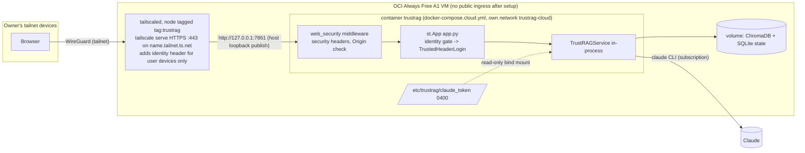
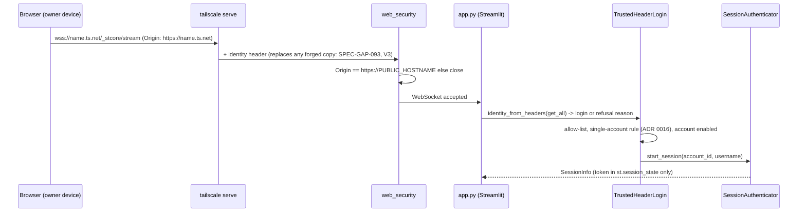

# P8 plan: cloud deployment with HTTPS and SSO

Status: **DRAFT, awaiting human approval** (CLAUDE.md section 5, step 1). Nothing in this plan is built until the
human approves it at T0, including ADRs 0016-0018 (Proposed), the amended P8-AC3 wording in `docs/SPEC.md`, and the
two deviations from the AC wording (SPEC-GAP-095 "HTTP redirects", SPEC-GAP-104 "platform secret store").
Revised 2026-11-06 after the security-reviewer's review of the plan (findings H1-H3, M1-M6, L1-L8; section 8).

Human decisions this plan is built on (2026-11-06, recorded as resolved SPEC-GAP-007, -008, -010):
1. Host: Oracle Cloud "Always Free" Ampere A1 (ARM) VM. Budget $0 in total: no paid services, no domain purchase, no
   Anthropic API key. Free-tier size uncertain (4 OCPU/24 GB or 2 OCPU/12 GB): **this plan fits 2 OCPU / 12 GB**.
2. SSO: Tailscale free personal plan, login through the tailnet's identity provider; HTTPS via `tailscale serve` on
   the free `*.ts.net` name with Tailscale-issued certificates; only the owner's tailnet devices; no Funnel.
3. P8-AC3 amended: `claude_code` allowed only in an explicit private single-user cloud mode (ADR 0016).

Sources read for this plan: `CLAUDE.md`; `docs/SPEC.md` (B1-B9, P8); `docs/SPEC-GAPS.md` (001-092, especially 007,
008, 010, 031, 035, 036, 038, 044, 048, 059, 068, 075, 088); `docs/adr/README.md`; ADRs 0007, 0011 in full; ADRs
0013-0015 (head, decisions); `ARCHITECTURE.md` (headings, "Deployment shapes"); `THREAT_MODEL.md` in full;
`docs/phases/p7-plan.md` (format, tasks, gates); `docker-compose.yml`, `Dockerfile`, `.dockerignore`, `.gitignore`,
`.env.example`, `.streamlit/config.toml`, `.github/workflows/tests.yml`, `pyproject.toml` (mypy/coverage scope);
`src/interfaces.py`, `src/settings.py`, `src/config.py`, `src/accounts.py`, `src/service.py`, `api/main.py`,
`app.py` (lines 1-190, grep), `src/llm.py` (grep), `src/claude_code.py` (grep), `src/state.py` (grep),
`tests/test_security.py` (`test_docker_and_ci_use_pins`, grep). `.env` was not read.

Facts checked while planning (read-only commands):
- `.venv`: streamlit 1.66.1, fastapi 0.162.0, starlette 1.10.0, uvicorn 0.54.0 (`python -c "import ...;print(...)"`).
- Streamlit 1.66.1 source: `st.context.headers` is a `StreamlitHeaders` mapping of the **initial request** headers
  with `get_all(key)`; `[key]` returns the first value (`_headers[key][0]`) although the docstring says the last;
  `get_all` is the only safe accessor. `server.trustedUserHeaders` exists but is hidden and "experimental".
  `st.App` (`streamlit.starlette.App`) is an ASGI app with `middleware=`, `routes=`, `lifespan=` parameters, runnable
  by uvicorn. The WebSocket origin check allows a missing `Origin`, same-origin, and `localhost`/`127.0.0.1`/machine
  IPs when `server.enableCORS` is true. `server.allowedHosts` exists (WebSocket Host allow-list).
- `streamlit/testing/v1/app_test.py` has no `headers` reference (grep): AppTest probably cannot inject request
  headers. **Not verified** beyond the grep.
- `uname -m` on the dev machine → `arm64`: the linux/arm64 image can run natively here (Docker not run by me).
- `pyproject.toml`: mypy `files = ["src", "api"]`, coverage `source = ["src", "api"]`: new Python modules go in
  `src/` so they are typed and counted.
- `tests/test_security.py::test_docker_and_ci_use_pins` reads `docker-compose.yml` only.
- **Not verified** (no web access, no VM, no Tailscale): every Tailscale behaviour (identity header name, stripping of
  forged copies, WebSocket handling, HTTP listener, CLI syntax, certificates, ACL features on the free plan), Oracle
  free-tier limits, idle reclamation and capacity, OCI Vault free quota, the latest CI arm64 build result, `st.App`
  parity with `streamlit run`, the container `appuser` uid, lifetime of `claude setup-token` tokens. Each is a
  SPEC-GAP, a VM verification step (section 3.6), or both.

---

## 1. Scope

In scope:
- **HTTPS only, no plain HTTP, security headers** (P8-AC1): `tailscale serve` terminates TLS on the `ts.net` name;
  nothing listens on HTTP (SPEC-GAP-095); an ASGI middleware on the cloud UI server sets security headers and refuses
  cross-origin requests (SPEC-GAP-096, -098); runs Streamlit as `st.App` under uvicorn in the cloud shape only
  (SPEC-GAP-097). ADR 0017, ADR 0018.
- **SSO sign-in mapped to the P6 account** (P8-AC2): trusted identity header from `tailscale serve`, exactly one
  allowed login, mapped to one admin-created P6 account through the existing `Authenticator.start_session`
  (SPEC-GAP-093, -100, -101, -113, -115). ADR 0017.
- **Provider policy by deployment mode** (P8-AC3 as amended): `DEPLOYMENT_MODE=local|private_cloud|cloud`; `cloud`
  refuses `claude_code`; `private_cloud` allows it only with SSO, one account, local backends (SPEC-GAP-102, -103).
  ADR 0016.
- **Secrets outside image and repo** (P8-AC4): token as a root-managed 0400 file on the VM, mounted read-only as
  today; nothing secret in `.env`, compose, image or environment (SPEC-GAP-104, deviation). ADR 0018.
- **Reproducible deployment from the repo plus a runbook** (P8-AC5): `docker-compose.cloud.yml`,
  `.env.cloud.example`, `docs/deploy/oracle-tailscale.md` with setup, verification (V1-V8), backup, rotation and
  teardown steps, all done by the human (SPEC-GAP-105-112). ADR 0018.
- **Baseline unchanged**: with `DEPLOYMENT_MODE=local` (default) and `SSO_MODE=off` (default), every v1.0/P6/P7
  behaviour, file and command is unchanged (B1-B9, P6-AC3 golden file, P7 suites).

Out of scope (not built in P8):
- Multi-user or public cloud deployment (only the `cloud` mode's provider refusal is built); public exposure,
  Tailscale Funnel, a custom domain, a public certificate authority other than Tailscale's.
- Exposing the FastAPI API in the cloud (it refuses to start in `private_cloud`); SSO for the API.
- Server mode (Postgres/Valkey) in the cloud; TLS between containers; Redis ACL (SPEC-GAP-114).
- OCI Vault, OCI CLI/SDK, instance principals, Terraform or any infrastructure-as-code; CI/CD deployment pipeline;
  image registry.
- Automated backups, monitoring/alerting services, log shipping.
- Multiple allowed logins, group or role mapping, auto sign-up, MFA in the app, persistent cookies (SPEC-GAP-035).
- Any change to retrieval, prompts, models or the eval suites.

---

## 2. Design

### 2.1 Overview



Sign-in sequence in SSO mode:



### 2.2 Data model changes

- No new tables, columns or `TypedDict`s in `src/models.py`. `Principal` and `SessionInfo` are reused. Sessions
  created by SSO are ordinary P6 session rows.
- New types local to `src/sso.py`:
  - `RefusalReason = Literal["missing", "duplicate", "malformed", "not_allowed", "no_account", "disabled", "mode"]`
    (SPEC-GAP-113).
  - `class IdentityRefused(Exception)` with attribute `reason: RefusalReason`; message fixed.
- `src/state.py`: unchanged. The single-account check uses the existing `state.list_accounts()` (local mode only).

### 2.3 Settings and config

`src/settings.py` (new fields; defaults keep today's behaviour):

| Setting | Type / default | Validation |
|---|---|---|
| `DEPLOYMENT_MODE` | `Literal["local","private_cloud","cloud"]`, `local` | see rules below |
| `SSO_MODE` | `Literal["off","tailscale"]`, `off` | `tailscale` only allowed with `DEPLOYMENT_MODE=private_cloud` |
| `SSO_ALLOWED_LOGIN` | `str`, empty | private_cloud: exactly one value: no comma or whitespace, ASCII printable, 3-254 chars |
| `SSO_ACCOUNT` | `str`, empty | private_cloud: `passwords.canonical_username(value)` is not None and equals the value |
| `PUBLIC_HOSTNAME` | `str`, empty | private_cloud: required; lower-case DNS name ending in `.ts.net`, no scheme, port or path |
| `SSO_DIAGNOSTICS` | `bool`, `false` | only allowed with `SSO_MODE=tailscale`; turns on `GET /_trustrag/identity` temporarily for V3/V4/V9 (review L1, SPEC-GAP-124) |

Rules (one fixed sentence per failure, built like `_backend_problem`, never echoing values):
- `cloud` + `llm_provider == "claude_code"` → refused (P8-AC3).
- `private_cloud` requires `sso_mode == "tailscale"`, `accounts_enabled`, `vector_store == "chroma"`,
  `state_backend == "sqlite"`, valid `SSO_ALLOWED_LOGIN`, `SSO_ACCOUNT`, `PUBLIC_HOSTNAME`.
- `local` and `cloud`: `sso_mode` must be `off`.
- `private_cloud` refuses to start when any of these environment variables is set (non-empty): `CLAUDE_CODE_OAUTH_TOKEN`
  (the token must be the mounted file), `TRUSTRAG_API_URL` (the UI must use the in-process service), `API_KEY` (the
  API does not run), and, with `LLM_PROVIDER=claude_code`, `ANTHROPIC_API_KEY` and `ANTHROPIC_AUTH_TOKEN` (review M4,
  SPEC-GAP-122). Checked by `deployment.check_private_mode()` from `os.environ` (these are not all settings fields);
  one fixed sentence naming no variable value.
- Every new settings error is built like `_backend_problem` (no `input`), so no SSO value, login or hostname is echoed
  (review L8).

`src/config.py` (constants, not settings): `DEPLOYMENT_MODE`, `SSO_MODE`, `SSO_ALLOWED_LOGIN`, `SSO_ACCOUNT`,
`PUBLIC_HOSTNAME` mirrors; `SSO_IDENTITY_HEADER = "Tailscale-User-Login"` (SPEC-GAP-093);
`SSO_IDENTITY_MAX_CHARS = 254`; `SECURITY_HEADERS` (tuple of name/value pairs, SPEC-GAP-096);
`PRIVATE_MODE_REFUSAL` (the fixed sentence of ADR 0016). Read at call time like the P6 settings.

### 2.4 Module changes

| Module | Change | Owner |
|---|---|---|
| `src/deployment.py` (new) | `check_private_mode() -> None` raising `DeploymentRefused` (fixed message) unless the ADR 0016 runtime rule holds and none of the environment variables of 2.3 is set; no-op unless `DEPLOYMENT_MODE == "private_cloud"` | backend |
| `src/sso.py` (new) | `identity_from_headers(headers) -> str` (raises `IdentityRefused`): reads **only** `get_all` (never `[]`/`get`), header names compared case-insensitively, so duplicates in any case are counted (review M5); `TrustedHeaderLogin(authenticator).login_identity(identity) -> SessionInfo`; `check_identity(headers) -> None` (no session; for the diagnostic route; shape and allow-list checked first, review L1); logging per SPEC-GAP-113 | backend |
| `src/web_security.py` (new) | Pure ASGI middleware class: adds `config.SECURITY_HEADERS` to every `http.response.start`; refuses an `Origin` that is not byte-for-byte `https://` + `PUBLIC_HOSTNAME` (no case folding, no trailing dot, no explicit port, `null` refused, more than one `Origin` header refused) (HTTP: 403 `{"detail":"Forbidden."}`; WebSocket: `websocket.close` before accept); passes `lifespan` scopes through untouched; refuses any other unknown scope type; never echoes Origin or Host (review M5) | backend |
| `src/ui_server.py` (new) | Sets the in-process marker `src.deployment.SERVED_BY_UI_SERVER = True` (a module attribute, never an environment variable) before building `app = st.App("app.py", middleware=[Middleware(SecurityMiddleware)], routes=[identity route], lifespan=...)`; lifespan calls `deployment.check_private_mode()`; route `GET /_trustrag/identity` only when `SSO_MODE=tailscale` **and** `SSO_DIAGNOSTICS=true` (SPEC-GAP-115, -124). Requires the T3a parity check (incl. that `app.py` runs in the same process as the marker, SPEC-GAP-120) | backend |
| `src/service.py` | `login_trusted_identity(identity: str) -> SessionInfo` delegating to an injected or lazily built `TrustedHeaderLogin(self.authenticator)` (constructor kwarg `identity_login=None`, like `password_login`) | backend |
| `src/accounts.py` | CLI `create`: refused with a fixed message when `DEPLOYMENT_MODE == "private_cloud"` and any account exists. Check-then-insert is not one transaction: two concurrent admin `create` runs could both pass; accepted in writing because the result (two accounts) makes every runtime check refuse (fail closed) (review L8, SPEC-GAP-128). `src/state.py` stays unchanged | backend |
| `app.py` | In `private_cloud`: refuses to render (fixed page) unless `deployment.SERVED_BY_UI_SERVER` is true, so `streamlit run app.py` (the Dockerfile CMD) can never serve private mode without the middleware and lifespan check; also calls `deployment.check_private_mode()` once per process (review M2). With `SSO_MODE=tailscale`: identity gate after `require_password()`; password form hidden; sign-out and expiry behaviour of SPEC-GAP-101; headers read through one small seam function so tests can supply them. With `SSO_MODE=off`: no change at all | backend |
| `api/main.py` | At import: refuse to start when `DEPLOYMENT_MODE == "private_cloud"` (fixed message). The identity header is never read. No `/v1` change | backend |
| `docker-compose.cloud.yml` (new) | One service `trustrag` on its own network (section 2.6) | devops |
| `.env.cloud.example` (new) | Non-secret settings with placeholders; comment that the token is a file, never a variable | devops |
| `.gitignore`, `.dockerignore` | `.gitignore` gains `.env.cloud`; `.dockerignore` replaces `.env` / `.env.server` with `.env` + `.env.*` and `!.env*.example` (review H3, SPEC-GAP-118) | devops |
| `docs/deploy/oracle-tailscale.md` (new) | Runbook (section 2.7) | devops |
| `.env.example`, `README.md`, `SECURITY.md`, `CHANGELOG.md` | Document the modes, the cloud shape, the deviations | backend drafts |
| `THREAT_MODEL.md` | Rows of section 4 (human gate) | backend drafts, security-reviewer reviews |
| `ARCHITECTURE.md` | "Deployment shapes" + new "Cloud reference setup (P8)" section, after approval | architect |

Unchanged: `Dockerfile`, `docker-compose.yml`, `.github/workflows/tests.yml`, `requirements*.lock`,
`pyproject.toml` dependencies, `src/interfaces.py`, `src/state*.py`, `src/llm.py`, `src/claude_code.py`, prompts.

### 2.5 HTTP contract changes

- **FastAPI `/v1/...`**: none (B7). The API refuses to start in `private_cloud`; in `local`/`cloud` it is unchanged and
  ignores any identity header (pinned by a test).
- **Cloud UI server only** (`src/ui_server.py`):

| Method, path | When | Request | Response |
|---|---|---|---|
| any, any | `Origin` header present and ≠ `https://<PUBLIC_HOSTNAME>` | – | `403 {"detail":"Forbidden."}` (HTTP) / WebSocket closed before accept |
| any HTTP response | always | – | `config.SECURITY_HEADERS` added (do not override a header Streamlit already set, e.g. `X-Content-Type-Options`) |
| `GET /_trustrag/identity` | `SSO_MODE=tailscale` and `SSO_DIAGNOSTICS=true` only (else 404) | identity header from serve | `200 {"identity":"allowed"}` or `403 {"identity":"refused","reason":"<RefusalReason>"}`; checks in order: shape (`missing`/`duplicate`/`malformed`), allow-list (`not_allowed`), and only for the allowed login the account state (`no_account`/`disabled`/`mode`), so a non-allowed caller never learns account state (review L1); no session created; value never returned |
| Streamlit routes (`/`, `/_stcore/...`) | always | – | unchanged apart from the headers above |

### 2.6 Cloud compose shape (`docker-compose.cloud.yml`)

- Service `trustrag`: `build: .`, `image: trustrag:latest`, command
  `["uvicorn", "src.ui_server:app", "--host", "0.0.0.0", "--port", "7860", "--no-proxy-headers"]`.
- `env_file: .env.cloud` (copied from `.env.cloud.example`; holds no secret; git- and docker-ignored), **not** `.env`,
  so no tool run on a developer machine reads the developer's real `.env` through this file (review H3). `environment:` sets explicitly
  `DEPLOYMENT_MODE: private_cloud`, `SSO_MODE: tailscale`, `ACCOUNTS_ENABLED: "true"`, `VECTOR_STORE: chroma`,
  `STATE_BACKEND: sqlite`, `CHROMA_DIR: /app/chroma_db` (no secret values).
- `volumes:` named volume `trustrag-cloud-data:/app/chroma_db`;
  `${TRUSTRAG_TOKEN_FILE:-/etc/trustrag/claude_token}:/run/secrets/claude_code_oauth_token:ro` (default path outside
  `$HOME` and the repo, review H3).
- `ports: ["127.0.0.1:7861:7860"]` only. Host port 7861 is used by no other shape (default compose uses 7860 and 8000,
  server profile 8001/8002), and `tailscale serve` targets `http://127.0.0.1:7861`; so a default `docker compose up`
  started on the VM by mistake is never what serve proxies (review M1, SPEC-GAP-119). The runbook says never to run the
  default compose or `docker run` of the image on the VM.
- `networks: [trustrag-cloud]`, a named network declared in this file with only this service attached (review M3).
  No other service, no `profiles`, no `network_mode: host`, no `privileged`, no added capabilities.
  `restart: unless-stopped`. Healthcheck from the Dockerfile (no `Origin`).
- Any non-local image in this file must be pinned by digest (there is none); `test_docker_and_ci_use_pins` extends to
  this file.

### 2.7 Runbook outline (`docs/deploy/oracle-tailscale.md`, devops writes, human performs)

1. Prerequisites and costs ($0; free-tier risks: SPEC-GAP-105). Account hardening: MFA on the Oracle account and on
   the identity provider used by Tailscale; no OCI API keys created. Forbidden on this VM: OCI boot-volume backups and
   custom images (they would contain `/etc/trustrag` and `/var/lib/tailscale`), the default `docker-compose.yml`,
   `docker run` of the image, Funnel (review L4, M1, M6).
2. Create the A1 VM (console, by the human): aarch64 Ubuntu LTS, 2 OCPU / 12 GB or the available free size; SSH key;
   ingress TCP 22 from the owner's address only (SPEC-GAP-109).
3. Host packages from signed vendor repos: Docker Engine + compose plugin; Tailscale; `unattended-upgrades`
   (SPEC-GAP-108). No `curl ... | sh` installers; record each vendor apt signing-key fingerprint and compare it with
   the vendor's published value (review L5). Record `docker version` (must be a release with the loopback-publish fix,
   SPEC-GAP-127) and `tailscale version`.
4. Tailscale: tailnet policy first: `tagOwners` gives `tag:trustrag` to the owner only; grants let the owner's
   identity reach `tag:trustrag:443` and nothing else; no grant from `tag:trustrag` to itself; the `funnel` node
   attribute removed/denied for every node (record the policy excerpt). Then `tailscale up` with the VM advertised as
   `tag:trustrag`, so requests that originate on the VM carry no user identity (review H1, M6, SPEC-GAP-116, -123).
   Enable MagicDNS and HTTPS certificates. Record the node's key-expiry state (tagged nodes may have expiry off,
   SPEC-GAP-110/-116). Choose machine/tailnet names with no personal information (CT logs, row 75).
5. Code: `git clone`, `git checkout <full commit SHA of gate A>` (a SHA, not a tag or branch name; review L5,
   SPEC-GAP-111); record `git rev-parse HEAD`.
6. Secrets: `claude setup-token` on the owner's machine; copy over the tailnet; `/etc/trustrag` 0700 root; token 0400
   owned by the container uid (`docker run --rm trustrag:latest id -u`) (SPEC-GAP-104).
7. Settings: `cp .env.cloud.example .env.cloud`, fill `SSO_ALLOWED_LOGIN`, `SSO_ACCOUNT`, `PUBLIC_HOSTNAME`;
   `chmod 600 .env.cloud`. Never put the token or any key in it.
8. Build and first account: `docker compose -f docker-compose.cloud.yml build`; `... run --rm trustrag python -m
   src.accounts create <SSO_ACCOUNT>`; `... up -d`.
9. Serve: `tailscale serve` HTTPS → `http://127.0.0.1:7861` in the background; confirm syntax with
   `tailscale serve --help` (SPEC-GAP-094; a unix-socket target, if supported, is preferred: SPEC-GAP-121); record
   `tailscale serve status`.
10. Close public ingress (remove rule 22); SSH via tailnet address from now on.
11. Verification V1-V8 (section 3.6), outputs into `docs/phases/p8-report.md` (SPEC-GAP-112).
12. Operations: upgrade (checkout new commit SHA, build, up), token rotation, backup and restore (SPEC-GAP-107: data
    archives stored 0600 or encrypted on the owner's machine), teardown (human gate: deleting the volume deletes
    documents). After revoking a tailnet device or user: `python -m src.accounts disable` then `enable` (revokes all
    sessions) or restart the container (review L6). Turn `SSO_DIAGNOSTICS` off after V3/V4/V9.

### 2.8 Files touched (summary)

New: `src/deployment.py`, `src/sso.py`, `src/web_security.py`, `src/ui_server.py`, `docker-compose.cloud.yml`,
`.env.cloud.example`, `docs/deploy/oracle-tailscale.md`, `tests/test_deployment_mode.py`, `tests/test_sso.py`,
`tests/test_ui_sso.py`, `tests/test_web_security.py`, `tests/test_ui_server.py`, `tests/test_cloud_deploy.py`.
Changed: `src/settings.py`, `src/config.py`, `src/service.py`, `src/accounts.py`, `app.py`, `api/main.py`,
`tests/test_security.py`, `.gitignore`, `.dockerignore`, `.env.example`, `README.md`, `SECURITY.md`, `CHANGELOG.md`, `THREAT_MODEL.md`,
`ARCHITECTURE.md`, `docs/adr/0007-subscription-mode-for-local-use.md` ("amended by 0016" note, human gate),
`docs/phases/p8-report.md` (verifier, then human for V1-V8).
ADRs: 0016, 0017, 0018 (Proposed, written now). Dependencies: none new.

### 2.9 Risks

| Risk | Impact | Mitigation / fallback |
|---|---|---|
| `tailscale serve` does not strip forged identity headers (SPEC-GAP-093) | Impersonation from anything that reaches serve with its own header | Exactly-one-value rule; V3 must pass before `SSO_MODE=tailscale`; else stop and ask |
| `st.App` under uvicorn behaves differently from `streamlit run` (SPEC-GAP-097) | No security headers, or broken UI | T3a parity check before build; fallback needs a human decision (proxy image or accept) |
| AppTest cannot inject headers | UI SSO tests hard to write | Header seam function in `app.py`; QA patches it |
| Free tier is 2 OCPU / 12 GB or less; instance reclaimed when idle (SPEC-GAP-105) | Slow or lost VM | One container, local storage; manual backups; V8 records the real size |
| Ambient authority: pages in the owner's browser reach the app with the owner's identity | Cross-site actions on the owner's data and quota | Strict Origin check, frame denial, Streamlit XSRF (row 67) |
| Host packages not hash-pinned (SPEC-GAP-108) | Supply chain | Vendor-signed repos, unattended upgrades; accepted residual (row 76) |
| VM-only checks cannot run in CI | AC1/AC4/AC5 evidence partly manual | Two-stage gate (SPEC-GAP-112) |
| Requests originating on the VM go through serve with the owner's identity (review H1) | Any VM process, container or SSRF becomes the owner | VM tagged `tag:trustrag` (no user identity), V9; else SSO off |
| Any local process on the VM can reach the loopback port and forge the header (review M3) | Impersonation by a local process | Accepted residual for a single-user VM ("a compromised host"); dedicated network; unix socket if serve supports it (SPEC-GAP-121) |
| Verifier or tests read a real `.env` / token or spend quota (review H3) | Secret disclosure, cost | `env_file: .env.cloud`; `config -q`; scratch env and empty token file; no upload or question |

---

## 3. Acceptance criteria → tests

All test names are to be written by qa-engineer in step 2 and must fail first for the right reason. "V" items are
manual steps on the VM run by the human (section 3.6).

### 3.1 P8-AC1: HTTPS only; HTTP redirects; security headers set

| Criterion | Test file | Test name |
|---|---|---|
| Every HTTP response of the security middleware carries the configured headers | `tests/test_web_security.py` | `test_security_headers_on_every_http_response` |
| HSTS has max-age, no includeSubDomains, no preload | `tests/test_web_security.py` | `test_hsts_value_is_conservative` |
| Existing headers are not duplicated or overridden | `tests/test_web_security.py` | `test_middleware_does_not_duplicate_existing_headers` |
| Cross-origin HTTP request refused with fixed 403 | `tests/test_web_security.py` | `test_cross_origin_http_request_is_refused_with_fixed_403` |
| Cross-origin WebSocket closed before accept | `tests/test_web_security.py` | `test_cross_origin_websocket_is_closed_before_accept` |
| Same-origin and Origin-less requests pass | `tests/test_web_security.py` | `test_same_origin_and_origin_less_requests_pass` |
| Origin edge cases refused: `null`, `https://<name>.ts.net.evil.example`, upper case, trailing dot, `:443`, two `Origin` headers (review M5) | `tests/test_web_security.py` | `test_origin_null_suffix_case_port_and_duplicate_origin_refused` |
| Lifespan scope passes through; unknown scope types refused (review M5) | `tests/test_web_security.py` | `test_middleware_passes_lifespan_and_refuses_unknown_scope_types` |
| Cross-origin WebSocket on the real `st.App` `/_stcore/stream` closed (review M5) | `tests/test_ui_server.py` | `test_ui_server_closes_cross_origin_websocket_on_stcore_stream` |
| Middleware never echoes Origin or Host | `tests/test_web_security.py` | `test_refusal_never_echoes_origin_or_host` |
| The real cloud UI server (st.App) is wrapped: `/_stcore/health` has the headers, cross-origin refused | `tests/test_ui_server.py` | `test_ui_server_wraps_streamlit_with_security_middleware` |
| Cloud compose publishes loopback only, one service, uvicorn `--no-proxy-headers` | `tests/test_cloud_deploy.py` | `test_cloud_compose_publishes_only_loopback_and_one_service`, `test_cloud_compose_runs_ui_server_without_proxy_headers` |
| Cloud host port differs from every port of the default compose; serve target in the runbook matches it (review M1) | `tests/test_cloud_deploy.py` | `test_cloud_compose_port_differs_from_every_default_compose_port`, `test_runbook_serve_target_matches_cloud_compose_port` |
| Dedicated named network with the single service (review M3) | `tests/test_cloud_deploy.py` | `test_cloud_compose_uses_dedicated_network_with_single_service` |
| `streamlit run app.py` cannot serve private mode (review M2) | `tests/test_deployment_mode.py` | `test_app_refuses_private_mode_when_not_served_by_ui_server` |
| Runbook removes the Funnel node attribute (review M6) | `tests/test_cloud_deploy.py` | `test_runbook_removes_funnel_node_attribute` |
| Runbook serves HTTPS only and never enables Funnel or an HTTP listener | `tests/test_cloud_deploy.py` | `test_runbook_serves_https_only_and_never_enables_funnel` |
| Local shapes unchanged (no middleware in `streamlit run`, default compose untouched) | `tests/test_cloud_deploy.py` | `test_default_compose_and_dockerfile_cmd_unchanged` |
| Certificate valid, headers through serve; no HTTP | VM | V1, V2 (extended), V5 |

### 3.2 P8-AC2: SSO login maps to P6 accounts

| Criterion | Test file | Test name |
|---|---|---|
| Exactly one header value required (zero, two, three refused) | `tests/test_sso.py` | `test_identity_requires_exactly_one_header_value` |
| The seam reads only `get_all` (fake mapping whose `__getitem__`/`get` raise) (review M5) | `tests/test_sso.py` | `test_identity_seam_uses_get_all` |
| Duplicate detection is case-insensitive on a raw ASGI header list (review M5) | `tests/test_sso.py` | `test_identity_duplicate_detection_is_case_insensitive` |
| Malformed values refused (non-ASCII, whitespace, comma, control, too long) | `tests/test_sso.py` | `test_identity_rejects_malformed_values` (Hypothesis property) |
| Allowed login maps to `SSO_ACCOUNT` and a session is created via `Authenticator.start_session` | `tests/test_sso.py` | `test_allowed_login_maps_to_configured_account_via_start_session` |
| Login comparison is case-insensitive and uses `hmac.compare_digest` | `tests/test_sso.py` | `test_allowed_login_comparison_is_lowercase_and_constant_time` |
| Login not on the allow-list refused | `tests/test_sso.py` | `test_login_not_on_allow_list_is_refused` |
| Sign-in never creates an account | `tests/test_sso.py` | `test_sso_never_creates_an_account` |
| Disabled or missing mapped account refused | `tests/test_sso.py` | `test_sso_refused_for_disabled_or_missing_account` |
| SSO session is an ordinary P6 session (sha256 at rest, expiry, cap) | `tests/test_sso.py` | `test_sso_session_is_ordinary_hashed_p6_session` |
| Header ignored entirely with `SSO_MODE=off` (UI and service) | `tests/test_sso.py` | `test_identity_header_ignored_when_sso_off` |
| API never reads the identity header | `tests/test_sso.py` | `test_api_never_reads_identity_header` |
| Logs never contain the identity value; reason enum only | `tests/test_sso.py` | `test_sso_logs_reason_enum_and_never_the_identity` |
| Diagnostic route: allowed / refused reason, no session, absent when SSO off or `SSO_DIAGNOSTICS=false` | `tests/test_ui_server.py` | `test_identity_route_reports_without_session_or_value`, `test_identity_route_absent_when_sso_off_or_diagnostics_off` |
| Diagnostic route shows account state only to the allowed identity (review L1) | `tests/test_ui_server.py` | `test_identity_route_hides_account_state_from_non_allowed_identity` |
| VM node is tagged in the runbook (review H1) | `tests/test_cloud_deploy.py` | `test_runbook_tags_the_vm_node` |
| UI signs in with the trusted identity | `tests/test_ui_sso.py` | `test_ui_signs_in_with_trusted_identity` |
| UI refusal page: no anonymous fallback, no password form | `tests/test_ui_sso.py` | `test_ui_refused_identity_shows_fixed_page_without_fallback` |
| Password form hidden in SSO mode; anonymous choice kept behind the gate | `tests/test_ui_sso.py` | `test_ui_sso_mode_hides_password_form_keeps_anonymous_choice` |
| Sign-out does not re-sign-in automatically; expiry clears state | `tests/test_ui_sso.py` | `test_ui_sign_out_in_sso_mode_does_not_resign_in`, `test_ui_sso_session_expiry_clears_state` |
| UI with SSO off identical to P6 | existing | `tests/test_ui_accounts.py`, `tests/test_anonymous_mode.py` (unchanged, must stay green) |
| Forged header through serve is replaced (GET, WebSocket handshake, other sources); browser sign-in works; VM-originated requests carry no identity | VM | V3, V3b, V3c, V4, V9 |

### 3.3 P8-AC3 (amended): provider policy by deployment mode

| Criterion | Test file | Test name |
|---|---|---|
| `local` keeps `claude_code` default and all P6/P7 settings behaviour | `tests/test_deployment_mode.py` | `test_local_mode_is_default_and_keeps_claude_code` |
| `cloud` refuses `claude_code` with a fixed message | `tests/test_deployment_mode.py` | `test_cloud_mode_refuses_claude_code` |
| `cloud` accepts `anthropic` and `bedrock` | `tests/test_deployment_mode.py` | `test_cloud_mode_accepts_api_key_providers` |
| `private_cloud` requires SSO tailscale, accounts on, one allowed login, valid account, hostname, local backends | `tests/test_deployment_mode.py` | `test_private_mode_requires_sso_accounts_and_local_backends` |
| `SSO_MODE=tailscale` refused outside `private_cloud` | `tests/test_deployment_mode.py` | `test_sso_tailscale_refused_outside_private_mode` |
| Runtime: zero or two accounts refused | `tests/test_deployment_mode.py` | `test_private_mode_refuses_zero_or_two_accounts` |
| Runtime: single account disabled or not `SSO_ACCOUNT` refused | `tests/test_deployment_mode.py` | `test_private_mode_refuses_wrong_or_disabled_single_account` |
| Refusal text fixed; no values, names or paths | `tests/test_deployment_mode.py` | `test_refusal_messages_are_fixed_and_leak_nothing` |
| UI server lifespan refuses to start; API refuses to start in `private_cloud` | `tests/test_deployment_mode.py` | `test_ui_server_lifespan_runs_private_mode_check`, `test_api_refuses_to_start_in_private_mode` |
| SSO sign-in re-checks the rule | `tests/test_sso.py` | `test_sso_login_rechecks_single_account_rule` |
| Admin CLI refuses a second account in `private_cloud` | `tests/test_deployment_mode.py` | `test_admin_cli_refuses_second_account_in_private_mode` |
| Private mode refuses token / keys in the environment (review M4) | `tests/test_deployment_mode.py` | `test_private_mode_refuses_token_in_environment` |
| Private mode refuses `TRUSTRAG_API_URL` (and `API_KEY`) (review M4) | `tests/test_deployment_mode.py` | `test_private_mode_refuses_api_url` |
| Settings errors never echo any SSO value (every new field) (review L8) | `tests/test_deployment_mode.py` | `test_settings_errors_never_echo_sso_values` |
| Cloud compose sets the private-mode settings explicitly | `tests/test_cloud_deploy.py` | `test_cloud_compose_sets_private_mode_explicitly` |
| Second account refused on the VM | VM | V7 |

### 3.4 P8-AC4: secrets never in image or repo

| Criterion | Test file | Test name |
|---|---|---|
| Token mounted read-only from a path outside the repo; no secret in `environment:`/`env_file` values | `tests/test_cloud_deploy.py` | `test_cloud_compose_mounts_token_read_only_and_sets_no_secret_env` |
| `.env.cloud.example` has placeholders only, no token/key variables set | `tests/test_cloud_deploy.py` | `test_cloud_env_example_contains_no_secret_values` |
| `.dockerignore`/`.gitignore` still exclude `.env`, `secrets/`, `*.secret` | `tests/test_cloud_deploy.py` | `test_secret_files_stay_git_and_docker_ignored` |
| Cloud compose reads `.env.cloud` (not `.env`), and `.env.cloud` is git- and docker-ignored while `*.example` files stay in the build context (review H3) | `tests/test_cloud_deploy.py` | `test_cloud_compose_env_file_is_not_dot_env_and_is_ignored` |
| Token path default is outside `$HOME` and the repo (review H3) | `tests/test_cloud_deploy.py` | `test_cloud_compose_token_path_default_is_outside_home_and_repo` |
| Runbook never expands a secret into a command line (review L2) | `tests/test_cloud_deploy.py` | `test_runbook_never_expands_secret_into_argv` |
| Pins extended to the cloud compose file | `tests/test_security.py` | `test_docker_and_ci_use_pins` (extended) |
| Token not in `docker inspect` (existing row 12) | existing | THREAT_MODEL row 12 check, repeated on the VM as V6 |
| File permissions and inspect check on the VM | VM | V6 |

### 3.5 P8-AC5: reproducible from repo + documented manual steps; nothing done by Claude

| Criterion | Test file | Test name |
|---|---|---|
| Runbook exists and covers every section of 2.7 and every V-step V1-V9 incl. V3b/V3c and the "any 200 = fail, SSO stays off" rule (review H2) | `tests/test_cloud_deploy.py` | `test_runbook_covers_required_sections` |
| No pipe-to-shell installers; code checked out by commit SHA (review L5) | `tests/test_cloud_deploy.py` | `test_runbook_has_no_pipe_to_shell_and_checks_out_a_commit_sha` |
| Runbook commands reference only files in the repo and the cloud compose file | `tests/test_cloud_deploy.py` | `test_runbook_references_existing_repo_files` |
| `docker compose -f docker-compose.cloud.yml config` and `build` succeed | verifier | full gate (section 5, T9) |
| Human performs every step; outputs recorded | VM | V1-V8 in `docs/phases/p8-report.md` |

### 3.6 Manual verification on the VM (human; SPEC-GAP-112)

| # | Check | Pass |
|---|---|---|
| V1 | From a tailnet device: `curl -sSI https://<PUBLIC_HOSTNAME>/` (no `-k`) | Valid certificate, 200, all `SECURITY_HEADERS` present |
| V2 | On the VM: `sudo ss -tlnp` (record). From a tailnet device: `curl -m 5 http://<PUBLIC_HOSTNAME>/`, `curl -m 5 http://<tailnet-ip>/`, `curl -m 5 -k https://<tailnet-ip>/`, `curl -m 5 http://<tailnet-ip>:7861/`, `curl -m 5 http://<tailnet-ip>:7860/` | `ss` shows the app port on 127.0.0.1 only; every curl refused or times out (the `-k` IP request may reach serve but must not return the app; record what it returns) |
| V3 | `SSO_DIAGNOSTICS=true` and temporarily `SSO_ALLOWED_LOGIN=forged@example.invalid`, restart; from the owner's device `curl -H '<header>: forged@example.invalid' https://<PUBLIC_HOSTNAME>/_trustrag/identity`; restore settings | 403 with reason `not_allowed` or `duplicate` |
| V3b | Same settings as V3; a WebSocket handshake to `wss://<PUBLIC_HOSTNAME>/_stcore/stream` with `Origin: https://<PUBLIC_HOSTNAME>` and the forged header (e.g. a browser header-override extension, or a WebSocket client); then container logs | No session; logs show only `auth.sso_refused` (never `auth.sso_login_succeeded`) |
| V3c | From a tagged or shared-in device (if one exists) repeat V3; otherwise record the tailnet policy excerpt showing such sources have no grant to `tag:trustrag:443` and that a connection from one fails | 403 / connection refused; or policy evidence recorded |
| V4 | `SSO_ALLOWED_LOGIN` back to the owner's login; owner opens the URL in a browser | Signed in as `SSO_ACCOUNT` (header reached the WebSocket) |
| V5 | From a non-tailnet network: connect to the public IP on 22, 80, 443, 7860, 7861; `tailscale funnel status`; record the tailnet policy excerpt showing no `funnel` node attribute | All refused or time out; no Funnel; excerpt recorded |
| V6 | `sudo stat -c '%a %U %n' /etc/trustrag /etc/trustrag/claude_token`; `docker inspect <container> \| sudo grep -cFf /etc/trustrag/claude_token -` (token never in argv); `sudo -u ubuntu cat /etc/trustrag/claude_token` | `700 root`, `400 <uid>`; count 0; the `cat` as `ubuntu` fails (if the container uid equals the `ubuntu` uid, record it: SPEC-GAP-125) |
| V7 | `docker compose -f docker-compose.cloud.yml run --rm trustrag python -m src.accounts create second-user` | Refused with the fixed message |
| V8 | `docker version`, `tailscale version`, `git rev-parse HEAD`, `nproc`, `free -g`, `docker stats --no-stream` idle and after one upload + question | Recorded; Docker release includes the loopback-publish fix (SPEC-GAP-127); SHA equals gate A; resolves SPEC-GAP-105/106 |
| V9 | `SSO_DIAGNOSTICS=true`: `curl https://<PUBLIC_HOSTNAME>/_trustrag/identity` from the VM host, and from inside the container (`docker compose -f docker-compose.cloud.yml exec trustrag python -c "import urllib.request; ..."`); then `SSO_DIAGNOSTICS=false` | Both 403 with `missing` or `not_allowed` (review H1) |

Rule (review H2): **any 200 or `auth.sso_login_succeeded` in V3, V3b, V3c or V9 is a fail; `SSO_MODE` stays `off` and P8-AC2 is blocked until the human decides.**

---

## 4. Threat model delta (draft; `THREAT_MODEL.md` edits are a human gate)

New actors: **Tailnet device / identity holder** (any device signed in to the owner's tailnet, or anyone holding the
owner's identity-provider login); **Web page in the owner's browser** (can make the browser send requests to the
tailnet name); **Cloud provider account holder** (Oracle console access).

New asset: the owner's tailnet identity (it is the app login in private mode).

| # | Attack | Control | Regression test |
|---|---|---|---|
| 64 | Identity header spoofing by connecting to the app without `tailscale serve` | Header trusted only with `SSO_MODE=tailscale` in `private_cloud`; one container on a dedicated network publishing `127.0.0.1:7861` only; no public ingress; API never reads the header and refuses to start in private mode. **Residual (accepted for a single-user VM):** any local process on the VM can connect to `127.0.0.1:7861` and forge the header; this is part of "a compromised host". A unix-socket target would narrow it if serve supports one (SPEC-GAP-121) | `test_identity_header_ignored_when_sso_off`, `test_api_never_reads_identity_header`, `test_api_refuses_to_start_in_private_mode`, `test_cloud_compose_publishes_only_loopback_and_one_service`, `test_cloud_compose_uses_dedicated_network_with_single_service`; V2, V5 |
| 65 | Forged or duplicated header passed through serve (append vs replace), on plain requests or the WebSocket handshake | Exactly one value via `get_all` only, case-insensitive names; strict charset and length; V3/V3b/V3c before enabling SSO, any success = fail | `test_identity_requires_exactly_one_header_value`, `test_identity_rejects_malformed_values`, `test_identity_seam_uses_get_all`, `test_identity_duplicate_detection_is_case_insensitive`; V3, V3b, V3c |
| 66 | Another tailnet identity (shared device, invited user, tagged device) signs in | Allow-list of exactly one login; no auto sign-up; missing header refused | `test_login_not_on_allow_list_is_refused`, `test_sso_never_creates_an_account`, `test_ui_refused_identity_shows_fixed_page_without_fallback` |
| 67 | Cross-site request or WebSocket from a page in the owner's browser rides the network identity; clickjacking | Byte-exact `Origin` check (403 / close before accept; `null`, suffix, case, port, trailing dot, duplicates refused); `X-Frame-Options: DENY`, `frame-ancestors 'none'`; Streamlit XSRF and CORS on | `test_cross_origin_http_request_is_refused_with_fixed_403`, `test_cross_origin_websocket_is_closed_before_accept`, `test_origin_null_suffix_case_port_and_duplicate_origin_refused`, `test_ui_server_closes_cross_origin_websocket_on_stcore_stream`, `test_ui_server_wraps_streamlit_with_security_middleware` |
| 68 | Plain HTTP, downgrade, DNS rebinding | No HTTP listener; TLS by serve; HSTS; rebinding fails at TLS (certificate is for the ts.net name only) | `test_hsts_value_is_conservative`, `test_runbook_serves_https_only_and_never_enables_funnel`; V1, V2 |
| 69 | Subscription quietly shared (second account, second login, server mode, mode switch) | ADR 0016 static + runtime checks; CLI refusal; `cloud` refuses `claude_code`. Residual: owner setting `local` on the VM | `test_private_mode_refuses_zero_or_two_accounts`, `test_cloud_mode_refuses_claude_code`, `test_admin_cli_refuses_second_account_in_private_mode`; V7 |
| 70 | Subscription token leaks on the cloud VM (image, repo, env, inspect, backups, boot-volume backups or custom images, logs, argv, verifier runs) | 0400 file under 0700 root dir, read-only mount, never env; settings in `.env.cloud` (ignored), never `.env`; backups exclude `/etc/trustrag`; OCI boot-volume backups and custom images forbidden (they contain `/etc/trustrag` and `/var/lib/tailscale`); data archives 0600 or encrypted on the owner's machine; V6 never puts the token in argv; the verifier uses `config -q`, a scratch env file and an empty token file | `test_cloud_compose_mounts_token_read_only_and_sets_no_secret_env`, `test_cloud_env_example_contains_no_secret_values`, `test_cloud_compose_env_file_is_not_dot_env_and_is_ignored`, `test_cloud_compose_token_path_default_is_outside_home_and_repo`, `test_runbook_never_expands_secret_into_argv`, existing row 12; V6 |
| 71 | Oracle account or identity-provider account takeover | Manual: MFA on both, no OCI API keys or instance principals (runbook checklist); not enforceable by code | `test_runbook_covers_required_sections` (checklist present) |
| 72 | Accidental public exposure (Funnel, OCI ingress rule, `0.0.0.0` publish) | Runbook forbids Funnel and removes/denies the `funnel` node attribute in the tailnet policy; ingress removed; compose loopback-only | `test_runbook_serves_https_only_and_never_enables_funnel`, `test_runbook_removes_funnel_node_attribute`, `test_cloud_compose_publishes_only_loopback_and_one_service`; V2, V5 |
| 73 | Identity value (email) leaks into logs or pages | Reason enum only; value never logged or shown | `test_sso_logs_reason_enum_and_never_the_identity`, `test_identity_route_reports_without_session_or_value` |
| 74 | Availability / data loss: idle reclamation, capacity, single VM | Accepted; manual backups over the tailnet | none (runbook) |
| 75 | Machine and tailnet names visible in public certificate transparency logs | Accepted; names without personal information | none (runbook) |
| 76 | Host packages (Docker, Tailscale) not hash-pinned by the repo; installer scripts | Vendor-signed repositories with recorded key fingerprints, no pipe-to-shell installers, code checked out by commit SHA, unattended upgrades; accepted residual. (Recorded, not changed in P8: the Dockerfile installs `@anthropic-ai/claude-code` by version, without an integrity hash, SPEC-GAP-126) | `test_runbook_has_no_pipe_to_shell_and_checks_out_a_commit_sha` |
| 77 | A compromised tailnet device of the owner has full access; a revoked device keeps a live TrustRAG session | Not defended (extends "A compromised host"); device hygiene, IdP MFA; session idle 2 h / absolute 24 h unchanged; after revoking a device or user the runbook disables and re-enables the account (revokes sessions) or restarts the container | `test_runbook_covers_required_sections` (revocation step present); existing `test_logout_and_password_reset_revoke_sessions` |
| 78 | A request that originates on the VM (host process, the container, an SSRF in any component) goes through serve and carries the owner's identity | VM node tagged `tag:trustrag` (serve adds no user identity for tagged sources, unconfirmed: SPEC-GAP-116) → `missing`; no policy grant from `tag:trustrag` to itself; V9 must pass before SSO is on | `test_runbook_tags_the_vm_node`; V9 |
| 79 | A second shape on the VM (default compose, `docker run`) publishes a port that serve proxies, without SSO | Cloud host port 7861 used by no other shape; serve targets 7861; runbook forbids other shapes on the VM | `test_cloud_compose_port_differs_from_every_default_compose_port`, `test_runbook_serve_target_matches_cloud_compose_port` |
| 80 | Private mode served by `streamlit run app.py` (Dockerfile CMD), skipping the Origin middleware and the lifespan check | `app.py` refuses to render in `private_cloud` without the in-process marker set by `src/ui_server.py`, and runs `check_private_mode()` once per process | `test_app_refuses_private_mode_when_not_served_by_ui_server` |
| 81 | Private mode with the token, an API key or an API URL in the environment (token in `docker inspect`; UI talking to an API that has no identity gate) | `check_private_mode()` refuses `CLAUDE_CODE_OAUTH_TOKEN`, `TRUSTRAG_API_URL`, `API_KEY`, and with `claude_code` `ANTHROPIC_API_KEY` / `ANTHROPIC_AUTH_TOKEN` | `test_private_mode_refuses_token_in_environment`, `test_private_mode_refuses_api_url` |
| 82 | Diagnostic identity route reveals account state (exists, disabled, mode) to any tailnet caller | Route only with `SSO_DIAGNOSTICS=true` (off by default, on only during V3/V4/V9); shape and allow-list checked first, account state only for the allowed login | `test_identity_route_absent_when_sso_off_or_diagnostics_off`, `test_identity_route_hides_account_state_from_non_allowed_identity` |

Changed rows / text: row 5 (network neighbours: in private cloud mode only tailnet devices reach serve); "Plain HTTP
on a network until P8" → "Plain HTTP in local shapes; HTTPS only in the P8 cloud setup"; "Subscription mode for other
people" → reference ADR 0016; "No TLS between containers" unchanged (server mode only, SPEC-GAP-114); "A compromised
host" gains the VM and any local process able to reach `127.0.0.1:7861` on it (it can forge the identity header,
row 64 residual).

---

## 5. Tasks

| # | Task | Owner | Depends on | Parallel with |
|---|---|---|---|---|
| T0 | Approve plan; ADRs 0016-0018; P8-AC3 wording; SPEC-GAPs 093-115 incl. deviations 095 and 104 | **human** | – | – |
| T1 | Failing tests of section 3 (incl. header seam for AppTest, extended pin test); run them, record output | qa-engineer | T0 | T2, T3a |
| T2 | `docker-compose.cloud.yml`, `.env.cloud.example`, `.gitignore` / `.dockerignore` entries, `docs/deploy/oracle-tailscale.md` (runbook incl. V1-V9, V3b, V3c, the fail rule, tagging, Funnel attribute, forbidden actions, revocation) | devops | T0 | T1, T3a |
| T3a | Parity check of `st.App` under uvicorn (config.toml, `st.context.headers`, XSRF, upload, health) in a scratch directory; report result before T3b. If it fails: stop and ask | backend | T0 | T1, T2 |
| T3b | `src/settings.py`, `src/config.py`, `src/deployment.py`, `src/sso.py`, `src/web_security.py`, `src/ui_server.py`, `src/service.py`, `src/accounts.py`, `app.py`, `api/main.py` | backend | T1, T3a | T2 |
| T4 | Drafts: THREAT_MODEL rows 64-77 and changed text; README, SECURITY.md, CHANGELOG, `.env.example` | backend (security-reviewer reviews the rows) | T3b | T5 |
| T5 | `ARCHITECTURE.md` design sections; ADR evidence sections | architect | T3b | T4 |
| T6 | Review the phase diff | code-reviewer **and** security-reviewer | T2, T4, T5 | each other |
| T7 | Fix confirmed findings; affected tests only | owners | T6 | – |
| T8 | Full gate from clean state: tests + coverage (with the P7 service containers, SPEC-GAP-092), ruff, format, mypy, invisible chars, `make eval-free`, `docker compose build`, `docker compose -f docker-compose.cloud.yml config -q` (never plain `config`, which prints resolved values) and `build`. Cloud image run on the arm64 dev machine: a scratch `.env.cloud` copied from `.env.cloud.example` in the scratchpad, `TRUSTRAG_TOKEN_FILE` pointing at an **empty** scratch file, never the real `.env` or token; measure idle memory only, **no upload and no question** (no Claude call, no quota). Write `docs/phases/p8-report.md` (review H3) | verifier | T7 | – |
| T9 | Gate A: report, SPEC-GAPs, findings, ADR status changes, git commands | manager → **human** | T8 | – |
| T10 | Human commits and pushes the phase branch, then performs the runbook on the VM at the gate-A commit SHA and records V1-V9 (incl. V3b, V3c) | **human** | T9 | – |
| T11 | Gate B: verifier marks V1-V9 "human-verified" in the report (any fail per the H2 rule keeps SSO off); human tags `p8-verified` and merges | verifier → **human** | T10 | – |

llm-eval-engineer: no task (no prompt, retrieval or eval change); `make eval-free` is run by the verifier only.

---

## 6. Human gates expected

1. **T0 decisions**: this plan; ADRs 0016, 0017, 0018 (and later their status, plus the "amended by 0016" note on
   ADR 0007); the amended P8-AC3 text in `docs/SPEC.md`; SPEC-GAPs 093-115; the two deviations from AC wording
   (095: no HTTP listener instead of a redirect; 104: files instead of a platform secret store).
2. **Security controls**: new THREAT_MODEL rows 64-77 and changed text; `SECURITY.md`; the new trust in an identity
   header (ADR 0017).
3. **Deployment config**: new `docker-compose.cloud.yml`; `.env.cloud.example`; `.gitignore` and `.dockerignore`
   entries for `.env.cloud` / `.env.*`. (No change to `docker-compose.yml`, `Dockerfile` or CI is planned; a fixed
   container uid (SPEC-GAP-125) or an integrity hash for the Claude Code npm package (SPEC-GAP-126) would each be a
   separate gate.)
3a. **Tailnet policy** (human, admin console): `tag:trustrag` and its `tagOwners`, grants, Funnel attribute removal.
4. **Dependencies / images / CI**: none planned. Any proposal to add a proxy image (fallback of SPEC-GAP-097) or a
   Tailscale image is a new gate with an ADR.
5. **Everything on Oracle Cloud, Tailscale and the VM** (production, DNS-like names, certificates, SSO
   configuration): performed only by the human (T10). Claude creates no resource and runs no command there.
6. **Secrets**: the human creates the subscription token file and `.env` on the VM; agents see only the examples.
7. **Data**: backups, restore and volume deletion on the VM are human actions.
8. **Two-stage phase gate** (SPEC-GAP-112): gate A after the verifier; gate B after V1-V9 (incl. V3b, V3c).
   Commands for gate A:

```bash
git switch -c p8-cloud-deploy
git add docs/phases/p8-plan.md docs/phases/p8-report.md docs/adr/0016-subscription-in-private-single-user-cloud-mode.md docs/adr/0017-tailscale-serve-for-https-and-sso.md docs/adr/0018-single-vm-oracle-always-free-deployment.md docs/adr/README.md docs/SPEC.md docs/SPEC-GAPS.md <every file of section 2.8 actually changed>
git commit -m "p8: cloud deployment with HTTPS and SSO (private single-user mode)"
git push -u origin p8-cloud-deploy
```

After gate B: `git tag p8-verified` and `git push origin p8-verified`, then merge the PR.

---

## 7. New SPEC-GAPs

Resolved by the human (2026-11-06): **007** (Oracle Always Free A1, $0, fit 2 OCPU/12 GB), **008** (Tailscale free,
`tailscale serve` HTTPS, no Funnel), **010** (P8-AC3 amended; ADR 0016).

New, all open, conservative defaults in `docs/SPEC-GAPS.md`:

| ID | Question | Default |
|---|---|---|
| 093 | Identity header name; does serve strip forged copies (also on WebSocket)? Not verified | Constant `Tailscale-User-Login`; exactly one value; V3 must pass before enabling SSO, else stop |
| 094 | `tailscale serve` syntax, certificate enablement, WebSocket proxying. Not verified | Runbook states intent; human confirms with `--help` and records the command |
| 095 | "HTTP redirects" | No HTTP listener at all; deviation confirmed by the human |
| 096 | Which security headers, which layer | App ASGI middleware; HSTS 1 year, nosniff, DENY, frame-ancestors, no-referrer, permissions, COOP; no full CSP |
| 097 | `st.App` under uvicorn parity. Not verified | Cloud shape only; T3a check; fail → stop and ask |
| 098 | Cross-origin requests riding the network identity | `PUBLIC_HOSTNAME`; strict Origin check; 403 / close |
| 099 | What is exposed | UI only, in-process service, loopback publish; API not run, never reads the header |
| 100 | Identity → account mapping | `SSO_ALLOWED_LOGIN` (one) + `SSO_ACCOUNT`; admin-created; no auto sign-up |
| 101 | UI in SSO mode | Gate first; password form hidden; anonymous kept behind gate; sign-out without auto re-sign-in |
| 102 | How private mode is declared and enforced | `DEPLOYMENT_MODE`; static + runtime checks; API refuses in private mode |
| 103 | "Exactly one account" | One row, enabled, equals `SSO_ACCOUNT`; CLI refuses a second |
| 104 | Platform secret store at $0 | Root-managed files on the VM; OCI Vault not used; deviation confirmed by the human |
| 105 | Free-tier size, idle reclamation, capacity. Not verified | Fit 2 OCPU/12 GB; accepted risks; no PAYG |
| 106 | Container resource limits | None until measured (verifier locally, human on VM) |
| 107 | Backups | Manual over the tailnet; never object storage; excludes secrets |
| 108 | VM image and package sources | Ubuntu LTS aarch64; Docker and Tailscale vendor repos; unattended upgrades |
| 109 | SSH and OCI ingress | 22 only during setup; then no public ingress; SSH over tailnet |
| 110 | Tailnet hardening | No Funnel, `funnel` attribute removed; VM tagged `tag:trustrag`; grant `tag:trustrag:443` to owner only; key expiry as Tailscale sets it for tagged nodes, recorded (amended, review H1) |
| 111 | Image delivery | Build on the VM from a tagged checkout; no registry |
| 112 | Evidence for VM-only checks | Two-stage gate; V1-V8 "human-verified" |
| 113 | Logging the identity | Reason enum only; value never logged |
| 114 | Deferred P6/P7 items (048, 068, 075, 088) | Unchanged; not applicable to the local-mode cloud shape |
| 115 | How V3/V4 observe the identity decision | `GET /_trustrag/identity` in SSO mode with `SSO_DIAGNOSTICS=true` only; shape and allow-list first; no session, no value |
| 116 | Does serve omit user identity for requests from a tagged node, incl. the VM to itself? Key expiry on tagged nodes? Not verified | VM tagged `tag:trustrag`, owner in `tagOwners`, no self-grant; V9 must give `missing`/`not_allowed`, else SSO off; record key-expiry state |
| 117 | V3c needs a tagged or shared-in source device | If none exists, the policy excerpt showing no grant plus a failed connection is accepted as evidence |
| 118 | Settings file name and ignore patterns for the cloud shape | `.env.cloud`; `.gitignore` adds it; `.dockerignore` `.env`, `.env.*`, `!.env*.example` |
| 119 | Host port of the cloud shape | `127.0.0.1:7861`, used by no other shape; serve targets it |
| 120 | How `app.py` knows it is served by `src/ui_server.py` | In-process module attribute `deployment.SERVED_BY_UI_SERVER`; not an env variable; T3a confirms `app.py` runs in the same process |
| 121 | Can `tailscale serve` proxy to a unix socket? Not verified | TCP loopback; local-process forgery accepted as residual; socket only after verification and a new decision |
| 122 | Which environment variables private mode refuses | `CLAUDE_CODE_OAUTH_TOKEN`, `TRUSTRAG_API_URL`, `API_KEY`; with `claude_code` also `ANTHROPIC_API_KEY`, `ANTHROPIC_AUTH_TOKEN` |
| 123 | Syntax of the tailnet-policy `funnel` node attribute. Not verified | Runbook: no node gets the attribute; record the policy excerpt in V5 |
| 124 | Should the diagnostic route be permanent? | No: `SSO_DIAGNOSTICS=false` by default; on only during V3/V4/V9 |
| 125 | Container `appuser` uid may equal the host `ubuntu` uid (1000). Not verified | V6 records it; a fixed uid in the Dockerfile is a separate decision (not planned) |
| 126 | Claude Code npm package installed by version without integrity hash (Dockerfile) | Recorded only; not changed in P8 |
| 127 | Which Docker Engine release has the loopback-publish fix. Not verified | Human records `docker version` in V8 and checks Docker's release notes; older release = stop |
| 128 | CLI "refuse a second account" is check-then-insert, not one transaction | Accept the admin-only race in writing: two accounts make every runtime check refuse (fail closed); `src/state.py` unchanged |

---

## 8. Security review of the plan (2026-11-06)

The security-reviewer reviewed this plan on 2026-11-06. Every finding was accepted; none was rejected.

| Finding | Severity | How it was addressed |
|---|---|---|
| H1 VM-originated requests through serve may carry the owner identity | high | VM tagged `tag:trustrag`, `tagOwners` = owner, no self-grant (2.7 step 4); row 78; V9; `test_runbook_tags_the_vm_node`; SPEC-GAP-116 (tagged-node behaviour and key expiry unconfirmed; 110 amended); ADR 0017 |
| H2 V3 covers only plain GET | high | V3b (WebSocket handshake), V3c (tagged/shared source or policy evidence), fail rule "any 200 / succeeded = SSO stays off"; `test_runbook_covers_required_sections` asserts them; row 65; SPEC-GAP-117 |
| H3 Verifier could print secrets or spend quota | high | `env_file: .env.cloud`; ignore patterns; T8 uses `config -q`, scratch env, empty token file, no upload or question; tests `test_cloud_compose_env_file_is_not_dot_env_and_is_ignored`, `test_cloud_compose_token_path_default_is_outside_home_and_repo`; row 70; SPEC-GAP-118; ADR 0018 |
| M1 Default compose on the VM served without SSO | medium | Port 7861; serve target 7861; runbook forbids other shapes; row 79; two tests; SPEC-GAP-119 |
| M2 `streamlit run` bypasses middleware and lifespan | medium | In-process marker; `app.py` refuses without it; per-process check; row 80; `test_app_refuses_private_mode_when_not_served_by_ui_server`; SPEC-GAP-120; ADR 0016 |
| M3 Row 64 overclaims | medium | Residual stated in row 64 and "a compromised host"; dedicated network; unix socket only if supported (SPEC-GAP-121); `test_cloud_compose_uses_dedicated_network_with_single_service`; ADR 0017 |
| M4 Secrets / API URL in the environment in private mode | medium | `check_private_mode()` refuses the listed variables; row 81; two tests; SPEC-GAP-122; ADR 0016 |
| M5 Tests must exercise the real parser and Origin edge cases | medium | `get_all`-only seam, case-insensitive duplicates, real `st.App` WebSocket, Origin edge cases, lifespan/unknown scopes: five named tests; rows 65 and 67 |
| M6 Funnel is the worst exposure | medium | Policy removes/denies the `funnel` node attribute; V5 records excerpt and `funnel status`; V2 adds `ss -tlnp` and tailnet-IP probes; `test_runbook_removes_funnel_node_attribute`; row 72; SPEC-GAP-123 |
| L1 Diagnostic route leaks account state | low | Off by default (`SSO_DIAGNOSTICS`); shape and allow-list first; row 82; `test_identity_route_hides_account_state_from_non_allowed_identity`; SPEC-GAP-124 (115 amended) |
| L2 V6 put the token in argv | low | `sudo grep -cFf /etc/trustrag/claude_token -`; `test_runbook_never_expands_secret_into_argv` |
| L3 Container uid may equal host `ubuntu` uid | low | V6 adds `sudo -u ubuntu cat` must fail; SPEC-GAP-125; fixed uid not planned (separate gate) |
| L4 Boot-volume backups and custom images contain secrets | low | Forbidden in the runbook; archives 0600 or encrypted; row 70; ADR 0018 |
| L5 Installers and checkout | low | No pipe-to-shell; key fingerprints recorded; checkout by gate-A commit SHA; `test_runbook_has_no_pipe_to_shell_and_checks_out_a_commit_sha`; row 76; npm integrity recorded as SPEC-GAP-126 (no P8 change) |
| L6 Revoked device keeps a session | low | Runbook: disable + enable the account or restart; row 77 |
| L7 Docker loopback-publish fix | low | V8 records `docker version`; SPEC-GAP-127 |
| L8 CLI race; settings echo | low | Race accepted in writing (fail closed), SPEC-GAP-128; `test_settings_errors_never_echo_sso_values` |

---

## Summary for the manager

- Files written: `docs/phases/p8-plan.md`; `docs/adr/0016-subscription-in-private-single-user-cloud-mode.md`,
  `docs/adr/0017-tailscale-serve-for-https-and-sso.md`, `docs/adr/0018-single-vm-oracle-always-free-deployment.md`
  (all Proposed); `docs/adr/README.md` (three rows); `docs/SPEC-GAPS.md` (007, 008, 010 resolved; 093-115 added);
  `docs/SPEC.md` (P8 status row, goal text, amended P8-AC3).
- Decisions needing human approval at T0: ADRs 0016-0018; P8-AC3 wording; deviations SPEC-GAP-095 and -104; trusting
  an identity header (ADR 0017) as a new security control; the two-stage gate (SPEC-GAP-112); the review fixes of
  section 8 and SPEC-GAPs 116-128 (notably 116 tagged-node behaviour and 128 the accepted CLI race).
- Blocking unknowns: SPEC-GAP-093 (serve header stripping, only checkable on the VM) and SPEC-GAP-097 (`st.App`
  parity, checkable locally in T3a).
